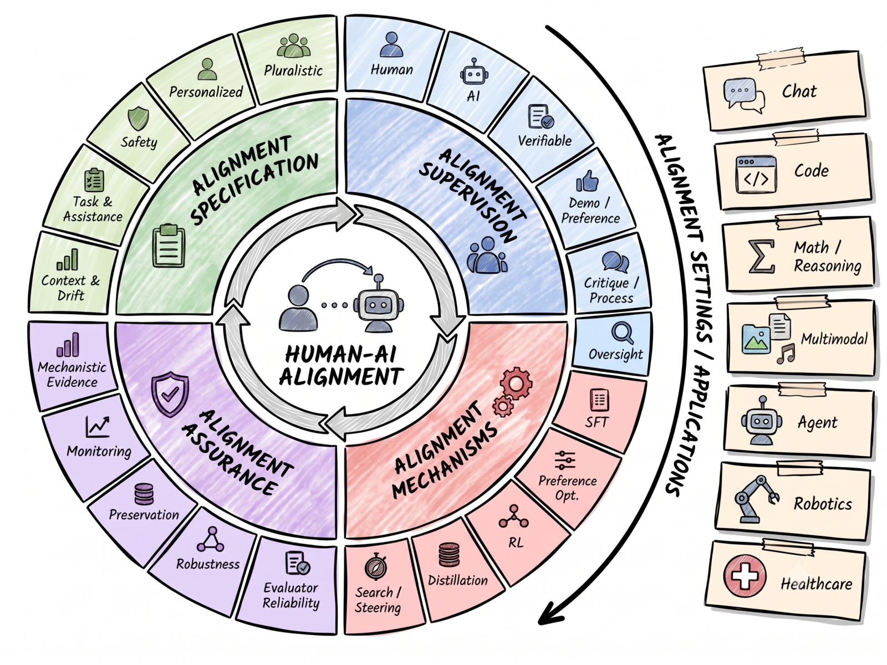
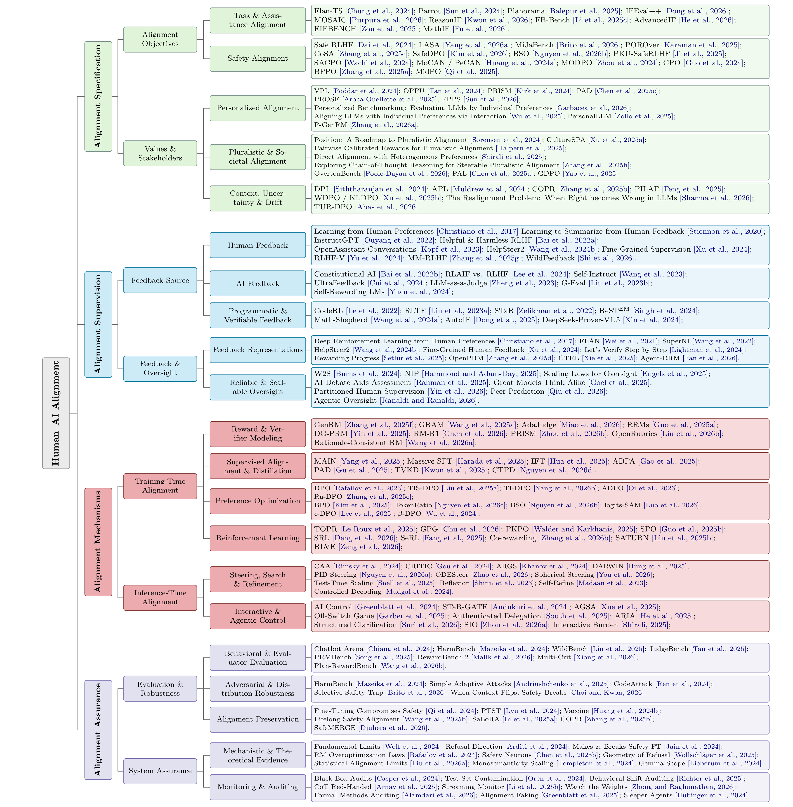
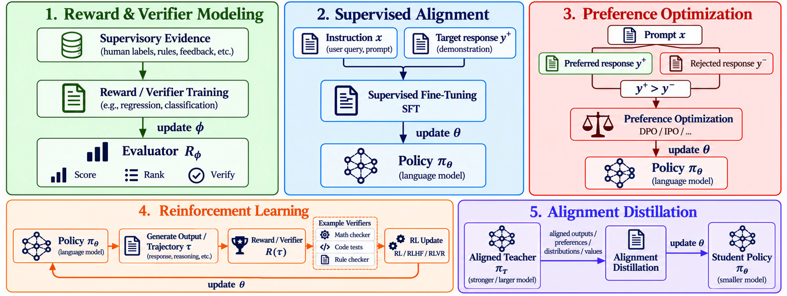
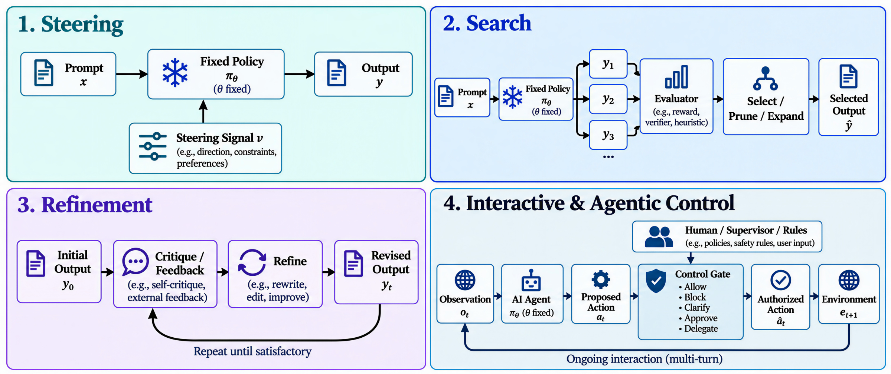

<div align="center">



   

</div>

A taxonomy-guided collection of research on specifying, supervising, implementing, and assuring Human–AI Alignment.

<!-- ## News

- **2026-09-29:** Synchronized the collection with the revised taxonomy and bibliography, expanding it to 451 unique works.
- **2026-09-24:** Expanded the collection to 416 unique works and synchronized all 23 branches with the lifecycle taxonomy.
- **2026-09-10:** Expanded the collection and synchronized all 23 branches with the revised taxonomy.
- **2026-09-09:** Released the first public taxonomy and paper collection. -->

## Contents

- [Overview](#overview)
- [Software framework](#software-framework)
  - [Examples](#examples)
- [Taxonomy](#taxonomy): [Lifecycle taxonomy](#lifecycle-taxonomy), [Training-time mechanisms](#training-time-mechanisms-at-a-glance), [Inference-time mechanisms](#inference-time-mechanisms-at-a-glance), [Collection coverage](#collection-coverage), [Cross-cutting descriptors](#cross-cutting-descriptors)
- [Paper collection](#paper-collection)
  - [Alignment Specification](#alignment-specification)
    - [Alignment Objectives](#alignment-objectives): [Task & Assistance Alignment](#task-assistance-alignment), [Safety Alignment](#safety-alignment)
    - [Values & Stakeholders](#values-stakeholders): [Personalized Alignment](#personalized-alignment), [Pluralistic & Societal Alignment](#pluralistic-societal-alignment), [Context, Uncertainty & Drift](#context-uncertainty-drift)
  - [Alignment Supervision](#alignment-supervision)
    - [Feedback Source](#feedback-source): [Human Feedback](#human-feedback), [AI Feedback](#ai-feedback), [Programmatic & Verifiable Feedback](#programmatic-verifiable-feedback)
    - [Feedback & Oversight](#feedback-oversight): [Demonstrations & Preferences](#demonstrations-preferences), [Critique, Process & Trajectory Feedback](#critique-process-trajectory-feedback), [Reliable & Scalable Oversight](#reliable-scalable-oversight)
  - [Alignment Mechanisms](#alignment-mechanisms)
    - [Training-Time Alignment](#training-time-alignment): [Reward & Verifier Modeling](#reward-verifier-modeling), [Supervised Alignment](#supervised-alignment), [Preference Optimization](#preference-optimization), [Reinforcement Learning](#reinforcement-learning), [Alignment Distillation](#alignment-distillation)
    - [Inference-Time Alignment](#inference-time-alignment): [Steering, Search & Refinement](#steering-search-refinement), [Interactive & Agentic Control](#interactive-agentic-control)
  - [Alignment Assurance](#alignment-assurance)
    - [Evaluation & Robustness](#evaluation-robustness): [Behavioral & Evaluator Evaluation](#behavioral-evaluator-evaluation), [Adversarial & Distribution Robustness](#adversarial-distribution-robustness), [Alignment Preservation](#alignment-preservation)
    - [System Assurance](#system-assurance): [Mechanistic & Theoretical Evidence](#mechanistic-theoretical-evidence), [Monitoring & Auditing](#monitoring-auditing)
- [General Survey Context](#general-survey-context)
- [Contributing](#contributing)
- [Scope](#scope)

## Overview

<p align="center">
  
</p>

<p align="center"><em>Human–AI alignment is organized as a lifecycle spanning alignment specification, supervision, mechanisms, and assurance across chat, code, mathematical reasoning, multimodal, agentic, robotics, and healthcare settings.</em></p>

[View the high-resolution survey overview (PDF)](./Figure/Human_AI_Alignment.pdf)

This survey provides a **unified overview of Human–AI Alignment**. We propose a lifecycle taxonomy that organizes the field along four dimensions—alignment specification, supervision, mechanisms, and assurance—and use it to structure the literature across 23 non-exclusive research branches.

## Software framework

Reference components for 22 cited papers in Task & Assistance, Personalized
Alignment, and Uncertainty & Drift are documented in
[Alignment specification](./docs/ALIGNMENT_SPECIFICATION.md), with explicit
implementation limits and an offline demo.

Human Feedback and AI Feedback code, covering the supervision components of 17
cited papers, is documented in [Alignment supervision](./docs/ALIGNMENT_SUPERVISION.md).

The repository also provides a Python framework that mirrors the four lifecycle dimensions while keeping common workflows simple. The core has no runtime dependencies; training libraries are installed only for the methods that need them.

```bash
python -m pip install -e .
hai-align catalog validate
python examples/minimal_pipeline.py
```

To train with DPO:

```bash
python -m pip install -e ".[dpo]"
hai-align train dpo --model Qwen/Qwen3-0.6B --dataset trl-lib/ultrafeedback_binarized --output outputs/qwen-dpo
```

```python
from human_alignment import DPO

run = DPO(
    model="Qwen/Qwen3-0.6B",
    dataset="trl-lib/ultrafeedback_binarized",
    output_dir="outputs/qwen-dpo",
).train()

print(run.generate("What is Human--AI alignment?"))
```

See [Codebase architecture](./docs/CODEBASE.md) for the public API and extension points. The machine-readable taxonomy lives in [`src/human_alignment/catalog/data/taxonomy.json`](./src/human_alignment/catalog/data/taxonomy.json).

Preference distillation is available through one consistent API for VPD, PPD,
DCKD, TVKD, ADPA, and CTPD:

```bash
python -m pip install -e ".[distillation]"
```

```python
from human_alignment import VPD, PreferenceDistillationExample

data = [
    PreferenceDistillationExample(
        prompt="Explain alignment briefly.",
        responses=("Alignment connects behavior to human targets.", "It is model scaling."),
        teacher_scores=(1.0, 0.0),
    )
]
run = VPD(model="student-model", dataset=data, output_dir="outputs/student-vpd").train()
```

See [Preference distillation](./docs/PREFERENCE_DISTILLATION.md) for objective-specific
dataset schemas, teacher-model use, and migration details.

The benchmarks the survey uses as evidence (RewardBench 2, JudgeBench, AlpacaEval 2)
run under their official scoring rules, and three inference-time methods (CAA,
best-of-N with a reward model, ARGS) steer a frozen model:

```bash
hai-align bench rewardbench2 --reward-model Skywork/Skywork-Reward-V2-Qwen3-0.6B --output-dir eval/rb2
```

See [Benchmarks and inference-time methods](./docs/BENCHMARKS_AND_INFERENCE.md).

Safety-alignment training is integrated under the same package, with 25 stages
covering SafeRLHF, SafeDPO, BSO, SACPO, CAN, MODPO, CPO, BFPO, MidPO, reward and
cost modeling, and multi-objective RLHF:

```bash
python -m pip install -e ".[safety]"
hai-align safety list
hai-align safety run recipes/safety_alignment/methods/safedpo.yaml
```

```python
from human_alignment import SafetyAlignment

run = SafetyAlignment(
    config="recipes/safety_alignment/methods/safedpo.yaml",
    output_dir="outputs/safedpo",
).train()
```

See [Safety alignment](./docs/SAFETY_ALIGNMENT.md) for recipe dependencies,
paper-faithful implementation choices, evaluation, and H100 workflows.

Additional preference methods are available as `IPO`, `BPO`, `TDPO`, `TISDPO`,
`TIDPO`, `TBPOQ`, and `TBPOA`, with recipes under `recipes/preference_optimization/`.
See [Preference optimization](./docs/PREFERENCE_OPTIMIZATION.md) for installation,
token-weight data formats, objective sources, and checkpoint handling.

The library supports both ends of an alignment experiment:

```python
from human_alignment import DPO, load_checkpoint

# Fine-tune a pretrained model or an existing checkpoint.
trained = DPO(
    model="models/student_sft",
    dataset="data/preferences",
    output_dir="outputs/student_dpo",
).train()

# Load the resulting checkpoint later for inference or assurance.
checkpoint = load_checkpoint(
    "outputs/student_dpo",
    config={"device_map": "auto", "torch_dtype": "bfloat16"},
)
print(checkpoint.generate("Explain alignment."))
```

Preference-distillation supervision can be prepared without the temporary
research scripts:

```bash
hai-align prepare distillation dckd \
  --dataset HuggingFaceH4/ultrafeedback_binarized \
  --teacher models/teacher_dpo \
  --tokenizer models/student_sft \
  --output data/ultrafeedback-dckd
```

### Examples

| Example | Purpose |
|---|---|
| [`minimal_pipeline.py`](./examples/minimal_pipeline.py) | Validate the catalog and run a minimal end-to-end pipeline |
| [`dpo_quickstart.py`](./examples/dpo_quickstart.py) | Launch DPO from Python |
| [`dpo.toml`](./examples/dpo.toml) | Configure a DPO run declaratively |
| [`checkpoint_workflow.py`](./examples/checkpoint_workflow.py) | Train, reload, and use a checkpoint |
| [`preference_distillation.py`](./examples/preference_distillation.py) | Prepare and run preference distillation |

## Taxonomy

### Lifecycle taxonomy

<p align="center">
  
</p>

<p align="center"><em>The lifecycle taxonomy organizes Human–AI alignment into four dimensions and eight groups; the paper collection below further resolves them into 23 non-exclusive research branches.</em></p>

[View the high-resolution taxonomy (PDF)](./Figure/Taxonomy.pdf)

| Dimension | Guiding question | Groups |
|---|---|---|
| **[Alignment Specification](#alignment-specification)** | What should an AI system align to, and whose objectives and values should count? | [Alignment Objectives](#alignment-objectives) · [Values & Stakeholders](#values-stakeholders) |
| **[Alignment Supervision](#alignment-supervision)** | Where do alignment signals come from, and how are they expressed and scaled? | [Feedback Source](#feedback-source) · [Feedback & Oversight](#feedback-oversight) |
| **[Alignment Mechanisms](#alignment-mechanisms)** | How are alignment signals translated into model behavior during training and inference? | [Training-Time Alignment](#training-time-alignment) · [Inference-Time Alignment](#inference-time-alignment) |
| **[Alignment Assurance](#alignment-assurance)** | How do we evaluate, stress-test, preserve, interpret, and monitor alignment? | [Evaluation & Robustness](#evaluation-robustness) · [System Assurance](#system-assurance) |

### Training-time mechanisms at a glance

<p align="center">
  
</p>

<p align="center"><em>Training-time alignment covers reward and verifier modeling, supervised alignment, preference optimization, reinforcement learning, and alignment distillation.</em></p>

[View the high-resolution training-time diagram (PDF)](./Figure/training.pdf)

### Inference-time mechanisms at a glance

<p align="center">
  
</p>

<p align="center"><em>Inference-time alignment covers steering, search, iterative refinement, and interactive or agentic control while keeping the model policy fixed.</em></p>

[View the high-resolution inference-time diagram (PDF)](./Figure/inference.pdf)

### Collection coverage

- **172 representative assignments** covering **167 citation keys** in the compact figure, before alias normalization.
- **598 collection assignments** across 23 terminal branches; repeated placement is intentional.
- **451 unique normalized works** are linked from the collection.
- **6 cross-cutting surveys** are listed separately after the branch collection.

### Cross-cutting descriptors

- **System and modality:** text, multimodal, agentic, and embodied systems.
- **Feedback granularity:** response, span, reasoning step, token, and action.
- **Optimization granularity:** sequence, segment, token, and trajectory.
- **Learning regime:** offline, online, static, and continual learning.

Feedback granularity and optimization granularity are tracked separately because the unit receiving feedback can differ from the unit optimized by the learning objective.

## Paper collection

Papers are sorted by year, newest first, within each branch. Each entry gives the title and authors, a link to the publication page (**Paper**), a direct link to the PDF (**PDF**) when the venue provides a stable one, and the publication year.

<a id="alignment-specification"></a>

## Alignment Specification

*What should an AI system align to, and whose objectives and values should count?*

| Group | Branch | Papers |
|---|---|---:|
| Alignment Objectives | [Task & Assistance Alignment](#task-assistance-alignment) | 35 |
| Alignment Objectives | [Safety Alignment](#safety-alignment) | 27 |
| Values & Stakeholders | [Personalized Alignment](#personalized-alignment) | 24 |
| Values & Stakeholders | [Pluralistic & Societal Alignment](#pluralistic-societal-alignment) | 35 |
| Values & Stakeholders | [Context, Uncertainty & Drift](#context-uncertainty-drift) | 23 |

<a id="alignment-objectives"></a>

### Alignment Objectives

<a id="task-assistance-alignment"></a>

#### Task & Assistance Alignment (35)

- **Deconstructing Instruction-Following: A New Benchmark for Granular Evaluation of Large Language Model Instruction Compliance Abilities**. *Alberto Purpura, Li Wang, Sahil Badyal, Gene Beaufrand, Adam Faulkner*. [[Paper]](https://doi.org/10.18653/v1/2026.eacl-long.62) [[PDF]](https://aclanthology.org/2026.eacl-long.62.pdf)  <!-- purpura2026mosaic -->
- **ReasonIF: Large Reasoning Models Fail to Follow Instructions During Reasoning**. *Yongchan Kwon, Shang Zhu, Federico Bianchi, Kaitlyn Zhou, James Zou*. [[Paper]](https://doi.org/10.18653/v1/2026.findings-acl.1456) [[PDF]](https://aclanthology.org/2026.findings-acl.1456.pdf)  <!-- kwon2026reasonif -->
- **Revisiting the Reliability of Language Models in Instruction-Following**. *Jianshuo Dong, Yutong Zhang, Liu Yan, Zhenyu Zhong, Tao Wei, Chao Zhang, Han Qiu*. [[Paper]](https://doi.org/10.18653/v1/2026.acl-long.354) [[PDF]](https://aclanthology.org/2026.acl-long.354.pdf)  <!-- dong2026ifevalpp -->
- **We Are What We Repeatedly Do: Improving Long Context Instruction Following**. *Preston K Robinette, Andrew Hard, Swaroop Ramaswamy, Ehsan Amid, Rajiv Mathews, Taylor T Johnson*. [[Paper]](https://doi.org/10.18653/v1/2026.findings-eacl.254) [[PDF]](https://aclanthology.org/2026.findings-eacl.254.pdf)  <!-- robinette2026verify -->
- **SFTMix: Elevating Language Model Instruction Tuning with Mixup Recipe**. *Yuxin Xiao, Shujian Zhang, Marzyeh Ghassemi, Wenxuan Zhou*. [[Paper]](https://aclanthology.org/2026.acl-long.78/) [[PDF]](https://aclanthology.org/2026.acl-long.78.pdf)  <!-- xiao2026sftmix -->
- **FB-Bench: A Fine-Grained Multi-Task Benchmark for Evaluating LLMs' Responsiveness to Human Feedback**. *Youquan Li, Miao Zheng, Fan Yang, Guosheng Dong, Bin Cui, Weipeng Chen, Zenan Zhou, Wentao Zhang*. [[Paper]](https://aclanthology.org/2025.emnlp-main.471/) [[PDF]](https://aclanthology.org/2025.emnlp-main.471.pdf)  <!-- li2025fbbench -->
- **IOPO: Empowering LLMs with Complex Instruction Following via Input-Output Preference Optimization**. *Xinghua Zhang, Haiyang Yu, Cheng Fu, Fei Huang, Yongbin Li*. [[Paper]](https://aclanthology.org/2025.acl-long.1079/) [[PDF]](https://aclanthology.org/2025.acl-long.1079.pdf)  <!-- zhang2025iopo -->
- **LongReward: Improving Long-context Large Language Models with AI Feedback**. *Jiajie Zhang, Zhongni Hou, Xin Lv, Shulin Cao, Zhenyu Hou, Yilin Niu, Lei Hou, Yuxiao Dong, Ling Feng, Juanzi Li*. [[Paper]](https://aclanthology.org/2025.acl-long.187/) [[PDF]](https://aclanthology.org/2025.acl-long.187.pdf)  <!-- zhang2025longreward -->
- **When Instructions Multiply: Measuring and Estimating LLM Capabilities of Multiple Instructions Following**. *Keno Harada, Yudai Yamazaki, Masachika Taniguchi, Edison Marrese-Taylor, Takeshi Kojima, Yusuke Iwasawa, Yutaka Matsuo*. [[Paper]](https://aclanthology.org/2025.findings-emnlp.896/) [[PDF]](https://aclanthology.org/2025.findings-emnlp.896.pdf)  <!-- harada2025manyifeval -->
- **A Good Plan is Hard to Find: Aligning Models with Preferences is Misaligned with What Helps Users**. *Nishant Balepur, Matthew Shu, Yoo Yeon Sung, Seraphina Goldfarb-Tarrant, Shi Feng, Fumeng Yang, Rachel Rudinger, Jordan Boyd-Graber*. [[Paper]](https://aclanthology.org/2025.emnlp-main.585/) [[PDF]](https://aclanthology.org/2025.emnlp-main.585.pdf)  <!-- balepur2025goodplan -->
- **Magpie: Alignment Data Synthesis from Scratch by Prompting Aligned LLMs with Nothing**. *Zhangchen Xu, Fengqing Jiang, Luyao Niu, Yuntian Deng, Radha Poovendran, Yejin Choi, Bill Yuchen Lin*. [[Paper]](https://proceedings.iclr.cc/paper_files/paper/2025/hash/be06e3802e9411381feece79b4d960c1-Abstract-Conference.html) [[PDF]](https://proceedings.iclr.cc/paper_files/paper/2025/file/be06e3802e9411381feece79b4d960c1-Paper-Conference.pdf)  <!-- xu2025magpie -->
- **UltraIF: Advancing Instruction Following from the Wild**. *Kaikai An, Li Sheng, Ganqu Cui, Shuzheng Si, Ning Ding, Yu Cheng, Baobao Chang*. [[Paper]](https://aclanthology.org/2025.emnlp-main.945/) [[PDF]](https://aclanthology.org/2025.emnlp-main.945.pdf)  <!-- an2025ultraif -->
- **Aligning Large Multimodal Models with Factually Augmented RLHF**. *Zhiqing Sun, Sheng Shen, Shengcao Cao, Haotian Liu, Chunyuan Li, Yikang Shen, Chuang Gan, Liangyan Gui, Yu-Xiong Wang, Yiming Yang, Kurt Keutzer, Trevor Darrell*. [[Paper]](https://aclanthology.org/2024.findings-acl.775/) [[PDF]](https://aclanthology.org/2024.findings-acl.775.pdf)  <!-- liu2024llavarlhf -->
- **HelpSteer 2: Open-source Dataset for Training Top-Performing Reward Models**. *Zhilin Wang, Yi Dong, Olivier Delalleau, Jiaqi Zeng, Gerald Shen, Daniel Egert, Jimmy J. Zhang, Makesh Narsimhan Sreedhar, Oleksii Kuchaiev*. [[Paper]](https://doi.org/10.52202/079017-0047)  <!-- wang2024helpsteer2 -->
- **LIONs: An Empirically Optimized Approach to Align Language Models**. *Xiao Yu, Qingyang Wu, Yu Li, Zhou Yu*. [[Paper]](https://aclanthology.org/2024.emnlp-main.496/) [[PDF]](https://aclanthology.org/2024.emnlp-main.496.pdf)  <!-- yu2024lions -->
- **Parrot: Enhancing Multi-Turn Instruction Following for Large Language Models**. *Yuchong Sun, Che Liu, Kun Zhou, Jinwen Huang, Ruihua Song, Xin Zhao, Fuzheng Zhang, Di Zhang, Kun Gai*. [[Paper]](https://aclanthology.org/2024.acl-long.525/) [[PDF]](https://aclanthology.org/2024.acl-long.525.pdf)  <!-- sun2024parrot -->
- **RAGTruth: A Hallucination Corpus for Developing Trustworthy Retrieval-Augmented Language Models**. *Cheng Niu, Yuanhao Wu, Juno Zhu, Siliang Xu, KaShun Shum, Randy Zhong, Juntong Song, Tong Zhang*. [[Paper]](https://aclanthology.org/2024.acl-long.585/) [[PDF]](https://aclanthology.org/2024.acl-long.585.pdf)  <!-- niu2024ragtruth -->
- **Scaling Instruction-Finetuned Language Models**. *Hyung Won Chung, Le Hou, Shayne Longpre, Barret Zoph, Yi Tay, William Fedus, Yunxuan Li, Xuezhi Wang, Mostafa Dehghani, Siddhartha Brahma et al.* [[Paper]](https://www.jmlr.org/papers/v25/23-0870.html) [[PDF]](https://jmlr.org/papers/volume25/23-0870/23-0870.pdf)  <!-- chung2024flan -->
- **UltraFeedback: Boosting Language Models with Scaled AI Feedback**. *Ganqu Cui, Lifan Yuan, Ning Ding, Guanming Yao, Bingxiang He, Wei Zhu, Yuan Ni, Guotong Xie, Ruobing Xie, Yankai Lin, Zhiyuan Liu, Maosong Sun*. [[Paper]](https://proceedings.mlr.press/v235/cui24f.html) [[PDF]](https://raw.githubusercontent.com/mlresearch/v235/main/assets/cui24f/cui24f.pdf)  <!-- cui2024ultrafeedback -->
- **Direct Preference Optimization: Your Language Model Is Secretly a Reward Model**. *Rafael Rafailov, Archit Sharma, Eric Mitchell, Christopher D. Manning, Stefano Ermon, Chelsea Finn*. [[Paper]](https://proceedings.neurips.cc/paper_files/paper/2023/hash/a85b405ed65c6477a4fe8302b5e06ce7-Abstract-Conference.html) [[PDF]](https://proceedings.neurips.cc/paper_files/paper/2023/file/a85b405ed65c6477a4fe8302b5e06ce7-Paper-Conference.pdf)  <!-- rafailov2023dpo -->
- **Enabling Large Language Models to Generate Text with Citations**. *Tianyu Gao, Howard Yen, Jiatong Yu, Danqi Chen*. [[Paper]](https://aclanthology.org/2023.emnlp-main.398/) [[PDF]](https://aclanthology.org/2023.emnlp-main.398.pdf)  <!-- gao2023citations -->
- **Fine-Grained Human Feedback Gives Better Rewards for Language Model Training**. *Zeqiu Wu, Yushi Hu, Weijia Shi, Nouha Dziri, Alane Suhr, Prithviraj Ammanabrolu, Noah Smith, Mari Ostendorf, Hannaneh Hajishirzi*. [[Paper]](https://proceedings.neurips.cc/paper_files/paper/2023/hash/b8c90b65739ae8417e61eadb521f63d5-Abstract.html) [[PDF]](https://proceedings.neurips.cc/paper_files/paper/2023/file/b8c90b65739ae8417e61eadb521f63d5-Paper-Conference.pdf)  <!-- wu2023finegrained -->
- **LIMA: Less Is More for Alignment**. *Chunting Zhou, Pengfei Liu, Puxin Xu, Srinivasan Iyer, Jiao Sun, Yuning Mao, Xuezhe Ma, Avia Efrat, Ping Yu, Lili Yu et al.* [[Paper]](https://papers.neurips.cc/paper_files/paper/2023/hash/ac662d74829e4407ce1d126477f4a03a-Abstract-Conference.html) [[PDF]](https://papers.neurips.cc/paper_files/paper/2023/file/ac662d74829e4407ce1d126477f4a03a-Paper-Conference.pdf)  <!-- zhou2023lima -->
- **Self-Instruct: Aligning Language Models with Self-Generated Instructions**. *Yizhong Wang, Yeganeh Kordi, Swaroop Mishra, Alisa Liu, Noah A. Smith, Daniel Khashabi, Hannaneh Hajishirzi*. [[Paper]](https://aclanthology.org/2023.acl-long.754/) [[PDF]](https://aclanthology.org/2023.acl-long.754.pdf)  <!-- wang2023selfinstruct -->
- **SteerLM: Attribute Conditioned SFT as an (User-Steerable) Alternative to RLHF**. *Yi Dong, Zhilin Wang, Makesh Sreedhar, Xianchao Wu, Oleksii Kuchaiev*. [[Paper]](https://aclanthology.org/2023.findings-emnlp.754/) [[PDF]](https://aclanthology.org/2023.findings-emnlp.754.pdf)  <!-- dong2023steerlm -->
- **The Flan Collection: Designing Data and Methods for Effective Instruction Tuning**. *Shayne Longpre, Le Hou, Tu Vu, Albert Webson, Hyung Won Chung, Yi Tay, Denny Zhou, Quoc V. Le, Barret Zoph, Jason Wei, Adam Roberts*. [[Paper]](https://proceedings.mlr.press/v202/longpre23a.html) [[PDF]](https://proceedings.mlr.press/v202/longpre23a/longpre23a.pdf)  <!-- longpre2023flancollection -->
- **Cross-Task Generalization via Natural Language Crowdsourcing Instructions**. *Swaroop Mishra, Daniel Khashabi, Chitta Baral, Hannaneh Hajishirzi*. [[Paper]](https://aclanthology.org/2022.acl-long.244/) [[PDF]](https://aclanthology.org/2022.acl-long.244.pdf)  <!-- mishra2022natural -->
- **Finetuned Language Models Are Zero-Shot Learners**. *Jason Wei, Maarten Bosma, Vincent Y. Zhao, Kelvin Guu, Adams Wei Yu, Brian Lester, Nan Du, Andrew M. Dai, Quoc V. Le*. [[Paper]](https://research.google/pubs/finetuned-language-models-are-zero-shot-learners/)  <!-- wei2022flan -->
- **Improving Alignment of Dialogue Agents via Targeted Human Judgements**. *Amelia Glaese, Nat McAleese, Maja Trębacz, John Aslanides, Vlad Firoiu, Timo Ewalds, Maribeth Rauh, Laura Weidinger, Martin Chadwick, Phoebe Thacker et al.* [[Paper]](https://arxiv.org/abs/2209.14375) [[PDF]](https://arxiv.org/pdf/2209.14375)  <!-- glaese2022sparrow -->
- **Multitask Prompted Training Enables Zero-Shot Task Generalization**. *Victor Sanh, Albert Webson, Colin Raffel, Stephen H. Bach, Lintang Sutawika, Zaid Alyafeai, Antoine Chaffin, Arnaud Stiegler, Teven Le Scao, Arun Raja et al.* [[Paper]](https://arxiv.org/abs/2110.08207) [[PDF]](https://arxiv.org/pdf/2110.08207)  <!-- sanh2022t0 -->
- **Super-NaturalInstructions: Generalization via Declarative Instructions on 1600+ NLP Tasks**. *Yizhong Wang, Swaroop Mishra, Pegah Alipoormolabashi, Yeganeh Kordi, Amirreza Mirzaei, Atharva Naik, Arjun Ashok, Arut Selvan Dhanasekaran, Anjana Arunkumar, David Stap et al.* [[Paper]](https://aclanthology.org/2022.emnlp-main.340/) [[PDF]](https://aclanthology.org/2022.emnlp-main.340.pdf)  <!-- wang2022supernatural -->
- **Training a Helpful and Harmless Assistant with Reinforcement Learning from Human Feedback**. *Yuntao Bai, Andy Jones, Kamal Ndousse, Amanda Askell, Anna Chen, Nova DasSarma, Dawn Drain, Stanislav Fort, Deep Ganguli, Tom Henighan et al.* [[Paper]](https://arxiv.org/abs/2204.05862) [[PDF]](https://arxiv.org/pdf/2204.05862)  <!-- bai2022hh -->
- **Training Language Models to Follow Instructions with Human Feedback**. *Long Ouyang, Jeffrey Wu, Xu Jiang, Diogo Almeida, Carroll Wainwright, Pamela Mishkin, Chong Zhang, Sandhini Agarwal, Katarina Slama, Alex Ray et al.* [[Paper]](https://proceedings.neurips.cc/paper_files/paper/2022/hash/b1efde53be364a73914f58805a001731-Abstract.html) [[PDF]](https://proceedings.neurips.cc/paper_files/paper/2022/file/b1efde53be364a73914f58805a001731-Paper-Conference.pdf)  <!-- ouyang2022instructgpt -->
- **A General Language Assistant as a Laboratory for Alignment**. *Amanda Askell, Yuntao Bai, Anna Chen, Dawn Drain, Deep Ganguli, Tom Henighan, Andy Jones, Nicholas Joseph, Ben Mann, Nova DasSarma et al.* [[Paper]](https://arxiv.org/abs/2112.00861) [[PDF]](https://arxiv.org/pdf/2112.00861)  <!-- askell2021assistant -->
- **WebGPT: Browser-Assisted Question-Answering with Human Feedback**. *Reiichiro Nakano, Jacob Hilton, Suchir Balaji, Jeff Wu, Long Ouyang, Christina Kim, Christopher Hesse, Shantanu Jain, Vineet Kosaraju, William Saunders et al.* [[Paper]](https://arxiv.org/abs/2112.09332) [[PDF]](https://arxiv.org/pdf/2112.09332)  <!-- nakano2021webgpt -->

<a id="safety-alignment"></a>

#### Safety Alignment (27)

- **LLM-VA: Resolving the Jailbreak-Overrefusal Trade-off via Vector Alignment**. *Haonan Zhang, Dongxia Wang, Yi Liu, Kexin Chen, Wenhai Wang*. [[Paper]](https://aclanthology.org/2026.acl-long.260/) [[PDF]](https://aclanthology.org/2026.acl-long.260.pdf)  <!-- zhang2026llmva -->
- **Mitigating Over-Refusal in Aligned Large Language Models via Inference-Time Activation Energy**. *Eric Hanchen Jiang, Weixuan Ou, Run Liu, Shengyuan Pang, Guancheng Wan, Ranjie Duan, Wei Dong, Kai-Wei Chang, XiaoFeng Wang, Ying Nian Wu, Xinfeng Li*. [[Paper]](https://aclanthology.org/2026.acl-long.1759/) [[PDF]](https://aclanthology.org/2026.acl-long.1759.pdf)  <!-- jiang2026els -->
- **More Thinking, Less Talking: Internalizing Deliberative Safety into LLM Parameters**. *Guan Wang, Xuehai Tang, Biyu Zhou, Jizhong Han, Songlin Hu*. [[Paper]](https://aclanthology.org/2026.acl-long.1572/) [[PDF]](https://aclanthology.org/2026.acl-long.1572.pdf)  <!-- wang2026hiar -->
- **Reasoning Structure Matters for Safety Alignment of Reasoning Models**. *Yeonjun In, Wonjoong Kim, Sangwu Park, Chanyoung Park*. [[Paper]](https://aclanthology.org/2026.acl-long.240/) [[PDF]](https://aclanthology.org/2026.acl-long.240.pdf)  <!-- in2026alttrain -->
- **Safety Is Not Universal: The Selective Safety Trap in LLM Alignment**. *Iago Alves Brito, Walcy Rios, Julia Soares Dollis, Diogo Fernandes Costa Silva, Arlindo Rodrigues Galvão Filho*. [[Paper]](https://doi.org/10.18653/v1/2026.findings-acl.489) [[PDF]](https://aclanthology.org/2026.findings-acl.489.pdf)  <!-- brito2026safetyisnotuniversal -->
- **AlphaAlign: Incentivizing Safety Alignment with Extremely Simplified Reinforcement Learning**. *Yi Zhang, An Zhang, XiuYu Zhang, Leheng Sheng, Yuxin Chen, Zhenkai Liang, Xiang Wang*. [[Paper]](https://iclr.cc/virtual/2026/poster/10011731)  <!-- zhang2026alphaalign -->
- **LASA: Language-Agnostic Semantic Alignment at the Semantic Bottleneck for LLM Safety**. *Junxiao Yang, Haoran Liu, Jinzhe Tu, Jiale Cheng, Zhexin Zhang, Shiyao Cui, Jiaqi Weng, Jialing Tao, Hui Xue, Hongning Wang, Han Qiu, Minlie Huang*. [[Paper]](https://aclanthology.org/2026.acl-long.1913/) [[PDF]](https://aclanthology.org/2026.acl-long.1913.pdf)  <!-- yang2026lasa -->
- **Mitigating the Safety Alignment Tax with Null-Space Constrained Policy Optimization**. *Yifan Niu, Han Xiao, Dongyi Liu, Nuo Chen, Jia Li*. [[Paper]](https://proceedings.iclr.cc/paper_files/paper/2026/hash/e664650506f1cf2b4696df892147c06e-Abstract-Conference.html) [[PDF]](https://proceedings.iclr.cc/paper_files/paper/2026/file/e664650506f1cf2b4696df892147c06e-Paper-Conference.pdf)  <!-- niu2026nspo -->
- **Safety at One Shot: Patching Fine-Tuned LLMs with A Single Instance**. *Jiawen Zhang, Lipeng He, Kejia Chen, Jian Lou, Jian Liu, Xiaohu Yang, Ruoxi Jia*. [[Paper]](https://proceedings.iclr.cc/paper_files/paper/2026/hash/3d7cb780442f0d17c844dbe34997fab7-Abstract-Conference.html) [[PDF]](https://proceedings.iclr.cc/paper_files/paper/2026/file/3d7cb780442f0d17c844dbe34997fab7-Paper-Conference.pdf)  <!-- zhang2026safetyoneshot -->
- **SafeDPO: A Simple Approach to Direct Preference Optimization with Enhanced Safety**. *Geon-Hyeong Kim, Yu Jin Kim, Byoungjip Kim, Honglak Lee, Kyunghoon Bae, Youngsoo Jang, Moontae Lee*. [[Paper]](https://proceedings.iclr.cc/paper_files/paper/2026/hash/447494b03345309e0ce196c78c7e5c83-Abstract-Conference.html) [[PDF]](https://proceedings.iclr.cc/paper_files/paper/2026/file/447494b03345309e0ce196c78c7e5c83-Paper-Conference.pdf)  <!-- kim2026safedpo -->
- **Controllable Safety Alignment: Inference-Time Adaptation to Diverse Safety Requirements**. *Jingyu Zhang, Ahmed Elgohary, Ahmed Magooda, Daniel Khashabi, Benjamin Van Durme*. [[Paper]](https://openreview.net/forum?id=ERce2rgMQC) [[PDF]](https://openreview.net/pdf?id=ERce2rgMQC)  <!-- zhang2025controllablesafetyalignment -->
- **POROver: Improving Safety and Reducing Overrefusal in Large Language Models with Overgeneration and Preference Optimization**. *Batuhan K. Karaman, Ishmam Zabir, Alon Benhaim, Vishrav Chaudhary, Mert R. Sabuncu, Xia Song*. [[Paper]](https://proceedings.mlr.press/v267/karaman25a.html) [[PDF]](https://raw.githubusercontent.com/mlresearch/v267/main/assets/karaman25a/karaman25a.pdf)  <!-- karaman2025porover -->
- **Safety Alignment Can Be Not Superficial With Explicit Safety Signals**. *Jianwei Li, Jung-Eun Kim*. [[Paper]](https://proceedings.mlr.press/v267/li25av.html) [[PDF]](https://raw.githubusercontent.com/mlresearch/v267/main/assets/li25av/li25av.pdf)  <!-- li2025explicitsafety -->
- **Shaping the Safety Boundaries: Understanding and Defending Against Jailbreaks in Large Language Models**. *Lang Gao, Jiahui Geng, Xiangliang Zhang, Preslav Nakov, Xiuying Chen*. [[Paper]](https://aclanthology.org/2025.acl-long.1233/) [[PDF]](https://aclanthology.org/2025.acl-long.1233.pdf)  <!-- gao2025abd -->
- **Alignment of Large Language Models with Constrained Learning**. *Botong Zhang, Shuo Li, Ignacio Hounie, Osbert Bastani, Dongsheng Ding, Alejandro Ribeiro*. [[Paper]](https://proceedings.nips.cc/paper_files/paper/2025/hash/2c9b48ed0dd0252ea3ea14182956341b-Abstract-Conference.html) [[PDF]](https://proceedings.nips.cc/paper_files/paper/2025/file/2c9b48ed0dd0252ea3ea14182956341b-Paper-Conference.pdf)  <!-- zhang2025constrainedalignment -->
- **Antidote: Post-fine-tuning Safety Alignment for Large Language Models against Harmful Fine-tuning Attack**. *Tiansheng Huang, Gautam Bhattacharya, Pratik Joshi, Joshua Kimball, Ling Liu*. [[Paper]](https://proceedings.mlr.press/v267/huang25b.html) [[PDF]](https://raw.githubusercontent.com/mlresearch/v267/main/assets/huang25b/huang25b.pdf)  <!-- huang2025antidote -->
- **Layer-Aware Representation Filtering: Purifying Finetuning Data to Preserve LLM Safety Alignment**. *Hao Li, Lijun Li, Zhenghao Lu, Xianyi Wei, Rui Li, Jing Shao, Lei Sha*. [[Paper]](https://aclanthology.org/2025.emnlp-main.406/) [[PDF]](https://aclanthology.org/2025.emnlp-main.406.pdf)  <!-- li2025larf -->
- **Lifelong Safety Alignment for Language Models**. *Haoyu Wang, Yifei Zhao, Zeyu Qin, Chao Du, Min Lin, Xueqian Wang, Tianyu Pang*. [[Paper]](https://proceedings.neurips.cc/paper_files/paper/2025/hash/1ca2f4528792b31eab7a3e7f6a1c130b-Abstract-Conference.html) [[PDF]](https://proceedings.neurips.cc/paper_files/paper/2025/file/1ca2f4528792b31eab7a3e7f6a1c130b-Paper-Conference.pdf)  <!-- wang2025lifelong -->
- **Deliberative Alignment: Reasoning Enables Safer Language Models**. *Melody Y. Guan, Manas Joglekar, Eric Wallace, Saachi Jain, Boaz Barak, Alec Helyar, Rachel Dias, Andrea Vallone, Hongyu Ren, Jason Wei et al.* [[Paper]](https://arxiv.org/abs/2412.16339) [[PDF]](https://arxiv.org/pdf/2412.16339)  <!-- guan2024deliberative -->
- **Improving Alignment and Robustness with Circuit Breakers**. *Andy Zou, Long Phan, Justin Wang, Derek Duenas, Maxwell Lin, Maksym Andriushchenko, Rowan Wang, Zico Kolter, Matt Fredrikson, Dan Hendrycks*. [[Paper]](https://proceedings.neurips.cc/paper_files/paper/2024/hash/97ca7168c2c333df5ea61ece3b3276e1-Abstract-Conference.html) [[PDF]](https://proceedings.neurips.cc/paper_files/paper/2024/file/97ca7168c2c333df5ea61ece3b3276e1-Paper-Conference.pdf)  <!-- zou2024circuitbreakers -->
- **Rule Based Rewards for Language Model Safety**. *Tong Mu, Alec Helyar, Johannes Heidecke, Joshua Achiam, Andrea Vallone, Ian Kivlichan, Molly Lin, Alex Beutel, John Schulman, Lilian Weng*. [[Paper]](https://doi.org/10.52202/079017-3457)  <!-- mu2024rulebased -->
- **Safe RLHF: Safe Reinforcement Learning from Human Feedback**. *Juntao Dai, Xuehai Pan, Ruiyang Sun, Jiaming Ji, Xinbo Xu, Mickel Liu, Yizhou Wang, Yaodong Yang*. [[Paper]](https://proceedings.iclr.cc/paper_files/paper/2024/hash/dd1577afd396928ed64216f3f1fd5556-Abstract-Conference.html) [[PDF]](https://proceedings.iclr.cc/paper_files/paper/2024/file/dd1577afd396928ed64216f3f1fd5556-Paper-Conference.pdf)  <!-- dai2024saferlhf -->
- **Vaccine: Perturbation-aware Alignment for Large Language Models against Harmful Fine-tuning Attack**. *Tiansheng Huang, Sihao Hu, Ling Liu*. [[Paper]](https://proceedings.neurips.cc/paper_files/paper/2024/hash/873c86d9a979ab80d8e2919510d4446b-Abstract-Conference.html) [[PDF]](https://proceedings.neurips.cc/paper_files/paper/2024/file/873c86d9a979ab80d8e2919510d4446b-Paper-Conference.pdf)  <!-- huang2024vaccine -->
- **BeaverTails: Towards Improved Safety Alignment of LLM via a Human-Preference Dataset**. *Jiaming Ji, Mickel Liu, Josef Dai, Xuehai Pan, Chi Zhang, Ce Bian, Boyuan Chen, Ruiyang Sun, Yizhou Wang, Yaodong Yang*. [[Paper]](https://proceedings.neurips.cc/paper_files/paper/2023/hash/4dbb61cb68671edc4ca3712d70083b9f-Abstract.html) [[PDF]](https://proceedings.neurips.cc/paper_files/paper/2023/file/4dbb61cb68671edc4ca3712d70083b9f-Paper-Datasets_and_Benchmarks.pdf)  <!-- ji2023beavertails -->
- **Constitutional AI: Harmlessness from AI Feedback**. *Yuntao Bai, Saurav Kadavath, Sandipan Kundu, Amanda Askell, Jackson Kernion, Andy Jones, Anna Chen, Anna Goldie, Azalia Mirhoseini, Cameron McKinnon et al.* [[Paper]](https://arxiv.org/abs/2212.08073) [[PDF]](https://arxiv.org/pdf/2212.08073)  <!-- bai2022constitutional -->
- **Training a Helpful and Harmless Assistant with Reinforcement Learning from Human Feedback**. *Yuntao Bai, Andy Jones, Kamal Ndousse, Amanda Askell, Anna Chen, Nova DasSarma, Dawn Drain, Stanislav Fort, Deep Ganguli, Tom Henighan et al.* [[Paper]](https://arxiv.org/abs/2204.05862) [[PDF]](https://arxiv.org/pdf/2204.05862)  <!-- bai2022hh -->
- **A General Language Assistant as a Laboratory for Alignment**. *Amanda Askell, Yuntao Bai, Anna Chen, Dawn Drain, Deep Ganguli, Tom Henighan, Andy Jones, Nicholas Joseph, Ben Mann, Nova DasSarma et al.* [[Paper]](https://arxiv.org/abs/2112.00861) [[PDF]](https://arxiv.org/pdf/2112.00861)  <!-- askell2021assistant -->

<a id="values-stakeholders"></a>

### Values & Stakeholders

<a id="personalized-alignment"></a>

#### Personalized Alignment (24)

- **Personalized Benchmarking: Evaluating LLMs by Individual Preferences**. *Cristina Garbacea, Heran Wang, Chenhao Tan*. [[Paper]](https://aclanthology.org/2026.findings-acl.31/) [[PDF]](https://aclanthology.org/2026.findings-acl.31.pdf)  <!-- garbacea2026personalizedbenchmark -->
- **When Personalization Misleads: Understanding and Mitigating Hallucinations in Personalized LLMs**. *Zhongxiang Sun, Yi Zhan, Chenglei Shen, Weijie Yu, Xiao Zhang, Ming He, Jun Xu*. [[Paper]](https://aclanthology.org/2026.findings-acl.395/) [[PDF]](https://aclanthology.org/2026.findings-acl.395.pdf)  <!-- sun2026fpps -->
- **From 1,000,000 Users to Every User: Scaling Up Personalized Preference for User-level Alignment**. *Jia-Nan Li, Jian Guan, Songhao Wu, Wei Wu, Rui Yan*. [[Paper]](https://aclanthology.org/2026.acl-long.1391/) [[PDF]](https://aclanthology.org/2026.acl-long.1391.pdf)  <!-- li2026alignx -->
- **Instant Personalized Large Language Model Adaptation via Hypernetwork**. *Zhaoxuan Tan, Zixuan Zhang, Haoyang Wen, Zheng Li, Rongzhi Zhang, Pei Chen, Fengran Mo, Zheyuan Liu, Qingkai Zeng, Qingyu Yin, Meng Jiang*. [[Paper]](https://aclanthology.org/2026.acl-long.1081/) [[PDF]](https://aclanthology.org/2026.acl-long.1081.pdf)  <!-- tan2026profilepeft -->
- **Personalizing LLMs with Binary Feedback: A Preference-Calibrated Optimization Framework**. *Xilai Ma, Liye Zhao, Weijun Yao, Haibing Di, Wenya Wang, Jing Li*. [[Paper]](https://aclanthology.org/2026.acl-long.1222/) [[PDF]](https://aclanthology.org/2026.acl-long.1222.pdf)  <!-- ma2026cbpo -->
- **Aligning LLMs with Individual Preferences via Interaction**. *Shujin Wu, Yi R. Fung, Cheng Qian, Jeonghwan Kim, Dilek Hakkani-Tur, Heng Ji*. [[Paper]](https://aclanthology.org/2025.coling-main.511/) [[PDF]](https://aclanthology.org/2025.coling-main.511.pdf)  <!-- wu2025interaction -->
- **Drift: Decoding-time Personalized Alignments with Implicit User Preferences**. *Minbeom Kim, Kang-il Lee, Seongho Joo, Hwaran Lee, Thibaut Thonet, Kyomin Jung*. [[Paper]](https://aclanthology.org/2025.findings-emnlp.324/) [[PDF]](https://aclanthology.org/2025.findings-emnlp.324.pdf)  <!-- kim2025drift -->
- **FaST: Feature-aware Sampling and Tuning for Personalized Preference Alignment with Limited Data**. *Thibaut Thonet, Germán Kruszewski, Jos Rozen, Pierre Erbacher, Marc Dymetman*. [[Paper]](https://aclanthology.org/2025.emnlp-main.475/) [[PDF]](https://aclanthology.org/2025.emnlp-main.475.pdf)  <!-- thonet2025fast -->
- **Personalized LLM Decoding via Contrasting Personal Preference**. *Hyungjune Bu, ChanJoo Jung, Minjae Kang, Jaehyung Kim*. [[Paper]](https://aclanthology.org/2025.emnlp-main.1723/) [[PDF]](https://aclanthology.org/2025.emnlp-main.1723.pdf)  <!-- bu2025cope -->
- **Tuning-Free Personalized Alignment via Trial-Error-Explain In-Context Learning**. *Hyundong Justin Cho, Karishma Sharma, Nicolaas Paul Jedema, Leonardo F. R. Ribeiro, Jonathan May, Alessandro Moschitti*. [[Paper]](https://aclanthology.org/2025.findings-naacl.326/) [[PDF]](https://aclanthology.org/2025.findings-naacl.326.pdf)  <!-- cho2025ticl -->
- **Whose Boat Does it Float? Improving Personalization in Preference Tuning via Inferred User Personas**. *Nishant Balepur, Vishakh Padmakumar, Fumeng Yang, Shi Feng, Rachel Rudinger, Jordan Boyd-Graber*. [[Paper]](https://aclanthology.org/2025.acl-long.168/) [[PDF]](https://aclanthology.org/2025.acl-long.168.pdf)  <!-- balepur2025personas -->
- **A Survey on Personalized Alignment—The Missing Piece for Large Language Models in Real-World Applications**. *Jian Guan, Junfei Wu, Jia-Nan Li, Chuanqi Cheng, Wei Wu*. [[Paper]](https://aclanthology.org/2025.findings-acl.277/) [[PDF]](https://aclanthology.org/2025.findings-acl.277.pdf)  <!-- guan2025personalizedsurvey -->
- **Aligning LLMs by Predicting Preferences from User Writing Samples**. *Stéphane Aroca-Ouellette, Natalie Mackraz, Barry-John Theobald, Katherine Metcalf*. [[Paper]](https://proceedings.mlr.press/v267/aroca-ouellette25a.html) [[PDF]](https://raw.githubusercontent.com/mlresearch/v267/main/assets/aroca-ouellette25a/aroca-ouellette25a.pdf)  <!-- aroca2025prose -->
- **PAL: Sample-Efficient Personalized Reward Modeling for Pluralistic Alignment**. *Daiwei Chen, Yi Chen, Aniket Rege, Zhi Wang, Ramya Korlakai Vinayak*. [[Paper]](https://openreview.net/forum?id=1kFDrYCuSu) [[PDF]](https://openreview.net/pdf?id=1kFDrYCuSu)  <!-- chen2025pal -->
- **Personality Alignment of Large Language Models**. *Minjun Zhu, Yixuan Weng, Linyi Yang, Yue Zhang*. [[Paper]](https://openreview.net/forum?id=0DZEs8NpUH) [[PDF]](https://openreview.net/pdf?id=0DZEs8NpUH)  <!-- zhu2025personality -->
- **Inference-Time Personalized Alignment with a Few User Preference Queries**. *Victor-Alexandru Pădurean, Parameswaran Kamalaruban, Nachiket Kotalwar, Alkis Gotovos, Adish Singla*. [[Paper]](https://proceedings.nips.cc/paper_files/paper/2025/hash/7ace822623d2313ec017df71c3a90286-Abstract-Conference.html) [[PDF]](https://proceedings.nips.cc/paper_files/paper/2025/file/7ace822623d2313ec017df71c3a90286-Paper-Conference.pdf)  <!-- padurean2025useralign -->
- **PAD: Personalized Alignment of LLMs at Decoding-time**. *Ruizhe Chen, Xiaotian Zhang, Meng Luo, Wenhao Chai, Zuozhu Liu*. [[Paper]](https://proceedings.iclr.cc/paper_files/paper/2025/hash/196c8da9209b1977408d8771c4e7ee56-Abstract-Conference.html) [[PDF]](https://proceedings.iclr.cc/paper_files/paper/2025/file/196c8da9209b1977408d8771c4e7ee56-Paper-Conference.pdf)  <!-- chen2025pad -->
- **Persona-judge: Personalized Alignment of Large Language Models via Token-level Self-judgment**. *Xiaotian Zhang, Ruizhe Chen, Yang Feng, Zuozhu Liu*. [[Paper]](https://aclanthology.org/2025.findings-acl.260/) [[PDF]](https://aclanthology.org/2025.findings-acl.260.pdf)  <!-- zhang2025personajudge -->
- **Teaching Language Models to Evolve with Users: Dynamic Profile Modeling for Personalized Alignment**. *Weixiang Zhao, Xingyu Sui, Yulin Hu, Jiahe Guo, Haixiao Liu, Biye Li, Yanyan Zhao, Bing Qin, Ting Liu*. [[Paper]](https://proceedings.neurips.cc/paper_files/paper/2025/hash/2fbc1ea60e215275e823c86338417162-Abstract-Conference.html) [[PDF]](https://proceedings.neurips.cc/paper_files/paper/2025/file/2fbc1ea60e215275e823c86338417162-Paper-Conference.pdf)  <!-- zhao2025rlpa -->
- **Democratizing Large Language Models via Personalized Parameter-Efficient Fine-tuning**. *Zhaoxuan Tan, Qingkai Zeng, Yijun Tian, Zheyuan Liu, Bing Yin, Meng Jiang*. [[Paper]](https://aclanthology.org/2024.emnlp-main.372/) [[PDF]](https://aclanthology.org/2024.emnlp-main.372.pdf)  <!-- tan2024oppu -->
- **Personalized Language Modeling from Personalized Human Feedback**. *Xinyu Li, Ruiyang Zhou, Zachary C. Lipton, Liu Leqi*. [[Paper]](https://arxiv.org/abs/2402.05133) [[PDF]](https://arxiv.org/pdf/2402.05133)  <!-- li2024personalized -->
- **Personalizing Reinforcement Learning from Human Feedback**. *Sriyash Poddar, Yanming Wan, Hamish Ivison, Abhishek Gupta, Natasha Jaques*. [[Paper]](https://proceedings.neurips.cc/paper_files/paper/2024/hash/5e1c255653eb98cef13f45b2d337c882-Abstract-Conference.html) [[PDF]](https://proceedings.neurips.cc/paper_files/paper/2024/file/5e1c255653eb98cef13f45b2d337c882-Paper-Conference.pdf)  <!-- poddar2024personalizing -->
- **The PRISM Alignment Dataset: What Participatory, Representative and Individualised Human Feedback Reveals About the Subjective and Multicultural Alignment of Large Language Models**. *Hannah Rose Kirk, Alexander Whitefield, Paul Röttger, Andrew Bean, Katerina Margatina, Juan Ciro, Rafael Mosquera, Max Bartolo, Adina Williams, He He, Bertie Vidgen, Scott A. Hale*. [[Paper]](https://proceedings.neurips.cc/paper_files/paper/2024/hash/be2e1b68b44f2419e19f6c35a1b8cf35-Abstract-Datasets_and_Benchmarks_Track.html) [[PDF]](https://proceedings.neurips.cc/paper_files/paper/2024/file/be2e1b68b44f2419e19f6c35a1b8cf35-Paper-Datasets_and_Benchmarks_Track.pdf)  <!-- kirk2024prism -->
- **Personalized Soups: Personalized Large Language Model Alignment via Post-hoc Parameter Merging**. *Joel Jang, Seungone Kim, Bill Yuchen Lin, Yizhong Wang, Jack Hessel, Luke Zettlemoyer, Hannaneh Hajishirzi, Yejin Choi, Prithviraj Ammanabrolu*. [[Paper]](https://arxiv.org/abs/2310.11564) [[PDF]](https://arxiv.org/pdf/2310.11564)  <!-- jang2023personalizedsoups -->

<a id="pluralistic-societal-alignment"></a>

#### Pluralistic & Societal Alignment (35)

- **Benchmarking Overton Pluralism in LLMs**. *Elinor Poole-Dayan, Jiayi Wu, Taylor Sorensen, Jiaxin Pei, Michiel A. Bakker*. [[Paper]](https://proceedings.iclr.cc/paper_files/paper/2026/hash/4444eb0b68174180d2a46841c951e7f3-Abstract-Conference.html) [[PDF]](https://proceedings.iclr.cc/paper_files/paper/2026/file/4444eb0b68174180d2a46841c951e7f3-Paper-Conference.pdf)  <!-- pooledayan2026overtonbench -->
- **Can Persona-Prompted LLMs Emulate Subgroup Values? An Empirical Analysis of Generalisability and Fairness in Cultural Alignment**. *Bryan Chen Zhengyu Tan, Zhengyuan Liu, Xiaoyuan Yi, Jing Yao, Xing Xie, Nancy F. Chen, Roy Ka-Wei Lee*. [[Paper]](https://aclanthology.org/2026.acl-long.1127/) [[PDF]](https://aclanthology.org/2026.acl-long.1127.pdf)  <!-- tan2026subgroupvalues -->
- **Cultivating Pluralism In Algorithmic Monoculture: The Community Alignment Dataset**. *Lily H. Zhang, Smitha Milli, Karen Long Jusko, Jonathan Smith, Brandon Amos, Wassim Bouaziz, Manon Revel, Jack Kussman, Yasha Sheynin, Lisa Titus et al.* [[Paper]](https://proceedings.iclr.cc/paper_files/paper/2026/hash/ee208bfc04b1bf6125a6a34baa1c28d3-Abstract-Conference.html) [[PDF]](https://proceedings.iclr.cc/paper_files/paper/2026/file/ee208bfc04b1bf6125a6a34baa1c28d3-Paper-Conference.pdf)  <!-- zhang2026cultivating -->
- **CuMA: Aligning LLMs with Sparse Cultural Values via Demographic-Aware Mixture of Adapters**. *Ao Sun, Xiaoyu Wang, Zhe Tan, Yu Li, Jiachen Zhu, Yuheng Jia, Shu Su*. [[Paper]](https://aclanthology.org/2026.acl-long.1265/) [[PDF]](https://aclanthology.org/2026.acl-long.1265.pdf)  <!-- sun2026cuma -->
- **Disentangling Consensus and Value-Specific Representations for Controllable Pluralistic Value Alignment of LLMs**. *JianKui Zhou, Jing Yao, Xiaoyuan Yi, Peng Zhang, Ning Gu, Zhan Hu, Xing Xie, Tun Lu*. [[Paper]](https://www.microsoft.com/en-us/research/publication/disentangling-consensus-and-value-specific-representations-for-controllable-pluralistic-value-alignment-of-llms-2/)  <!-- zhou2026disalign -->
- **PerSpectra: A Scalable and Configurable Pluralist Benchmark of Perspectives from Arguments**. *Shangrui Nie, Kian Omoomi, Lucie Flek, Zhixue Zhao, Charles Welch*. [[Paper]](https://proceedings.iclr.cc/paper_files/paper/2026/hash/7be86db6ef1209cf97a418758101fa7c-Abstract-Conference.html) [[PDF]](https://proceedings.iclr.cc/paper_files/paper/2026/file/7be86db6ef1209cf97a418758101fa7c-Paper-Conference.pdf)  <!-- nie2026perspectra -->
- **VALUEFLOW: Toward Pluralistic and Steerable Value-based Alignment in Large Language Models**. *Woojin Kim, Sieun Hyeon, Jusang Oh, Jaeyoung Do*. [[Paper]](https://aidaslab.github.io/VALUEFLOW/)  <!-- kim2026valueflow -->
- **A Game-Theoretic Negotiation Framework for Cross-Cultural Consensus**. *Guoxi Zhang, Jiawei Chen, Tianzhuo Yang, Jiaming Ji, Yaodong Yang, Juntao Dai*. [[Paper]](https://aclanthology.org/2026.acl-long.49/) [[PDF]](https://aclanthology.org/2026.acl-long.49.pdf)  <!-- zhang2026crosscultural -->
- **ALPHA: Action-Based Learning for Pluralistic Human Alignment in Large Language Models**. *Aanisha Bhattacharyya, Susmit Agrawal, Yaman Kumar Singla, Tarun Ram Menta, Nikitha Sr, Rajiv Ratn Shah, Changyou Chen, Balaji Krishnamurthy*. [[Paper]](https://doi.org/10.1609/aaai.v40i44.41056)  <!-- bhattacharyya2026alpha -->
- **DVMap: Fine-Grained Pluralistic Value Alignment via High-Consensus Demographic-Value Mapping**. *Pengyun Zhu, Yuqi Ren, Zhen Wang, Lei Yang, Deyi Xiong*. [[Paper]](https://aclanthology.org/2026.acl-long.909/) [[PDF]](https://aclanthology.org/2026.acl-long.909.pdf)  <!-- zhu2026dvmap -->
- **FGD-Align: Pluralistic Alignment for Large Language Models via Fuzzy Group Decision-Making**. *Weihang Pan, Zhengxu Yu, Yong Wu, Xun Liang, Zhongming Jin, Qiang Fu, Penghui Shang, Binbin Lin, Xiaofei He, Jieping Ye*. [[Paper]](https://doi.org/10.1609/aaai.v40i21.38819)  <!-- pan2026fgdalign -->
- **Mind the Gap in Cultural Alignment: Task-Aware Culture Management for Large Language Models**. *Binchi Zhang, Xujiang Zhao, Jundong Li, Haifeng Chen, Zhengzhang Chen*. [[Paper]](https://aclanthology.org/2026.acl-long.766/) [[PDF]](https://aclanthology.org/2026.acl-long.766.pdf)  <!-- zhang2026culturemanager -->
- **Operationalizing Pluralistic Values in Large Language Model Alignment Reveals Trade-offs in Safety, Inclusivity, and Model Behavior**. *Dalia Ali, Dora Zhao, Allison Koenecke, Orestis Papakyriakopoulos*. [[Paper]](https://doi.org/10.1609/aaai.v40i44.41053)  <!-- ali2026pluralistic -->
- **LLMs' Pluralistic Compatibility**. *Severin Engelmann, Rajiv Movva*. [[Paper]](https://proceedings.mlr.press/v294/engelmann25a.html) [[PDF]](https://raw.githubusercontent.com/mlresearch/v294/main/assets/engelmann25a/engelmann25a.pdf)  <!-- engelmann2025pluralisticcompatibility -->
- **Aligning Trustworthy AI with Democracy: A Dual Taxonomy of Opportunities and Risks**. *Oier Mentxaka, Natalia Díaz-Rodríguez, Mark Coeckelbergh, Marcos López de Prado, Emilia Gómez, David Fernández Llorca, Enrique Herrera-Viedma, Francisco Herrera*. [[Paper]](https://arxiv.org/abs/2505.13565) [[PDF]](https://arxiv.org/pdf/2505.13565)  <!-- mentxaka2025democracy -->
- **Direct Alignment with Heterogeneous Preferences**. *Ali Shirali, Arash Nasr-Esfahany, Abdullah Alomar, Parsa Mirtaheri, Rediet Abebe, Ariel D. Procaccia*. [[Paper]](https://doi.org/10.52202/085713-2350)  <!-- shirali2025heterogeneous -->
- **Exploring Chain-of-Thought Reasoning for Steerable Pluralistic Alignment**. *Yunfan Zhang, Kathleen McKeown, Smaranda Muresan*. [[Paper]](https://aclanthology.org/2025.emnlp-main.1301/) [[PDF]](https://aclanthology.org/2025.emnlp-main.1301.pdf)  <!-- zhang2025pluralisticcot -->
- **Multiple LLM Agents Debate for Equitable Cultural Alignment**. *Dayeon Ki, Rachel Rudinger, Tianyi Zhou, Marine Carpuat*. [[Paper]](https://aclanthology.org/2025.acl-long.1210/) [[PDF]](https://aclanthology.org/2025.acl-long.1210.pdf)  <!-- ki2025culturaldebate -->
- **Pairwise Calibrated Rewards for Pluralistic Alignment**. *Daniel Halpern, Evi Micha, Ariel D. Procaccia, Itai Shapira*. [[Paper]](https://papers.neurips.cc/paper_files/paper/2025/hash/53dbd7e34fab703a639964e2d3ee9e84-Abstract-Conference.html) [[PDF]](https://papers.neurips.cc/paper_files/paper/2025/file/53dbd7e34fab703a639964e2d3ee9e84-Paper-Conference.pdf)  <!-- halpern2025pairwise -->
- **PAL: Sample-Efficient Personalized Reward Modeling for Pluralistic Alignment**. *Daiwei Chen, Yi Chen, Aniket Rege, Zhi Wang, Ramya Korlakai Vinayak*. [[Paper]](https://openreview.net/forum?id=1kFDrYCuSu) [[PDF]](https://openreview.net/pdf?id=1kFDrYCuSu)  <!-- chen2025pal -->
- **No Preference Left Behind: Group Distributional Preference Optimization**. *Binwei Yao, Zefan Cai, Yun-Shiuan Chuang, Shanglin Yang, Ming Jiang, Diyi Yang, Junjie Hu*. [[Paper]](https://proceedings.iclr.cc/paper_files/paper/2025/hash/b57b9aafccf6bf6a76d01079e316e14d-Abstract-Conference.html) [[PDF]](https://proceedings.iclr.cc/paper_files/paper/2025/file/b57b9aafccf6bf6a76d01079e316e14d-Paper-Conference.pdf)  <!-- yao2025gdpo -->
- **Self-Pluralising Culture Alignment for Large Language Models**. *Shaoyang Xu, Yongqi Leng, Linhao Yu, Deyi Xiong*. [[Paper]](https://aclanthology.org/2025.naacl-long.350/) [[PDF]](https://aclanthology.org/2025.naacl-long.350.pdf)  <!-- xu2025culturespa -->
- **Steerable Pluralism: Pluralistic Alignment via Few-Shot Comparative Regression**. *Jadie Adams, Brian Hu, Emily Veenhuis, David Joy, Bharadwaj Ravichandran, Aaron Bray, Anthony Hoogs, Arslan Basharat*. [[Paper]](https://doi.org/10.1609/aies.v8i1.36527)  <!-- adams2025steerable -->
- **AI Control: Improving Safety Despite Intentional Subversion**. *Ryan Greenblatt, Buck Shlegeris, Kshitij Sachan, Fabien Roger*. [[Paper]](https://proceedings.mlr.press/v235/greenblatt24a.html) [[PDF]](https://raw.githubusercontent.com/mlresearch/v235/main/assets/greenblatt24a/greenblatt24a.pdf)  <!-- greenblatt2024control -->
- **Collective Constitutional AI: Aligning a Language Model with Public Input**. *Saffron Huang, Divya Siddarth, Liane Lovitt, Thomas I. Liao, Esin Durmus, Alex Tamkin, Deep Ganguli*. [[Paper]](https://arxiv.org/abs/2406.07814) [[PDF]](https://arxiv.org/pdf/2406.07814)  <!-- huang2024collective -->
- **CultureLLM: Incorporating Cultural Differences into Large Language Models**. *Cheng Li, Mengzhuo Chen, Jindong Wang, Sunayana Sitaram, Xing Xie*. [[Paper]](https://proceedings.neurips.cc/paper_files/paper/2024/hash/9a16935bf54c4af233e25d998b7f4a2c-Abstract-Conference.html) [[PDF]](https://proceedings.neurips.cc/paper_files/paper/2024/file/9a16935bf54c4af233e25d998b7f4a2c-Paper-Conference.pdf)  <!-- li2024culturellm -->
- **Distributional Preference Learning: Understanding and Accounting for Hidden Context in RLHF**. *Anand Siththaranjan, Cassidy Laidlaw, Dylan Hadfield-Menell*. [[Paper]](https://openreview.net/forum?id=0tWTxYYPnW) [[PDF]](https://openreview.net/pdf?id=0tWTxYYPnW)  <!-- siththaranjan2024distributional -->
- **Modular Pluralism: Pluralistic Alignment via Multi-LLM Collaboration**. *Shangbin Feng, Taylor Sorensen, Yuhan Liu, Jillian Fisher, Chan Young Park, Yejin Choi, Yulia Tsvetkov*. [[Paper]](https://aclanthology.org/2024.emnlp-main.240/) [[PDF]](https://aclanthology.org/2024.emnlp-main.240.pdf)  <!-- feng2024modular -->
- **Position: A Roadmap to Pluralistic Alignment**. *Taylor Sorensen, Jared Moore, Jillian Fisher, Mitchell L Gordon, Niloofar Mireshghallah, Christopher Michael Rytting, Andre Ye, Liwei Jiang, Ximing Lu, Nouha Dziri, Tim Althoff, Yejin Choi*. [[Paper]](https://proceedings.mlr.press/v235/sorensen24a.html) [[PDF]](https://raw.githubusercontent.com/mlresearch/v235/main/assets/sorensen24a/sorensen24a.pdf)  <!-- sorensen2024pluralistic -->
- **Position: Social Choice Should Guide AI Alignment in Dealing with Diverse Human Feedback**. *Vincent Conitzer, Rachel Freedman, Jobst Heitzig, Wesley H. Holliday, Bob M. Jacobs, Nathan Lambert, Milan Mosse, Eric Pacuit, Stuart Russell, Hailey Schoelkopf, Emanuel Tewolde, William S. Zwicker*. [[Paper]](https://proceedings.mlr.press/v235/conitzer24a.html) [[PDF]](https://raw.githubusercontent.com/mlresearch/v235/main/assets/conitzer24a/conitzer24a.pdf)  <!-- conitzer2024socialchoice -->
- **Rule Based Rewards for Language Model Safety**. *Tong Mu, Alec Helyar, Johannes Heidecke, Joshua Achiam, Andrea Vallone, Ian Kivlichan, Molly Lin, Alex Beutel, John Schulman, Lilian Weng*. [[Paper]](https://doi.org/10.52202/079017-3457)  <!-- mu2024rulebased -->
- **The PRISM Alignment Dataset: What Participatory, Representative and Individualised Human Feedback Reveals About the Subjective and Multicultural Alignment of Large Language Models**. *Hannah Rose Kirk, Alexander Whitefield, Paul Röttger, Andrew Bean, Katerina Margatina, Juan Ciro, Rafael Mosquera, Max Bartolo, Adina Williams, He He, Bertie Vidgen, Scott A. Hale*. [[Paper]](https://proceedings.neurips.cc/paper_files/paper/2024/hash/be2e1b68b44f2419e19f6c35a1b8cf35-Abstract-Datasets_and_Benchmarks_Track.html) [[PDF]](https://proceedings.neurips.cc/paper_files/paper/2024/file/be2e1b68b44f2419e19f6c35a1b8cf35-Paper-Datasets_and_Benchmarks_Track.pdf)  <!-- kirk2024prism -->
- **Constitutional AI: Harmlessness from AI Feedback**. *Yuntao Bai, Saurav Kadavath, Sandipan Kundu, Amanda Askell, Jackson Kernion, Andy Jones, Anna Chen, Anna Goldie, Azalia Mirhoseini, Cameron McKinnon et al.* [[Paper]](https://arxiv.org/abs/2212.08073) [[PDF]](https://arxiv.org/pdf/2212.08073)  <!-- bai2022constitutional -->
- **Fine-Tuning Language Models to Find Agreement among Humans with Diverse Preferences**. *Michiel Bakker, Martin Chadwick, Hannah Sheahan, Michael Tessler, Lucy Campbell-Gillingham, Jan Balaguer, Nat McAleese, Amelia Glaese, John Aslanides, Matt Botvinick, Christopher Summerfield*. [[Paper]](https://proceedings.neurips.cc/paper/2022/hash/f978c8f3b5f399cae464e85f72e28503-Abstract-Conference.html) [[PDF]](https://proceedings.neurips.cc/paper/2022/file/f978c8f3b5f399cae464e85f72e28503-Paper-Conference.pdf)  <!-- bakker2022finetuning -->
- **The Moral Machine Experiment**. *Edmond Awad, Sohan Dsouza, Richard Kim, Jonathan Schulz, Joseph Henrich, Azim Shariff, Jean-François Bonnefon, Iyad Rahwan*. [[Paper]](https://doi.org/10.1038/s41586-018-0637-6)  <!-- awad2018moral -->

<a id="context-uncertainty-drift"></a>

#### Context, Uncertainty & Drift (23)

- **Act-Adaptive Margin: Dynamically Calibrating Reward Models for Subjective Ambiguity**. *Feiteng Fang, Dingwei Chen, Xiang Huang, Ting-En Lin, Yuchuan Wu, Xiong Liu, Jing Ye, Ziqiang Liu, Haonan Zhang, Liang Zhu et al.* [[Paper]](https://doi.org/10.18653/v1/2026.acl-long.710) [[PDF]](https://aclanthology.org/2026.acl-long.710.pdf)  <!-- fang2026aam -->
- **ActiveDPO: Active Direct Preference Optimization for Sample-Efficient Alignment**. *Xiaoqiang Lin, Arun Verma, Zhongxiang Dai, Daniela Rus, See-Kiong Ng, Bryan Kian Hsiang Low*. [[Paper]](https://proceedings.iclr.cc/paper_files/paper/2026/hash/24b4531f1ed8d6581530cfde9f47a80b-Abstract-Conference.html) [[PDF]](https://proceedings.iclr.cc/paper_files/paper/2026/file/24b4531f1ed8d6581530cfde9f47a80b-Paper-Conference.pdf)  <!-- lin2026activedpo -->
- **Conformal Feedback Alignment: Quantifying Answer-Level Reliability for Robust LLM Alignment**. *Tiejin Chen, Xiaoou Liu, Vishnu Nandam, Kuan-Ru Liou, Hua Wei*. [[Paper]](https://doi.org/10.18653/v1/2026.findings-eacl.184) [[PDF]](https://aclanthology.org/2026.findings-eacl.184.pdf)  <!-- chen2026cfa -->
- **When Human Preferences Flip: An Instance-Dependent Robust Loss for RLHF**. *Yifan Xu, Xichen Ye, Yifan Chen, Qiaosheng Zhang*. [[Paper]](https://ojs.aaai.org/index.php/AAAI/article/view/41143)  <!-- xu2026fadpo -->
- **Moral Change or Noise? On Problems of Aligning AI with Temporally Unstable Human Feedback**. *Vijay Keswani, Cyrus Cousins, Breanna Nguyen, Vincent Conitzer, Hoda Heidari, Jana Schaich Borg, Walter Sinnott-Armstrong*. [[Paper]](https://ojs.aaai.org/index.php/AAAI/article/view/41083)  <!-- keswani2026moralchange -->
- **Reward Model Routing in Alignment**. *Xinle Wu, Yao Lu*. [[Paper]](https://proceedings.iclr.cc/paper_files/paper/2026/hash/8dc9b0192713f44f035b8c0bd3f4153a-Abstract-Conference.html) [[PDF]](https://proceedings.iclr.cc/paper_files/paper/2026/file/8dc9b0192713f44f035b8c0bd3f4153a-Paper-Conference.pdf)  <!-- wu2026rmrouting -->
- **Active Reward Modeling: Adaptive Preference Labeling for Large Language Model Alignment**. *Yunyi Shen, Hao Sun, Jean-Francois Ton*. [[Paper]](https://proceedings.mlr.press/v267/shen25c.html) [[PDF]](https://raw.githubusercontent.com/mlresearch/v267/main/assets/shen25c/shen25c.pdf)  <!-- shen2025activerm -->
- **PILAF: Optimal Human Preference Sampling for Reward Modeling**. *Yunzhen Feng, Ariel Kwiatkowski, Kunhao Zheng, Julia Kempe, Yaqi Duan*. [[Paper]](https://proceedings.mlr.press/v267/feng25g.html) [[PDF]](https://raw.githubusercontent.com/mlresearch/v267/main/assets/feng25g/feng25g.pdf)  <!-- feng2025pilaf -->
- **Robust LLM Alignment via Distributionally Robust Direct Preference Optimization**. *Zaiyan Xu, Sushil Vemuri, Kishan Panaganti, Dileep Kalathil, Rahul Jain, Deepak Ramachandran*. [[Paper]](https://papers.neurips.cc/paper_files/paper/2025/hash/272efd3a6091ceefcbc79f1f3a6fdba4-Abstract-Conference.html) [[PDF]](https://papers.neurips.cc/paper_files/paper/2025/file/272efd3a6091ceefcbc79f1f3a6fdba4-Paper-Conference.pdf)  <!-- xu2025robustdpo -->
- **Uncertainty-Aware Iterative Preference Optimization for Enhanced LLM Reasoning**. *Lei Li, Hehuan Liu, Yaxin Zhou, ZhaoYang Gui, Xudong Weng, Yi Yuan, Zheng Wei, Zang Li*. [[Paper]](https://aclanthology.org/2025.acl-long.1169/) [[PDF]](https://aclanthology.org/2025.acl-long.1169.pdf)  <!-- li2025uipo -->
- **Ask a Strong LLM Judge when Your Reward Model is Uncertain**. *Zhenghao Xu, Qin Lu, Qingru Zhang, Liang Qiu, Ilgee Hong, Changlong Yu, Wenlin Yao, Yao Liu, Haoming Jiang, Lihong Li, Hyokun Yun, Tuo Zhao*. [[Paper]](https://proceedings.neurips.cc/paper_files/paper/2025/hash/6c312cf14321a99ae3788a41593cf2bd-Abstract-Conference.html) [[PDF]](https://proceedings.neurips.cc/paper_files/paper/2025/file/6c312cf14321a99ae3788a41593cf2bd-Paper-Conference.pdf)  <!-- xu2025uncertaintyjudge -->
- **COPR: Continual Human Preference Learning via Optimal Policy Regularization**. *Han Zhang, Lin Gui, Yu Lei, Yuanzhao Zhai, Yehong Zhang, Zhuo Zhang, Yulan He, Hui Wang, Yue Yu, Kam-Fai Wong, Bin Liang, Ruifeng Xu*. [[Paper]](https://aclanthology.org/2025.findings-acl.281/) [[PDF]](https://aclanthology.org/2025.findings-acl.281.pdf)  <!-- zhang2025copr -->
- **Lifelong Safety Alignment for Language Models**. *Haoyu Wang, Yifei Zhao, Zeyu Qin, Chao Du, Min Lin, Xueqian Wang, Tianyu Pang*. [[Paper]](https://proceedings.neurips.cc/paper_files/paper/2025/hash/1ca2f4528792b31eab7a3e7f6a1c130b-Abstract-Conference.html) [[PDF]](https://proceedings.neurips.cc/paper_files/paper/2025/file/1ca2f4528792b31eab7a3e7f6a1c130b-Paper-Conference.pdf)  <!-- wang2025lifelong -->
- **Uncertainty and Influence aware Reward Model Refinement for Reinforcement Learning from Human Feedback**. *Zexu Sun, Yiju Guo, Yankai Lin, Xu Chen, Qi Qi, Xing Tang, Xiuqiang He, Ji-Rong Wen*. [[Paper]](https://proceedings.iclr.cc/paper_files/paper/2025/hash/fd7259e22add6de6df8ff0ccc902a34d-Abstract-Conference.html) [[PDF]](https://proceedings.iclr.cc/paper_files/paper/2025/file/fd7259e22add6de6df8ff0ccc902a34d-Paper-Conference.pdf)  <!-- sun2025ugda -->
- **Active Preference Learning for Large Language Models**. *William Muldrew, Peter Hayes, Mingtian Zhang, David Barber*. [[Paper]](https://openreview.net/forum?id=CTgEV6qgUy) [[PDF]](https://openreview.net/pdf?id=CTgEV6qgUy)  <!-- muldrew2024active -->
- **Distributional Preference Learning: Understanding and Accounting for Hidden Context in RLHF**. *Anand Siththaranjan, Cassidy Laidlaw, Dylan Hadfield-Menell*. [[Paper]](https://openreview.net/forum?id=0tWTxYYPnW) [[PDF]](https://openreview.net/pdf?id=0tWTxYYPnW)  <!-- siththaranjan2024distributional -->
- **On The Stability of Moral Preferences: A Problem with Computational Elicitation Methods**. *Kyle Boerstler, Vijay Keswani, Lok Chan, Jana Schaich Borg, Vincent Conitzer, Hoda Heidari, Walter Sinnott-Armstrong*. [[Paper]](https://ojs.aaai.org/index.php/AIES/article/view/31626)  <!-- boerstler2024stability -->
- **Perplexity-aware Correction for Robust Alignment with Noisy Preferences**. *Keyi Kong, Xilie Xu, Di Wang, Jingfeng Zhang, Mohan Kankanhalli*. [[Paper]](https://proceedings.neurips.cc/paper_files/paper/2024/hash/31a57804448363bcab777f818f75f5b4-Abstract-Conference.html) [[PDF]](https://proceedings.neurips.cc/paper_files/paper/2024/file/31a57804448363bcab777f818f75f5b4-Paper-Conference.pdf)  <!-- kong2024perpcorrect -->
- **Inverse Reward Design**. *Dylan Hadfield-Menell, Smitha Milli, Pieter Abbeel, Stuart Russell, Anca Dragan*. [[PDF]](https://proceedings.neurips.cc/paper/2017/file/32fdab6559cdfa4f167f8c31b9199643-Paper.pdf)  <!-- hadfieldmenell2017ird -->
- **The Off-Switch Game**. *Dylan Hadfield-Menell, Anca D. Dragan, Pieter Abbeel, Stuart Russell*. [[Paper]](https://doi.org/10.24963/ijcai.2017/32)  <!-- hadfieldmenell2017offswitch -->
- **Cooperative Inverse Reinforcement Learning**. *Dylan Hadfield-Menell, Stuart Russell, Pieter Abbeel, Anca Dragan*. [[PDF]](https://proceedings.neurips.cc/paper_files/paper/2016/file/c3395dd46c34fa7fd8d729d8cf88b7a8-Paper.pdf)  <!-- hadfieldmenell2016cirl -->
- **Apprenticeship Learning via Inverse Reinforcement Learning**. *Pieter Abbeel, Andrew Y. Ng*. [[Paper]](https://doi.org/10.1145/1015330.1015430)  <!-- abbeel2004apprenticeship -->
- **Algorithms for Inverse Reinforcement Learning**. *Andrew Y. Ng, Stuart J. Russell*. [[PDF]](https://aima.eecs.berkeley.edu/~russell/papers/ml00-irl.pdf)  <!-- ng2000irl -->

<a id="alignment-supervision"></a>

## Alignment Supervision

*Where do alignment signals come from, and how are they expressed and scaled?*

| Group | Branch | Papers |
|---|---|---:|
| Feedback Source | [Human Feedback](#human-feedback) | 20 |
| Feedback Source | [AI Feedback](#ai-feedback) | 23 |
| Feedback Source | [Programmatic & Verifiable Feedback](#programmatic-verifiable-feedback) | 22 |
| Feedback & Oversight | [Demonstrations & Preferences](#demonstrations-preferences) | 24 |
| Feedback & Oversight | [Critique, Process & Trajectory Feedback](#critique-process-trajectory-feedback) | 19 |
| Feedback & Oversight | [Reliable & Scalable Oversight](#reliable-scalable-oversight) | 25 |

<a id="feedback-source"></a>

### Feedback Source

<a id="human-feedback"></a>

#### Human Feedback (20)

- **WildFeedback: Aligning LLMs With In-situ User Interactions And Feedback**. *Taiwei Shi, Zhuoer Wang, Longqi Yang, Ying-Chun Lin, Zexue He, Mengting Wan, Pei Zhou, Sujay Kumar Jauhar, Sihao Chen, Shan Xia et al.* [[Paper]](https://aclanthology.org/2026.acl-long.1701/) [[PDF]](https://aclanthology.org/2026.acl-long.1701.pdf)  <!-- shi2026wildfeedback -->
- **Aligning Language Models with Demonstrated Feedback**. *Omar Shaikh, Michelle Lam, Joey Hejna, Yijia Shao, Hyundong Cho, Michael Bernstein, Diyi Yang*. [[Paper]](https://proceedings.iclr.cc/paper_files/paper/2025/hash/349a45f211fb1b3850da1ccd829e869e-Abstract-Conference.html) [[PDF]](https://proceedings.iclr.cc/paper_files/paper/2025/file/349a45f211fb1b3850da1ccd829e869e-Paper-Conference.pdf)  <!-- shaikh2025ditto -->
- **Binary Classifier Optimization for Large Language Model Alignment**. *Seungjae Jung, Gunsoo Han, Daniel Wontae Nam, Kyoung-Woon On*. [[Paper]](https://aclanthology.org/2025.acl-long.93/) [[PDF]](https://aclanthology.org/2025.acl-long.93.pdf)  <!-- jung2025bco -->
- **Hybrid Preferences: Learning to Route Instances for Human vs. AI Feedback**. *Lester James Validad Miranda, Yizhong Wang, Yanai Elazar, Sachin Kumar, Valentina Pyatkin, Faeze Brahman, Noah A. Smith, Hannaneh Hajishirzi, Pradeep Dasigi*. [[Paper]](https://aclanthology.org/2025.acl-long.355/) [[PDF]](https://aclanthology.org/2025.acl-long.355.pdf)  <!-- miranda2025hybrid -->
- **MM-RLHF: The Next Step Forward in Multimodal LLM Alignment**. *Yi-Fan Zhang, Tao Yu, Haochen Tian, Chaoyou Fu, Peiyan Li, Jianshu Zeng, Wulin Xie, Yang Shi, Huanyu Zhang, Junkang Wu et al.* [[Paper]](https://icml.cc/virtual/2025/poster/45124)  <!-- zhang2025mmrlhf -->
- **Aligning Large Multimodal Models with Factually Augmented RLHF**. *Zhiqing Sun, Sheng Shen, Shengcao Cao, Haotian Liu, Chunyuan Li, Yikang Shen, Chuang Gan, Liangyan Gui, Yu-Xiong Wang, Yiming Yang, Kurt Keutzer, Trevor Darrell*. [[Paper]](https://aclanthology.org/2024.findings-acl.775/) [[PDF]](https://aclanthology.org/2024.findings-acl.775.pdf)  <!-- liu2024llavarlhf -->
- **Aligning Large Language Models via Fine-grained Supervision**. *Dehong Xu, Liang Qiu, Minseok Kim, Faisal Ladhak, Jaeyoung Do*. [[Paper]](https://aclanthology.org/2024.acl-short.62/) [[PDF]](https://aclanthology.org/2024.acl-short.62.pdf)  <!-- xu2024finegrained -->
- **ChatGLM-RLHF: Practices of Aligning Large Language Models with Human Feedback**. *Zhenyu Hou, Yilin Niu, Zhengxiao Du, Xiaohan Zhang, Xiao Liu, Aohan Zeng, Qinkai Zheng, Minlie Huang, Hongning Wang, Jie Tang, Yuxiao Dong*. [[Paper]](https://arxiv.org/abs/2404.00934) [[PDF]](https://arxiv.org/pdf/2404.00934)  <!-- hou2024chatglmrlhf -->
- **HelpSteer 2: Open-source Dataset for Training Top-Performing Reward Models**. *Zhilin Wang, Yi Dong, Olivier Delalleau, Jiaqi Zeng, Gerald Shen, Daniel Egert, Jimmy J. Zhang, Makesh Narsimhan Sreedhar, Oleksii Kuchaiev*. [[Paper]](https://doi.org/10.52202/079017-0047)  <!-- wang2024helpsteer2 -->
- **RLHF-V: Towards Trustworthy MLLMs via Behavior Alignment from Fine-Grained Correctional Human Feedback**. *Tianyu Yu, Yuan Yao, Haoye Zhang, Taiwen He, Yifeng Han, Ganqu Cui, Jinyi Hu, Zhiyuan Liu, Hai-Tao Zheng, Maosong Sun*. [[Paper]](https://openaccess.thecvf.com/content/CVPR2024/html/Yu_RLHF-V_Towards_Trustworthy_MLLMs_via_Behavior_Alignment_from_Fine-grained_Correctional_CVPR_2024_paper.html) [[PDF]](https://openaccess.thecvf.com/content/CVPR2024/papers/Yu_RLHF-V_Towards_Trustworthy_MLLMs_via_Behavior_Alignment_from_Fine-grained_Correctional_CVPR_2024_paper.pdf)  <!-- yu2024rlhfv -->
- **Towards Aligning Language Models with Textual Feedback**. *Saüc Abadal Lloret, Shehzaad Dhuliawala, Keerthiram Murugesan, Mrinmaya Sachan*. [[Paper]](https://aclanthology.org/2024.emnlp-main.1129/) [[PDF]](https://aclanthology.org/2024.emnlp-main.1129.pdf)  <!-- lloret2024alt -->
- **HelpSteer: Multi-Attribute Human Preference Dataset for Training and Evaluation of Large Language Models**. *Zhilin Wang, Yi Dong, Jiaqi Zeng, Virginia Adams, Makesh Narsimhan Sreedhar, Daniel Egert, Olivier Delalleau, Jane Scowcroft, Neel Kant, Aidan Swope, Oleksii Kuchaiev*. [[Paper]](https://arxiv.org/abs/2311.09528) [[PDF]](https://arxiv.org/pdf/2311.09528)  <!-- wang2023helpsteer -->
- **OpenAssistant Conversations – Democratizing Large Language Model Alignment**. *Andreas Köpf, Yannic Kilcher, Dimitri von Rütte, Sotiris Anagnostidis, Zhi-Rui Tam, Keith Stevens, Abdullah Barhoum, Nguyen Minh Duc, Oliver Stanley, Richárd Nagyfi et al.* [[Paper]](https://arxiv.org/abs/2304.07327) [[PDF]](https://arxiv.org/pdf/2304.07327)  <!-- kopf2023openassistant -->
- **Fine-Grained Human Feedback Gives Better Rewards for Language Model Training**. *Zeqiu Wu, Yushi Hu, Weijia Shi, Nouha Dziri, Alane Suhr, Prithviraj Ammanabrolu, Noah Smith, Mari Ostendorf, Hannaneh Hajishirzi*. [[Paper]](https://proceedings.neurips.cc/paper_files/paper/2023/hash/b8c90b65739ae8417e61eadb521f63d5-Abstract.html) [[PDF]](https://proceedings.neurips.cc/paper_files/paper/2023/file/b8c90b65739ae8417e61eadb521f63d5-Paper-Conference.pdf)  <!-- wu2023finegrained -->
- **Improving Alignment of Dialogue Agents via Targeted Human Judgements**. *Amelia Glaese, Nat McAleese, Maja Trębacz, John Aslanides, Vlad Firoiu, Timo Ewalds, Maribeth Rauh, Laura Weidinger, Martin Chadwick, Phoebe Thacker et al.* [[Paper]](https://arxiv.org/abs/2209.14375) [[PDF]](https://arxiv.org/pdf/2209.14375)  <!-- glaese2022sparrow -->
- **Training a Helpful and Harmless Assistant with Reinforcement Learning from Human Feedback**. *Yuntao Bai, Andy Jones, Kamal Ndousse, Amanda Askell, Anna Chen, Nova DasSarma, Dawn Drain, Stanislav Fort, Deep Ganguli, Tom Henighan et al.* [[Paper]](https://arxiv.org/abs/2204.05862) [[PDF]](https://arxiv.org/pdf/2204.05862)  <!-- bai2022hh -->
- **Training Language Models to Follow Instructions with Human Feedback**. *Long Ouyang, Jeffrey Wu, Xu Jiang, Diogo Almeida, Carroll Wainwright, Pamela Mishkin, Chong Zhang, Sandhini Agarwal, Katarina Slama, Alex Ray et al.* [[Paper]](https://proceedings.neurips.cc/paper_files/paper/2022/hash/b1efde53be364a73914f58805a001731-Abstract.html) [[PDF]](https://proceedings.neurips.cc/paper_files/paper/2022/file/b1efde53be364a73914f58805a001731-Paper-Conference.pdf)  <!-- ouyang2022instructgpt -->
- **Learning to Summarize with Human Feedback**. *Nisan Stiennon, Long Ouyang, Jeff Wu, Daniel M. Ziegler, Ryan Lowe, Chelsea Voss, Alec Radford, Dario Amodei, Paul Christiano*. [[Paper]](https://proceedings.neurips.cc/paper/2020/hash/1f89885d556929e98d3ef9b86448f951-Abstract.html) [[PDF]](https://proceedings.neurips.cc/paper/2020/file/1f89885d556929e98d3ef9b86448f951-Paper.pdf)  <!-- stiennon2020summarize -->
- **Fine-Tuning Language Models from Human Preferences**. *Daniel M. Ziegler, Nisan Stiennon, Jeffrey Wu, Tom B. Brown, Alec Radford, Dario Amodei, Paul Christiano, Geoffrey Irving*. [[Paper]](https://arxiv.org/abs/1909.08593) [[PDF]](https://arxiv.org/pdf/1909.08593)  <!-- ziegler2019finetuning -->
- **Deep Reinforcement Learning from Human Preferences**. *Paul F. Christiano, Jan Leike, Tom B. Brown, Miljan Martic, Shane Legg, Dario Amodei*. [[Paper]](https://proceedings.neurips.cc/paper/2017/hash/d5e2c0adad503c91f91df240d0cd4e49-Abstract.html) [[PDF]](https://proceedings.neurips.cc/paper/2017/file/d5e2c0adad503c91f91df240d0cd4e49-Paper.pdf)  <!-- christiano2017preferences -->

<a id="ai-feedback"></a>

#### AI Feedback (23)

- **Aligning Large Language Models via Fully Self-Synthetic Data**. *Shangjian Yin, Zhepei Wei, Xinyu Zhu, Wei-Lin Chen, Yu Meng*. [[Paper]](https://aclanthology.org/2026.acl-long.1595/) [[PDF]](https://aclanthology.org/2026.acl-long.1595.pdf)  <!-- yin2026sao -->
- **Check Your Work: Structured Checklist Feedback for Improving Large Language Models**. *Jonathan Cook, Tim Rocktäschel, Jakob Nicolaus Foerster, Dennis Aumiller, Alex Wang*. [[Paper]](https://aclanthology.org/2026.acl-long.759/) [[PDF]](https://aclanthology.org/2026.acl-long.759.pdf)  <!-- cook2026checklist -->
- **Magpie: Alignment Data Synthesis from Scratch by Prompting Aligned LLMs with Nothing**. *Zhangchen Xu, Fengqing Jiang, Luyao Niu, Yuntian Deng, Radha Poovendran, Yejin Choi, Bill Yuchen Lin*. [[Paper]](https://proceedings.iclr.cc/paper_files/paper/2025/hash/be06e3802e9411381feece79b4d960c1-Abstract-Conference.html) [[PDF]](https://proceedings.iclr.cc/paper_files/paper/2025/file/be06e3802e9411381feece79b4d960c1-Paper-Conference.pdf)  <!-- xu2025magpie -->
- **Diverse AI Feedback For Large Language Model Alignment**. *Tianshu Yu, Ting-En Lin, Yuchuan Wu, Min Yang, Fei Huang, Yongbin Li*. [[Paper]](https://aclanthology.org/2025.tacl-1.19/) [[PDF]](https://aclanthology.org/2025.tacl-1.19.pdf)  <!-- yu2025daif -->
- **Learning LLM-as-a-Judge for Preference Alignment**. *Ziyi Ye, Xiangsheng Li, Qiuchi Li, Qingyao Ai, Yujia Zhou, Wei Shen, Dong Yan, Yiqun Liu*. [[Paper]](https://proceedings.iclr.cc/paper_files/paper/2025/hash/09fd990b19b2e69cc4d20e9969e43f09-Abstract-Conference.html) [[PDF]](https://proceedings.iclr.cc/paper_files/paper/2025/file/09fd990b19b2e69cc4d20e9969e43f09-Paper-Conference.pdf)  <!-- ye2025conj -->
- **LLaVA-Critic: Learning to Evaluate Multimodal Models**. *Tianyi Xiong, Xiyao Wang, Dong Guo, Qinghao Ye, Haoqi Fan, Quanquan Gu, Heng Huang, Chunyuan Li*. [[Paper]](https://doi.org/10.1109/CVPR52734.2025.01271)  <!-- xiong2025llavacritic -->
- **LLM Critics Help Catch LLM Bugs**. *Nat McAleese, Rai Michael Pokorny, Juan Felipe Ceron Uribe, Evgenia Nitishinskaya, Maja Trebacz, Jan Leike*. [[Paper]](https://arxiv.org/abs/2407.00215) [[PDF]](https://arxiv.org/pdf/2407.00215)  <!-- mcaleese2024critics -->
- **Direct Large Language Model Alignment Through Self-Rewarding Contrastive Prompt Distillation**. *Aiwei Liu, Haoping Bai, Zhiyun Lu, Xiang Kong, Xiaoming Wang, Jiulong Shan, Meng Cao, Lijie Wen*. [[Paper]](https://aclanthology.org/2024.acl-long.523/) [[PDF]](https://aclanthology.org/2024.acl-long.523.pdf)  <!-- liu2024dlma -->
- **RLAIF vs. RLHF: Scaling Reinforcement Learning from Human Feedback with AI Feedback**. *Harrison Lee, Samrat Phatale, Hassan Mansoor, Thomas Mesnard, Johan Ferret, Kellie Lu, Colton Bishop, Ethan Hall, Victor Carbune, Abhinav Rastogi, Sushant Prakash*. [[Paper]](https://proceedings.mlr.press/v235/lee24t.html) [[PDF]](https://raw.githubusercontent.com/mlresearch/v235/main/assets/lee24t/lee24t.pdf)  <!-- lee2024rlaif -->
- **Self-Rewarding Language Models**. *Weizhe Yuan, Richard Yuanzhe Pang, Kyunghyun Cho, Xian Li, Sainbayar Sukhbaatar, Jing Xu, Jason E. Weston*. [[Paper]](https://proceedings.mlr.press/v235/yuan24d.html) [[PDF]](https://raw.githubusercontent.com/mlresearch/v235/main/assets/yuan24d/yuan24d.pdf)  <!-- yuan2024selfrewarding -->
- **UltraFeedback: Boosting Language Models with Scaled AI Feedback**. *Ganqu Cui, Lifan Yuan, Ning Ding, Guanming Yao, Bingxiang He, Wei Zhu, Yuan Ni, Guotong Xie, Ruobing Xie, Yankai Lin, Zhiyuan Liu, Maosong Sun*. [[Paper]](https://proceedings.mlr.press/v235/cui24f.html) [[PDF]](https://raw.githubusercontent.com/mlresearch/v235/main/assets/cui24f/cui24f.pdf)  <!-- cui2024ultrafeedback -->
- **VLFeedback: A Large-Scale AI Feedback Dataset for Large Vision-Language Models Alignment**. *Lei Li, Zhihui Xie, Mukai Li, Shunian Chen, Peiyi Wang, Liang Chen, Yazheng Yang, Benyou Wang, Lingpeng Kong, Qi Liu*. [[Paper]](https://aclanthology.org/2024.emnlp-main.358/) [[PDF]](https://aclanthology.org/2024.emnlp-main.358.pdf)  <!-- li2024vlfeedback -->
- **Enhancing Chat Language Models by Scaling High-quality Instruction Conversations**. *Ning Ding, Yulin Chen, Bokai Xu, Yujia Qin, Shengding Hu, Zhiyuan Liu, Maosong Sun, Bowen Zhou*. [[Paper]](https://arxiv.org/abs/2305.14233) [[PDF]](https://arxiv.org/pdf/2305.14233)  <!-- ding2023ultrachat -->
- **G-Eval: NLG Evaluation using GPT-4 with Better Human Alignment**. *Yang Liu, Dan Iter, Yichong Xu, Shuohang Wang, Ruochen Xu, Chenguang Zhu*. [[Paper]](https://arxiv.org/abs/2303.16634) [[PDF]](https://arxiv.org/pdf/2303.16634)  <!-- liu2023geval -->
- **JudgeLM: Fine-tuned Large Language Models Are Scalable Judges**. *Lianghui Zhu, Xinggang Wang, Xinlong Wang*. [[Paper]](https://arxiv.org/abs/2310.17631) [[PDF]](https://arxiv.org/pdf/2310.17631)  <!-- zhu2023judgelm -->
- **Judging LLM-as-a-Judge with MT-Bench and Chatbot Arena**. *Lianmin Zheng, Wei-Lin Chiang, Ying Sheng, Siyuan Zhuang, Zhanghao Wu, Yonghao Zhuang, Zi Lin, Zhuohan Li, Dacheng Li, Eric Xing et al.* [[Paper]](https://proceedings.neurips.cc/paper_files/paper/2023/hash/91f18a1287b398d378ef22505bf41832-Abstract-Datasets_and_Benchmarks.html) [[PDF]](https://proceedings.neurips.cc/paper_files/paper/2023/file/91f18a1287b398d378ef22505bf41832-Paper-Datasets_and_Benchmarks.pdf)  <!-- zheng2023mtbench -->
- **Orca: Progressive Learning from Complex Explanation Traces of GPT-4**. *Subhabrata Mukherjee, Arindam Mitra, Ganesh Jawahar, Sahaj Agarwal, Hamid Palangi, Ahmed Awadallah*. [[Paper]](https://arxiv.org/abs/2306.02707) [[PDF]](https://arxiv.org/pdf/2306.02707)  <!-- mukherjee2023orca -->
- **Reflexion: Language Agents with Verbal Reinforcement Learning**. *Noah Shinn, Federico Cassano, Ashwin Gopinath, Karthik Narasimhan, Shunyu Yao*. [[Paper]](https://doi.org/10.52202/075280-0377)  <!-- shinn2023reflexion -->
- **Self-Alignment: Building an Open-source and Self-Instructive Language Model**. *Zhiqing Sun, Yikang Shen, Qinhong Zhou, Hongxin Zhang, Zhenfang Chen, David Cox, Yiming Yang, Chuang Gan*. [[Paper]](https://proceedings.neurips.cc/paper/2023/hash/0764db1151b936aca59249e2c1386101-Abstract-Conference.html) [[PDF]](https://proceedings.neurips.cc/paper/2023/file/0764db1151b936aca59249e2c1386101-Paper-Conference.pdf)  <!-- sun2023selfalignment -->
- **Self-Instruct: Aligning Language Models with Self-Generated Instructions**. *Yizhong Wang, Yeganeh Kordi, Swaroop Mishra, Alisa Liu, Noah A. Smith, Daniel Khashabi, Hannaneh Hajishirzi*. [[Paper]](https://aclanthology.org/2023.acl-long.754/) [[PDF]](https://aclanthology.org/2023.acl-long.754.pdf)  <!-- wang2023selfinstruct -->
- **Self-Refine: Iterative Refinement with Self-Feedback**. *Aman Madaan, Niket Tandon, Prakhar Gupta, Skyler Hallinan, Luyu Gao, Sarah Wiegreffe, Uri Alon, Nouha Dziri, Shrimai Prabhumoye, Yiming Yang et al.* [[Paper]](https://arxiv.org/abs/2303.17651) [[PDF]](https://arxiv.org/pdf/2303.17651)  <!-- madaan2023selfrefine -->
- **WizardLM: Empowering Large Language Models with Evol-Instruct**. *Can Xu, Qingfeng Sun, Kai Zheng, Xiubo Geng, Pu Zhao, Jiazhan Feng, Chongyang Tao, Qingwei Lin, Daxin Jiang*. [[Paper]](https://arxiv.org/abs/2304.12244) [[PDF]](https://arxiv.org/pdf/2304.12244)  <!-- xu2023wizardlm -->
- **Constitutional AI: Harmlessness from AI Feedback**. *Yuntao Bai, Saurav Kadavath, Sandipan Kundu, Amanda Askell, Jackson Kernion, Andy Jones, Anna Chen, Anna Goldie, Azalia Mirhoseini, Cameron McKinnon et al.* [[Paper]](https://arxiv.org/abs/2212.08073) [[PDF]](https://arxiv.org/pdf/2212.08073)  <!-- bai2022constitutional -->

<a id="programmatic-verifiable-feedback"></a>

#### Programmatic & Verifiable Feedback (22)

- **Crossing the Reward Bridge: Expanding Reinforcement Learning with Verifiable Rewards Across Diverse Domains**. *Yi Su, Dian Yu, Linfeng Song, Juntao Li, Haitao Mi, Zhaopeng Tu, Min Zhang, Dong Yu*. [[Paper]](https://aclanthology.org/2026.acl-long.178/) [[PDF]](https://aclanthology.org/2026.acl-long.178.pdf)  <!-- su2026rewardbridge -->
- **Knowledge-to-Verification: Exploring RLVR for LLMs in Knowledge-Intensive Domains**. *Zhonghang Yuan, Zhefan Wang, Fang Hu, Zihong Chen, Jinzhe Li, Gang Li, Jie Ying, Huanjun Kong, Songyang Zhang, Nanqing Dong*. [[Paper]](https://aclanthology.org/2026.acl-long.1891/) [[PDF]](https://aclanthology.org/2026.acl-long.1891.pdf)  <!-- yuan2026k2v -->
- **OpenPRM: Building Open-domain Process-based Reward Models with Preference Trees**. *Kaiyan Zhang, Jiayuan Zhang, Haoxin Li, Xuekai Zhu, Ermo Hua, Xingtai Lv, Ning Ding, Biqing Qi, Bowen Zhou*. [[Paper]](https://openreview.net/forum?id=fGIqGfmgkW) [[PDF]](https://openreview.net/pdf?id=fGIqGfmgkW)  <!-- zhang2025openprm -->
- **DeepSeek-R1: Incentivizing Reasoning Capability in LLMs via Reinforcement Learning**. *Daya Guo, Dejian Yang, Haowei Zhang, Junxiao Song, Peiyi Wang, Qihao Zhu, Runxin Xu, Ruoyu Zhang, Shirong Ma, Xiao Bi et al.* [[Paper]](https://arxiv.org/abs/2501.12948) [[PDF]](https://arxiv.org/pdf/2501.12948)  <!-- deepseek2025r1 -->
- **Generative Verifiers: Reward Modeling as Next-Token Prediction**. *Lunjun Zhang, Arian Hosseini, Hritik Bansal, Seyed Mehran Kazemi, Aviral Kumar, Rishabh Agarwal*. [[Paper]](https://proceedings.iclr.cc/paper_files/paper/2025/hash/214308a2d5e3f83ef9ad2739e1cbc46d-Abstract-Conference.html) [[PDF]](https://proceedings.iclr.cc/paper_files/paper/2025/file/214308a2d5e3f83ef9ad2739e1cbc46d-Paper-Conference.pdf)  <!-- zhang2025genrm -->
- **Rewarding Progress: Scaling Automated Process Verifiers for LLM Reasoning**. *Amrith Setlur, Chirag Nagpal, Adam Fisch, Xinyang Geng, Jacob Eisenstein, Rishabh Agarwal, Alekh Agarwal, Jonathan Berant, Aviral Kumar*. [[Paper]](https://proceedings.iclr.cc/paper_files/paper/2025/hash/98711dea460bdefe0e651ca23ec98ba2-Abstract-Conference.html) [[PDF]](https://proceedings.iclr.cc/paper_files/paper/2025/file/98711dea460bdefe0e651ca23ec98ba2-Paper-Conference.pdf)  <!-- setlur2025rewarding -->
- **RLEF: Grounding Code LLMs in Execution Feedback with Reinforcement Learning**. *Jonas Gehring, Kunhao Zheng, Jade Copet, Vegard Mella, Taco Cohen, Gabriel Synnaeve*. [[Paper]](https://proceedings.mlr.press/v267/gehring25a.html) [[PDF]](https://raw.githubusercontent.com/mlresearch/v267/main/assets/gehring25a/gehring25a.pdf)  <!-- gehring2025rlef -->
- **Self-play with Execution Feedback: Improving Instruction-following Capabilities of Large Language Models**. *Guanting Dong, Keming Lu, Chengpeng Li, Tingyu Xia, Bowen Yu, Chang Zhou, Jingren Zhou*. [[Paper]](https://proceedings.iclr.cc/paper_files/paper/2025/hash/62203a74e233e933b160711e791e1a02-Abstract-Conference.html) [[PDF]](https://proceedings.iclr.cc/paper_files/paper/2025/file/62203a74e233e933b160711e791e1a02-Paper-Conference.pdf)  <!-- dong2025autoif -->
- **Let's Verify Step by Step**. *Hunter Lightman, Vineet Kosaraju, Yura Burda, Harri Edwards, Bowen Baker, Teddy Lee, Jan Leike, John Schulman, Ilya Sutskever, Karl Cobbe*. [[Paper]](https://proceedings.iclr.cc/paper_files/paper/2024/hash/aca97732e30bcf1303bc22ac3924fd16-Abstract-Conference.html) [[PDF]](https://proceedings.iclr.cc/paper_files/paper/2024/file/aca97732e30bcf1303bc22ac3924fd16-Paper-Conference.pdf)  <!-- lightman2024verify -->
- **Beyond Human Data: Scaling Self-Training for Problem-Solving with Language Models**. *Avi Singh, John D. Co-Reyes, Rishabh Agarwal, Ankesh Anand, Piyush Patil, Xavier Garcia, Peter J. Liu, James Harrison, Jaehoon Lee, Kelvin Xu et al.* [[Paper]](https://openreview.net/forum?id=lNAyUngGFK) [[PDF]](https://openreview.net/pdf?id=lNAyUngGFK)  <!-- singh2024restem -->
- **DeepSeek-Prover-V1.5: Harnessing Proof Assistant Feedback for Reinforcement Learning and Monte-Carlo Tree Search**. *Huajian Xin, Z. Z. Ren, Junxiao Song, Zhihong Shao, Wanjia Zhao, Haocheng Wang, Bo Liu, Liyue Zhang, Xuan Lu, Qiushi Du et al.* [[Paper]](https://doi.org/10.48550/arXiv.2408.08152) [[PDF]](https://arxiv.org/pdf/2408.08152)  <!-- xin2024deepseekprover15 -->
- **DeepSeekMath: Pushing the Limits of Mathematical Reasoning in Open Language Models**. *Zhihong Shao, Peiyi Wang, Qihao Zhu, Runxin Xu, Junxiao Song, Xiao Bi, Haowei Zhang, Mingchuan Zhang, Y. K. Li, Y. Wu, Daya Guo*. [[Paper]](https://arxiv.org/abs/2402.03300) [[PDF]](https://arxiv.org/pdf/2402.03300)  <!-- shao2024deepseekmath -->
- **Math-Shepherd: Verify and Reinforce LLMs Step-by-Step without Human Annotations**. *Peiyi Wang, Lei Li, Zhihong Shao, Runxin Xu, Damai Dai, Yifei Li, Deli Chen, Yu Wu, Zhifang Sui*. [[Paper]](https://aclanthology.org/2024.acl-long.510/) [[PDF]](https://aclanthology.org/2024.acl-long.510.pdf)  <!-- wang2024mathshepherd -->
- **Rule Based Rewards for Language Model Safety**. *Tong Mu, Alec Helyar, Johannes Heidecke, Joshua Achiam, Andrea Vallone, Ian Kivlichan, Molly Lin, Alex Beutel, John Schulman, Lilian Weng*. [[Paper]](https://doi.org/10.52202/079017-3457)  <!-- mu2024rulebased -->
- **V-STaR: Training Verifiers for Self-Taught Reasoners**. *Arian Hosseini, Xingdi Yuan, Nikolay Malkin, Aaron Courville, Alessandro Sordoni, Rishabh Agarwal*. [[Paper]](https://openreview.net/forum?id=stmqBSW2dV) [[PDF]](https://openreview.net/pdf?id=stmqBSW2dV)  <!-- hosseini2024vstar -->
- **CodeT: Code Generation with Generated Tests**. *Bei Chen, Fengji Zhang, Anh Nguyen, Daoguang Zan, Zeqi Lin, Jian-Guang Lou, Weizhu Chen*. [[Paper]](https://openreview.net/forum?id=ktrw68Cmu9c) [[PDF]](https://openreview.net/pdf?id=ktrw68Cmu9c)  <!-- chen2023codet -->
- **LeanDojo: Theorem Proving with Retrieval-Augmented Language Models**. *Kaiyu Yang, Aidan Swope, Alex Gu, Rahul Chalamala, Peiyang Song, Shixing Yu, Saad Godil, Ryan J. Prenger, Animashree Anandkumar*. [[Paper]](https://proceedings.neurips.cc/paper_files/paper/2023/hash/4441469427094f8873d0fecb0c4e1cee-Abstract-Datasets_and_Benchmarks.html) [[PDF]](https://proceedings.neurips.cc/paper_files/paper/2023/file/4441469427094f8873d0fecb0c4e1cee-Paper-Datasets_and_Benchmarks.pdf)  <!-- yang2023leandojo -->
- **RLTF: Reinforcement Learning from Unit Test Feedback**. *Jiate Liu, Yiqin Zhu, Kaiwen Xiao, Qiang Fu, Xiao Han, Wei Yang, Deheng Ye*. [[Paper]](https://openreview.net/forum?id=hjYmsV6nXZ) [[PDF]](https://openreview.net/pdf?id=hjYmsV6nXZ)  <!-- liu2023rltf -->
- **CodeRL: Mastering Code Generation through Pretrained Models and Deep Reinforcement Learning**. *Hung Le, Yue Wang, Akhilesh Deepak Gotmare, Silvio Savarese, Steven C. H. Hoi*. [[Paper]](https://proceedings.neurips.cc/paper_files/paper/2022/hash/8636419dea1aa9fbd25fc4248e702da4-Abstract-Conference.html) [[PDF]](https://proceedings.neurips.cc/paper_files/paper/2022/file/8636419dea1aa9fbd25fc4248e702da4-Paper-Conference.pdf)  <!-- li2022coderl -->
- **STaR: Bootstrapping Reasoning With Reasoning**. *Eric Zelikman, Yuhuai Wu, Jesse Mu, Noah Goodman*. [[Paper]](https://proceedings.neurips.cc/paper_files/paper/2022/hash/639a9a172c044fbb64175b5fad42e9a5-Abstract-Conference.html) [[PDF]](https://proceedings.neurips.cc/paper_files/paper/2022/file/639a9a172c044fbb64175b5fad42e9a5-Paper-Conference.pdf)  <!-- zelikman2022star -->
- **Evaluating Large Language Models Trained on Code**. *Mark Chen, Jerry Tworek, Heewoo Jun, Qiming Yuan, Henrique Ponde de Oliveira Pinto, Jared Kaplan, Harri Edwards, Yuri Burda, Nicholas Joseph, Greg Brockman et al.* [[Paper]](https://arxiv.org/abs/2107.03374) [[PDF]](https://arxiv.org/pdf/2107.03374)  <!-- chen2021humaneval -->
- **Measuring Coding Challenge Competence With APPS**. *Dan Hendrycks, Steven Basart, Saurav Kadavath, Mantas Mazeika, Akul Arora, Ethan Guo, Collin Burns, Samir Puranik, Horace He, Dawn Song, Jacob Steinhardt*. [[Paper]](https://arxiv.org/abs/2105.09938) [[PDF]](https://arxiv.org/pdf/2105.09938)  <!-- hendrycks2021apps -->

<a id="feedback-oversight"></a>

### Feedback & Oversight

<a id="demonstrations-preferences"></a>

#### Demonstrations & Preferences (24)

- **WildFeedback: Aligning LLMs With In-situ User Interactions And Feedback**. *Taiwei Shi, Zhuoer Wang, Longqi Yang, Ying-Chun Lin, Zexue He, Mengting Wan, Pei Zhou, Sujay Kumar Jauhar, Sihao Chen, Shan Xia et al.* [[Paper]](https://aclanthology.org/2026.acl-long.1701/) [[PDF]](https://aclanthology.org/2026.acl-long.1701.pdf)  <!-- shi2026wildfeedback -->
- **Hybrid Preferences: Learning to Route Instances for Human vs. AI Feedback**. *Lester James Validad Miranda, Yizhong Wang, Yanai Elazar, Sachin Kumar, Valentina Pyatkin, Faeze Brahman, Noah A. Smith, Hannaneh Hajishirzi, Pradeep Dasigi*. [[Paper]](https://aclanthology.org/2025.acl-long.355/) [[PDF]](https://aclanthology.org/2025.acl-long.355.pdf)  <!-- miranda2025hybrid -->
- **Aligning Language Models with Demonstrated Feedback**. *Omar Shaikh, Michelle Lam, Joey Hejna, Yijia Shao, Hyundong Cho, Michael Bernstein, Diyi Yang*. [[Paper]](https://proceedings.iclr.cc/paper_files/paper/2025/hash/349a45f211fb1b3850da1ccd829e869e-Abstract-Conference.html) [[PDF]](https://proceedings.iclr.cc/paper_files/paper/2025/file/349a45f211fb1b3850da1ccd829e869e-Paper-Conference.pdf)  <!-- shaikh2025ditto -->
- **Aligning Large Language Models with Implicit Preferences from User-Generated Content**. *Zhaoxuan Tan, Zheng Li, Tianyi Liu, Haodong Wang, Hyokun Yun, Ming Zeng, Pei Chen, Zhihan Zhang, Yifan Gao, Ruijie Wang et al.* [[Paper]](https://aclanthology.org/2025.acl-long.384/) [[PDF]](https://aclanthology.org/2025.acl-long.384.pdf)  <!-- tan2025pugc -->
- **Binary Classifier Optimization for Large Language Model Alignment**. *Seungjae Jung, Gunsoo Han, Daniel Wontae Nam, Kyoung-Woon On*. [[Paper]](https://aclanthology.org/2025.acl-long.93/) [[PDF]](https://aclanthology.org/2025.acl-long.93.pdf)  <!-- jung2025bco -->
- **Finding the Sweet Spot: Preference Data Construction for Scaling Preference Optimization**. *Yao Xiao, Hai Ye, Linyao Chen, Hwee Tou Ng, Lidong Bing, Xiaoli Li, Roy Ka-Wei Lee*. [[Paper]](https://aclanthology.org/2025.acl-long.615/) [[PDF]](https://aclanthology.org/2025.acl-long.615.pdf)  <!-- xiao2025sweetspot -->
- **Joint Reward and Policy Learning with Demonstrations and Human Feedback Improves Alignment**. *Chenliang Li, Siliang Zeng, Zeyi Liao, Jiaxiang Li, Dongyeop Kang, Alfredo Garcia, Mingyi Hong*. [[Paper]](https://proceedings.iclr.cc/paper_files/paper/2025/hash/0ad6ebd11593822b8a6d5873ca9c5b0b-Abstract-Conference.html) [[PDF]](https://proceedings.iclr.cc/paper_files/paper/2025/file/0ad6ebd11593822b8a6d5873ca9c5b0b-Paper-Conference.pdf)  <!-- li2025joint -->
- **Aligning Large Language Models via Fine-grained Supervision**. *Dehong Xu, Liang Qiu, Minseok Kim, Faisal Ladhak, Jaeyoung Do*. [[Paper]](https://aclanthology.org/2024.acl-short.62/) [[PDF]](https://aclanthology.org/2024.acl-short.62.pdf)  <!-- xu2024finegrained -->
- **Scaling Instruction-Finetuned Language Models**. *Hyung Won Chung, Le Hou, Shayne Longpre, Barret Zoph, Yi Tay, William Fedus, Yunxuan Li, Xuezhi Wang, Mostafa Dehghani, Siddhartha Brahma et al.* [[Paper]](https://www.jmlr.org/papers/v25/23-0870.html) [[PDF]](https://jmlr.org/papers/volume25/23-0870/23-0870.pdf)  <!-- chung2024flan -->
- **Active Preference Learning for Large Language Models**. *William Muldrew, Peter Hayes, Mingtian Zhang, David Barber*. [[Paper]](https://openreview.net/forum?id=CTgEV6qgUy) [[PDF]](https://openreview.net/pdf?id=CTgEV6qgUy)  <!-- muldrew2024active -->
- **Getting More Juice Out of the SFT Data: Reward Learning from Human Demonstration Improves SFT for LLM Alignment**. *Jiaxiang Li, Siliang Zeng, Hoi-To Wai, Chenliang Li, Alfredo Garcia, Mingyi Hong*. [[Paper]](https://papers.nips.cc/paper_files/paper/2024/hash/e0c9b65fb3e41aaa86576df3ec33ad2e-Abstract-Conference.html) [[PDF]](https://papers.nips.cc/paper_files/paper/2024/file/e0c9b65fb3e41aaa86576df3ec33ad2e-Paper-Conference.pdf)  <!-- li2024demoreward -->
- **HelpSteer 2: Open-source Dataset for Training Top-Performing Reward Models**. *Zhilin Wang, Yi Dong, Olivier Delalleau, Jiaqi Zeng, Gerald Shen, Daniel Egert, Jimmy J. Zhang, Makesh Narsimhan Sreedhar, Oleksii Kuchaiev*. [[Paper]](https://doi.org/10.52202/079017-0047)  <!-- wang2024helpsteer2 -->
- **RLHF-V: Towards Trustworthy MLLMs via Behavior Alignment from Fine-Grained Correctional Human Feedback**. *Tianyu Yu, Yuan Yao, Haoye Zhang, Taiwen He, Yifeng Han, Ganqu Cui, Jinyi Hu, Zhiyuan Liu, Hai-Tao Zheng, Maosong Sun*. [[Paper]](https://openaccess.thecvf.com/content/CVPR2024/html/Yu_RLHF-V_Towards_Trustworthy_MLLMs_via_Behavior_Alignment_from_Fine-grained_Correctional_CVPR_2024_paper.html) [[PDF]](https://openaccess.thecvf.com/content/CVPR2024/papers/Yu_RLHF-V_Towards_Trustworthy_MLLMs_via_Behavior_Alignment_from_Fine-grained_Correctional_CVPR_2024_paper.pdf)  <!-- yu2024rlhfv -->
- **UltraFeedback: Boosting Language Models with Scaled AI Feedback**. *Ganqu Cui, Lifan Yuan, Ning Ding, Guanming Yao, Bingxiang He, Wei Zhu, Yuan Ni, Guotong Xie, Ruobing Xie, Yankai Lin, Zhiyuan Liu, Maosong Sun*. [[Paper]](https://proceedings.mlr.press/v235/cui24f.html) [[PDF]](https://raw.githubusercontent.com/mlresearch/v235/main/assets/cui24f/cui24f.pdf)  <!-- cui2024ultrafeedback -->
- **Fine-Grained Human Feedback Gives Better Rewards for Language Model Training**. *Zeqiu Wu, Yushi Hu, Weijia Shi, Nouha Dziri, Alane Suhr, Prithviraj Ammanabrolu, Noah Smith, Mari Ostendorf, Hannaneh Hajishirzi*. [[Paper]](https://proceedings.neurips.cc/paper_files/paper/2023/hash/b8c90b65739ae8417e61eadb521f63d5-Abstract.html) [[PDF]](https://proceedings.neurips.cc/paper_files/paper/2023/file/b8c90b65739ae8417e61eadb521f63d5-Paper-Conference.pdf)  <!-- wu2023finegrained -->
- **LIMA: Less Is More for Alignment**. *Chunting Zhou, Pengfei Liu, Puxin Xu, Srinivasan Iyer, Jiao Sun, Yuning Mao, Xuezhe Ma, Avia Efrat, Ping Yu, Lili Yu et al.* [[Paper]](https://papers.neurips.cc/paper_files/paper/2023/hash/ac662d74829e4407ce1d126477f4a03a-Abstract-Conference.html) [[PDF]](https://papers.neurips.cc/paper_files/paper/2023/file/ac662d74829e4407ce1d126477f4a03a-Paper-Conference.pdf)  <!-- zhou2023lima -->
- **Self-Instruct: Aligning Language Models with Self-Generated Instructions**. *Yizhong Wang, Yeganeh Kordi, Swaroop Mishra, Alisa Liu, Noah A. Smith, Daniel Khashabi, Hannaneh Hajishirzi*. [[Paper]](https://aclanthology.org/2023.acl-long.754/) [[PDF]](https://aclanthology.org/2023.acl-long.754.pdf)  <!-- wang2023selfinstruct -->
- **The Flan Collection: Designing Data and Methods for Effective Instruction Tuning**. *Shayne Longpre, Le Hou, Tu Vu, Albert Webson, Hyung Won Chung, Yi Tay, Denny Zhou, Quoc V. Le, Barret Zoph, Jason Wei, Adam Roberts*. [[Paper]](https://proceedings.mlr.press/v202/longpre23a.html) [[PDF]](https://proceedings.mlr.press/v202/longpre23a/longpre23a.pdf)  <!-- longpre2023flancollection -->
- **Cross-Task Generalization via Natural Language Crowdsourcing Instructions**. *Swaroop Mishra, Daniel Khashabi, Chitta Baral, Hannaneh Hajishirzi*. [[Paper]](https://aclanthology.org/2022.acl-long.244/) [[PDF]](https://aclanthology.org/2022.acl-long.244.pdf)  <!-- mishra2022natural -->
- **Finetuned Language Models Are Zero-Shot Learners**. *Jason Wei, Maarten Bosma, Vincent Y. Zhao, Kelvin Guu, Adams Wei Yu, Brian Lester, Nan Du, Andrew M. Dai, Quoc V. Le*. [[Paper]](https://research.google/pubs/finetuned-language-models-are-zero-shot-learners/)  <!-- wei2022flan -->
- **Super-NaturalInstructions: Generalization via Declarative Instructions on 1600+ NLP Tasks**. *Yizhong Wang, Swaroop Mishra, Pegah Alipoormolabashi, Yeganeh Kordi, Amirreza Mirzaei, Atharva Naik, Arjun Ashok, Arut Selvan Dhanasekaran, Anjana Arunkumar, David Stap et al.* [[Paper]](https://aclanthology.org/2022.emnlp-main.340/) [[PDF]](https://aclanthology.org/2022.emnlp-main.340.pdf)  <!-- wang2022supernatural -->
- **Training Language Models to Follow Instructions with Human Feedback**. *Long Ouyang, Jeffrey Wu, Xu Jiang, Diogo Almeida, Carroll Wainwright, Pamela Mishkin, Chong Zhang, Sandhini Agarwal, Katarina Slama, Alex Ray et al.* [[Paper]](https://proceedings.neurips.cc/paper_files/paper/2022/hash/b1efde53be364a73914f58805a001731-Abstract.html) [[PDF]](https://proceedings.neurips.cc/paper_files/paper/2022/file/b1efde53be364a73914f58805a001731-Paper-Conference.pdf)  <!-- ouyang2022instructgpt -->
- **Learning to Summarize with Human Feedback**. *Nisan Stiennon, Long Ouyang, Jeff Wu, Daniel M. Ziegler, Ryan Lowe, Chelsea Voss, Alec Radford, Dario Amodei, Paul Christiano*. [[Paper]](https://proceedings.neurips.cc/paper/2020/hash/1f89885d556929e98d3ef9b86448f951-Abstract.html) [[PDF]](https://proceedings.neurips.cc/paper/2020/file/1f89885d556929e98d3ef9b86448f951-Paper.pdf)  <!-- stiennon2020summarize -->
- **Deep Reinforcement Learning from Human Preferences**. *Paul F. Christiano, Jan Leike, Tom B. Brown, Miljan Martic, Shane Legg, Dario Amodei*. [[Paper]](https://proceedings.neurips.cc/paper/2017/hash/d5e2c0adad503c91f91df240d0cd4e49-Abstract.html) [[PDF]](https://proceedings.neurips.cc/paper/2017/file/d5e2c0adad503c91f91df240d0cd4e49-Paper.pdf)  <!-- christiano2017preferences -->

<a id="critique-process-trajectory-feedback"></a>

#### Critique, Process & Trajectory Feedback (19)

- **Critique-RL: Training Language Models for Critiquing Through Two-Stage Reinforcement Learning**. *Zhiheng Xi, Jixuan Huang, Xin Guo, Boyang Hong, Dingwen Yang, Xiaoran Fan, Shuo Li, Zehui Chen, Junjie Ye, Siyu Yuan et al.* [[Paper]](https://proceedings.iclr.cc/paper_files/paper/2026/hash/d0e08f7a2d1b2d5c2da159395e8d61aa-Abstract-Conference.html) [[PDF]](https://proceedings.iclr.cc/paper_files/paper/2026/file/d0e08f7a2d1b2d5c2da159395e8d61aa-Paper-Conference.pdf)  <!-- xi2026critiquerl -->
- **Exploring Reasoning Reward Model for Agents**. *Kaixuan Fan, Kaituo Feng, Manyuan Zhang, Tianshuo Peng, Zhixun Li, Yilei Jiang, Shuang Chen, Xiangyu Yue*. [[Paper]](https://aclanthology.org/2026.findings-acl.95/) [[PDF]](https://aclanthology.org/2026.findings-acl.95.pdf)  <!-- fan2026agentrrm -->
- **The Bidirectional Process Reward Model**. *Lingyin Zhang, Jun Gao, Xiaoxue Ren, Ziqiang Cao*. [[Paper]](https://aclanthology.org/2026.acl-long.572/) [[PDF]](https://aclanthology.org/2026.acl-long.572.pdf)  <!-- zhang2026biprm -->
- **Dynamic and Generalizable Process Reward Modeling**. *Zhangyue Yin, Qiushi Sun, Zhiyuan Zeng, Qinyuan Cheng, Xipeng Qiu, Xuanjing Huang*. [[Paper]](https://aclanthology.org/2025.acl-long.212/) [[PDF]](https://aclanthology.org/2025.acl-long.212.pdf)  <!-- yin2025dgprm -->
- **OpenPRM: Building Open-domain Process-based Reward Models with Preference Trees**. *Kaiyan Zhang, Jiayuan Zhang, Haoxin Li, Xuekai Zhu, Ermo Hua, Xingtai Lv, Ning Ding, Biqing Qi, Bowen Zhou*. [[Paper]](https://openreview.net/forum?id=fGIqGfmgkW) [[PDF]](https://openreview.net/pdf?id=fGIqGfmgkW)  <!-- zhang2025openprm -->
- **Rewarding Progress: Scaling Automated Process Verifiers for LLM Reasoning**. *Amrith Setlur, Chirag Nagpal, Adam Fisch, Xinyang Geng, Jacob Eisenstein, Rishabh Agarwal, Alekh Agarwal, Jonathan Berant, Aviral Kumar*. [[Paper]](https://proceedings.iclr.cc/paper_files/paper/2025/hash/98711dea460bdefe0e651ca23ec98ba2-Abstract-Conference.html) [[PDF]](https://proceedings.iclr.cc/paper_files/paper/2025/file/98711dea460bdefe0e651ca23ec98ba2-Paper-Conference.pdf)  <!-- setlur2025rewarding -->
- **Self-Generated Critiques Boost Reward Modeling for Language Models**. *Yue Yu, Zhengxing Chen, Aston Zhang, Liang Tan, Chenguang Zhu, Richard Yuanzhe Pang, Yundi Qian, Xuewei Wang, Suchin Gururangan, Chao Zhang et al.* [[Paper]](https://aclanthology.org/2025.naacl-long.573/) [[PDF]](https://aclanthology.org/2025.naacl-long.573.pdf)  <!-- yu2025criticrm -->
- **Teaching Language Models to Critique via Reinforcement Learning**. *Zhihui Xie, Jie Chen, Liyu Chen, Weichao Mao, Jingjing Xu, Lingpeng Kong*. [[Paper]](https://proceedings.mlr.press/v267/xie25a.html) [[PDF]](https://raw.githubusercontent.com/mlresearch/v267/main/assets/xie25a/xie25a.pdf)  <!-- xie2025ctrl -->
- **Training Language Model to Critique for Better Refinement**. *Tianshu Yu, Chao Xiang, Mingchuan Yang, Pei Ke, Bosi Wen, Cunxiang Wang, Jiale Cheng, Li Zhang, Xinyu Mu, Chuxiong Sun, Minlie Huang*. [[Paper]](https://aclanthology.org/2025.findings-acl.1373/) [[PDF]](https://aclanthology.org/2025.findings-acl.1373.pdf)  <!-- yu2025rco -->
- **CRITIC: Large Language Models Can Self-Correct with Tool-Interactive Critiquing**. *Zhibin Gou, Zhihong Shao, Yeyun Gong, Yelong Shen, Yujiu Yang, Nan Duan, Weizhu Chen*. [[Paper]](https://openreview.net/forum?id=Sx038qxjek) [[PDF]](https://openreview.net/pdf?id=Sx038qxjek)  <!-- gou2024critic -->
- **Let's Verify Step by Step**. *Hunter Lightman, Vineet Kosaraju, Yura Burda, Harri Edwards, Bowen Baker, Teddy Lee, Jan Leike, John Schulman, Ilya Sutskever, Karl Cobbe*. [[Paper]](https://proceedings.iclr.cc/paper_files/paper/2024/hash/aca97732e30bcf1303bc22ac3924fd16-Abstract-Conference.html) [[PDF]](https://proceedings.iclr.cc/paper_files/paper/2024/file/aca97732e30bcf1303bc22ac3924fd16-Paper-Conference.pdf)  <!-- lightman2024verify -->
- **LLM Critics Help Catch LLM Bugs**. *Nat McAleese, Rai Michael Pokorny, Juan Felipe Ceron Uribe, Evgenia Nitishinskaya, Maja Trebacz, Jan Leike*. [[Paper]](https://arxiv.org/abs/2407.00215) [[PDF]](https://arxiv.org/pdf/2407.00215)  <!-- mcaleese2024critics -->
- **RLHF-V: Towards Trustworthy MLLMs via Behavior Alignment from Fine-Grained Correctional Human Feedback**. *Tianyu Yu, Yuan Yao, Haoye Zhang, Taiwen He, Yifeng Han, Ganqu Cui, Jinyi Hu, Zhiyuan Liu, Hai-Tao Zheng, Maosong Sun*. [[Paper]](https://openaccess.thecvf.com/content/CVPR2024/html/Yu_RLHF-V_Towards_Trustworthy_MLLMs_via_Behavior_Alignment_from_Fine-grained_Correctional_CVPR_2024_paper.html) [[PDF]](https://openaccess.thecvf.com/content/CVPR2024/papers/Yu_RLHF-V_Towards_Trustworthy_MLLMs_via_Behavior_Alignment_from_Fine-grained_Correctional_CVPR_2024_paper.pdf)  <!-- yu2024rlhfv -->
- **UltraFeedback: Boosting Language Models with Scaled AI Feedback**. *Ganqu Cui, Lifan Yuan, Ning Ding, Guanming Yao, Bingxiang He, Wei Zhu, Yuan Ni, Guotong Xie, Ruobing Xie, Yankai Lin, Zhiyuan Liu, Maosong Sun*. [[Paper]](https://proceedings.mlr.press/v235/cui24f.html) [[PDF]](https://raw.githubusercontent.com/mlresearch/v235/main/assets/cui24f/cui24f.pdf)  <!-- cui2024ultrafeedback -->
- **Fine-Grained Human Feedback Gives Better Rewards for Language Model Training**. *Zeqiu Wu, Yushi Hu, Weijia Shi, Nouha Dziri, Alane Suhr, Prithviraj Ammanabrolu, Noah Smith, Mari Ostendorf, Hannaneh Hajishirzi*. [[Paper]](https://proceedings.neurips.cc/paper_files/paper/2023/hash/b8c90b65739ae8417e61eadb521f63d5-Abstract.html) [[PDF]](https://proceedings.neurips.cc/paper_files/paper/2023/file/b8c90b65739ae8417e61eadb521f63d5-Paper-Conference.pdf)  <!-- wu2023finegrained -->
- **Reflexion: Language Agents with Verbal Reinforcement Learning**. *Noah Shinn, Federico Cassano, Ashwin Gopinath, Karthik Narasimhan, Shunyu Yao*. [[Paper]](https://doi.org/10.52202/075280-0377)  <!-- shinn2023reflexion -->
- **Self-Refine: Iterative Refinement with Self-Feedback**. *Aman Madaan, Niket Tandon, Prakhar Gupta, Skyler Hallinan, Luyu Gao, Sarah Wiegreffe, Uri Alon, Nouha Dziri, Shrimai Prabhumoye, Yiming Yang et al.* [[Paper]](https://arxiv.org/abs/2303.17651) [[PDF]](https://arxiv.org/pdf/2303.17651)  <!-- madaan2023selfrefine -->
- **Constitutional AI: Harmlessness from AI Feedback**. *Yuntao Bai, Saurav Kadavath, Sandipan Kundu, Amanda Askell, Jackson Kernion, Andy Jones, Anna Chen, Anna Goldie, Azalia Mirhoseini, Cameron McKinnon et al.* [[Paper]](https://arxiv.org/abs/2212.08073) [[PDF]](https://arxiv.org/pdf/2212.08073)  <!-- bai2022constitutional -->
- **Solving Math Word Problems with Process- and Outcome-Based Feedback**. *Jonathan Uesato, Nate Kushman, Ramana Kumar, Francis Song, Noah Siegel, Lisa Wang, Antonia Creswell, Geoffrey Irving, Irina Higgins*. [[Paper]](https://arxiv.org/abs/2211.14275) [[PDF]](https://arxiv.org/pdf/2211.14275)  <!-- uesato2022process -->

<a id="reliable-scalable-oversight"></a>

#### Reliable & Scalable Oversight (25)

- **Agentic Oversight via Dialectic Reasoning**. *Leonardo Ranaldi, Federico Ranaldi*. [[Paper]](https://aclanthology.org/2026.acl-long.1143/) [[PDF]](https://aclanthology.org/2026.acl-long.1143.pdf)  <!-- ranaldi2026agentic -->
- **Selective Weak-to-Strong Generalization**. *Hao Lang, Fei Huang, Yongbin Li*. [[Paper]](https://doi.org/10.1609/aaai.v40i44.41089)  <!-- lang2026selective -->
- **Towards Scalable Oversight via Partitioned Human Supervision**. *Ren Yin, Takashi Ishida, Masashi Sugiyama*. [[Paper]](https://iclr.cc/virtual/2026/poster/10010265)  <!-- yin2026partitioned -->
- **Truthfulness Despite Weak Supervision: Evaluating and Training LLMs Using Peer Prediction**. *Tianyi Qiu, Micah Carroll, Cameron Allen*. [[Paper]](https://proceedings.iclr.cc/paper_files/paper/2026/hash/650f33fdfaa83f432b9cfa2a2b45d663-Abstract-Conference.html) [[PDF]](https://proceedings.iclr.cc/paper_files/paper/2026/file/650f33fdfaa83f432b9cfa2a2b45d663-Paper-Conference.pdf)  <!-- qiu2026peerprediction -->
- **AI Debate Aids Assessment of Controversial Claims**. *Salman Rahman, Sheriff Issaka, Ashima Suvarna, Genglin Liu, James Shiffer, Jaeyoung Lee, Md Rizwan Parvez, Hamid Palangi, Shi Feng, Nanyun Peng et al.* [[Paper]](https://arxiv.org/abs/2506.02175) [[PDF]](https://arxiv.org/pdf/2506.02175)  <!-- rahman2025aidebate -->
- **Barriers and Pathways to Human-AI Alignment: A Game-Theoretic Approach**. *Aran Nayebi*. [[Paper]](https://arxiv.org/abs/2502.05934) [[PDF]](https://arxiv.org/pdf/2502.05934)  <!-- nayebi2025barriers -->
- **Debate Helps Weak-to-Strong Generalization**. *Hao Lang, Fei Huang, Yongbin Li*. [[Paper]](https://ojs.aaai.org/index.php/AAAI/article/view/34952)  <!-- lang2025debate -->
- **Great Models Think Alike and this Undermines AI Oversight**. *Shashwat Goel, Joschka Strüber, Ilze Amanda Auzina, Karuna K. Chandra, Ponnurangam Kumaraguru, Douwe Kiela, Ameya Prabhu, Matthias Bethge, Jonas Geiping*. [[Paper]](https://proceedings.mlr.press/v267/goel25b.html) [[PDF]](https://raw.githubusercontent.com/mlresearch/v267/main/assets/goel25b/goel25b.pdf)  <!-- goel2025oversight -->
- **Neural Interactive Proofs**. *Lewis Hammond, Sam Adam-Day*. [[Paper]](https://openreview.net/forum?id=d55b8d2f6f6e6d130cbda350ff2a123c) [[PDF]](https://openreview.net/pdf?id=d55b8d2f6f6e6d130cbda350ff2a123c)  <!-- hammond2025neuralproofs -->
- **RewardBench: Evaluating Reward Models for Language Modeling**. *Nathan Lambert, Valentina Pyatkin, Jacob Morrison, LJ Miranda, Bill Yuchen Lin, Khyathi Chandu, Nouha Dziri, Sachin Kumar, Tom Zick, Yejin Choi, Noah A. Smith, Hannaneh Hajishirzi*. [[Paper]](https://aclanthology.org/2025.findings-naacl.96/) [[PDF]](https://aclanthology.org/2025.findings-naacl.96.pdf)  <!-- lambert2025rewardbench -->
- **Scaling Laws for Scalable Oversight**. *Joshua Engels, David Baek, Subhash Kantamneni, Max Tegmark*. [[Paper]](https://proceedings.neurips.cc/paper_files/paper/2025/hash/8c3caae2f725c8e2a55ecd600563d172-Abstract-Conference.html) [[PDF]](https://proceedings.neurips.cc/paper_files/paper/2025/file/8c3caae2f725c8e2a55ecd600563d172-Paper-Conference.pdf)  <!-- engels2025scaling -->
- **Active Preference Learning for Large Language Models**. *William Muldrew, Peter Hayes, Mingtian Zhang, David Barber*. [[Paper]](https://openreview.net/forum?id=CTgEV6qgUy) [[PDF]](https://openreview.net/pdf?id=CTgEV6qgUy)  <!-- muldrew2024active -->
- **AI Control: Improving Safety Despite Intentional Subversion**. *Ryan Greenblatt, Buck Shlegeris, Kshitij Sachan, Fabien Roger*. [[Paper]](https://proceedings.mlr.press/v235/greenblatt24a.html) [[PDF]](https://raw.githubusercontent.com/mlresearch/v235/main/assets/greenblatt24a/greenblatt24a.pdf)  <!-- greenblatt2024control -->
- **Debating with More Persuasive LLMs Leads to More Truthful Answers**. *Akbir Khan, John Hughes, Dan Valentine, Laura Ruis, Kshitij Sachan, Ansh Radhakrishnan, Edward Grefenstette, Samuel R. Bowman, Tim Rocktäschel, Ethan Perez*. [[Paper]](https://proceedings.mlr.press/v235/khan24a.html) [[PDF]](https://raw.githubusercontent.com/mlresearch/v235/main/assets/khan24a/khan24a.pdf)  <!-- khan2024debate -->
- **Easy-to-Hard Generalization: Scalable Alignment Beyond Human Supervision**. *Zhiqing Sun, Longhui Yu, Yikang Shen, Weiyang Liu, Yiming Yang, Sean Welleck, Chuang Gan*. [[Paper]](https://proceedings.neurips.cc/paper_files/paper/2024/hash/5b6346a05a537d4cdb2f50323452a9fe-Abstract-Conference.html) [[PDF]](https://proceedings.neurips.cc/paper_files/paper/2024/file/5b6346a05a537d4cdb2f50323452a9fe-Paper-Conference.pdf)  <!-- sun2024easyhard -->
- **On Scalable Oversight with Weak LLMs Judging Strong LLMs**. *Zachary Kenton, Noah Y. Siegel, János Kramár, Jonah Brown-Cohen, Samuel Albanie, Jannis Bulian, Rishabh Agarwal, David Lindner, Yunhao Tang, Noah D. Goodman, Rohin Shah*. [[Paper]](https://proceedings.neurips.cc/paper_files/paper/2024/hash/899511e37a8e01e1bd6f6f1d377cc250-Abstract-Conference.html) [[PDF]](https://proceedings.neurips.cc/paper_files/paper/2024/file/899511e37a8e01e1bd6f6f1d377cc250-Paper-Conference.pdf)  <!-- kenton2024scalableoversight -->
- **Prover-Verifier Games Improve Legibility of LLM Outputs**. *Jan Hendrik Kirchner, Yining Chen, Harri Edwards, Jan Leike, Nat McAleese, Yuri Burda*. [[Paper]](https://arxiv.org/abs/2407.13692) [[PDF]](https://arxiv.org/pdf/2407.13692)  <!-- kirchner2024proververifier -->
- **Reward Modeling Requires Automatic Adjustment Based on Data Quality**. *Binghai Wang, Rui Zheng, Lu Chen, Zhiheng Xi, Wei Shen, Yuhao Zhou, Dong Yan, Tao Gui, Qi Zhang, Xuanjing Huang*. [[Paper]](https://doi.org/10.18653/v1/2024.findings-emnlp.234) [[PDF]](https://aclanthology.org/2024.findings-emnlp.234.pdf)  <!-- wang2024rmquality -->
- **RIME: Robust Preference-based Reinforcement Learning with Noisy Preferences**. *Jie Cheng, Gang Xiong, Xingyuan Dai, Qinghai Miao, Yisheng Lv, Fei-Yue Wang*. [[Paper]](https://openreview.net/forum?id=BxAvcnlS8O) [[PDF]](https://openreview.net/pdf?id=BxAvcnlS8O)  <!-- cheng2024rime -->
- **Self-Exploring Language Models: Active Preference Elicitation for Online Alignment**. *Shenao Zhang, Donghan Yu, Hiteshi Sharma, Han Zhong, Zhihan Liu, Ziyi Yang, Shuohang Wang, Hany Hassan, Zhaoran Wang*. [[Paper]](https://arxiv.org/abs/2405.19332) [[PDF]](https://arxiv.org/pdf/2405.19332)  <!-- zhang2024selm -->
- **Weak-to-Strong Generalization: Eliciting Strong Capabilities with Weak Supervision**. *Collin Burns, Pavel Izmailov, Jan Hendrik Kirchner, Bowen Baker, Leo Gao, Leopold Aschenbrenner, Yining Chen, Adrien Ecoffet, Manas Joglekar, Jan Leike, Ilya Sutskever, Jeff Wu*. [[Paper]](https://proceedings.mlr.press/v235/burns24b.html) [[PDF]](https://raw.githubusercontent.com/mlresearch/v235/main/assets/burns24b/burns24b.pdf)  <!-- burns2024weakstrong -->
- **Fine-Grained Human Feedback Gives Better Rewards for Language Model Training**. *Zeqiu Wu, Yushi Hu, Weijia Shi, Nouha Dziri, Alane Suhr, Prithviraj Ammanabrolu, Noah Smith, Mari Ostendorf, Hannaneh Hajishirzi*. [[Paper]](https://proceedings.neurips.cc/paper_files/paper/2023/hash/b8c90b65739ae8417e61eadb521f63d5-Abstract.html) [[PDF]](https://proceedings.neurips.cc/paper_files/paper/2023/file/b8c90b65739ae8417e61eadb521f63d5-Paper-Conference.pdf)  <!-- wu2023finegrained -->
- **Scaling Laws for Reward Model Overoptimization**. *Leo Gao, John Schulman, Jacob Hilton*. [[Paper]](https://proceedings.mlr.press/v202/gao23h.html) [[PDF]](https://proceedings.mlr.press/v202/gao23h/gao23h.pdf)  <!-- gao2023overoptimization -->
- **AI Safety via Debate**. *Geoffrey Irving, Paul Christiano, Dario Amodei*. [[Paper]](https://arxiv.org/abs/1805.00899) [[PDF]](https://arxiv.org/pdf/1805.00899)  <!-- irving2018debate -->
- **Supervising Strong Learners by Amplifying Weak Experts**. *Paul Christiano, Buck Shlegeris, Dario Amodei*. [[Paper]](https://arxiv.org/abs/1810.08575) [[PDF]](https://arxiv.org/pdf/1810.08575)  <!-- christiano2018amplification -->

<a id="alignment-mechanisms"></a>

## Alignment Mechanisms

*How are alignment signals translated into model behavior during training and inference?*

| Group | Branch | Papers |
|---|---|---:|
| Training-Time Alignment | [Reward & Verifier Modeling](#reward-verifier-modeling) | 27 |
| Training-Time Alignment | [Supervised Alignment](#supervised-alignment) | 22 |
| Training-Time Alignment | [Preference Optimization](#preference-optimization) | 50 |
| Training-Time Alignment | [Reinforcement Learning](#reinforcement-learning) | 32 |
| Training-Time Alignment | [Alignment Distillation](#alignment-distillation) | 9 |
| Inference-Time Alignment | [Steering, Search & Refinement](#steering-search-refinement) | 31 |
| Inference-Time Alignment | [Interactive & Agentic Control](#interactive-agentic-control) | 17 |

<a id="training-time-alignment"></a>

### Training-Time Alignment

<a id="reward-verifier-modeling"></a>

#### Reward & Verifier Modeling (27)

- **OpenRubrics: Towards Scalable Synthetic Rubric Generation for Reward Modeling and LLM Alignment**. *Tianci Liu, Ran Xu, Tony Yu, Ilgee Hong, Carl Yang, Tuo Zhao, Haoyu Wang*. [[Paper]](https://aclanthology.org/2026.acl-long.791/) [[PDF]](https://aclanthology.org/2026.acl-long.791.pdf)  <!-- liu2026openrubrics -->
- **Outcome Accuracy is Not Enough: Aligning the Reasoning Process of Reward Models**. *Binghai Wang, Yantao Liu, Yuxuan Liu, Tianyi Tang, Shenzhi Wang, Chang Gao, Chujie Zheng, Yichang Zhang, Le Yu, Shixuan Liu et al.* [[Paper]](https://aclanthology.org/2026.acl-long.1924/) [[PDF]](https://aclanthology.org/2026.acl-long.1924.pdf)  <!-- wang2026rationale -->
- **PRISM: Probabilistic Reward Model with Inherent Structural Modeling**. *Yuhang Zhou, Yixin Cao, Yuchen Ni, Shihan Dou, Xutian Chen, Ge Zhang, Xiang Liu, Guangnan Ye*. [[Paper]](https://aclanthology.org/2026.acl-long.563/) [[PDF]](https://aclanthology.org/2026.acl-long.563.pdf)  <!-- zhou2026prismrm -->
- **RM-R1: Reward Modeling as Reasoning**. *Xiusi Chen, Gaotang Li, Ziqi Wang, Bowen Jin, Cheng Qian, Yu Wang, Hongru Wang, Yu Zhang, Denghui Zhang, Tong Zhang, Hanghang Tong, Heng Ji*. [[Paper]](https://proceedings.iclr.cc/paper_files/paper/2026/hash/8e3b8de251afd887fb4589c1e3a3c793-Abstract-Conference.html) [[PDF]](https://proceedings.iclr.cc/paper_files/paper/2026/file/8e3b8de251afd887fb4589c1e3a3c793-Paper-Conference.pdf)  <!-- chen2026rmr1 -->
- **The Bidirectional Process Reward Model**. *Lingyin Zhang, Jun Gao, Xiaoxue Ren, Ziqiang Cao*. [[Paper]](https://aclanthology.org/2026.acl-long.572/) [[PDF]](https://aclanthology.org/2026.acl-long.572.pdf)  <!-- zhang2026biprm -->
- **AdaJudge: Adaptive Multi-Perspective Judging for Reward Modeling**. *Yongliang Miao, Yangyang Liang, Mengnan Du*. [[Paper]](https://aclanthology.org/2026.acl-long.440/) [[PDF]](https://aclanthology.org/2026.acl-long.440.pdf)  <!-- miao2026adajudge -->
- **Agentic Reward Modeling: Integrating Human Preferences with Verifiable Correctness Signals for Reliable Reward Systems**. *Hao Peng, Yunjia Qi, Xiaozhi Wang, Zijun Yao, Bin Xu, Lei Hou, Juanzi Li*. [[Paper]](https://aclanthology.org/2025.acl-long.775/) [[PDF]](https://aclanthology.org/2025.acl-long.775.pdf)  <!-- peng2025agenticrm -->
- **Dynamic and Generalizable Process Reward Modeling**. *Zhangyue Yin, Qiushi Sun, Zhiyuan Zeng, Qinyuan Cheng, Xipeng Qiu, Xuanjing Huang*. [[Paper]](https://aclanthology.org/2025.acl-long.212/) [[PDF]](https://aclanthology.org/2025.acl-long.212.pdf)  <!-- yin2025dgprm -->
- **Generative Verifiers: Reward Modeling as Next-Token Prediction**. *Lunjun Zhang, Arian Hosseini, Hritik Bansal, Seyed Mehran Kazemi, Aviral Kumar, Rishabh Agarwal*. [[Paper]](https://proceedings.iclr.cc/paper_files/paper/2025/hash/214308a2d5e3f83ef9ad2739e1cbc46d-Abstract-Conference.html) [[PDF]](https://proceedings.iclr.cc/paper_files/paper/2025/file/214308a2d5e3f83ef9ad2739e1cbc46d-Paper-Conference.pdf)  <!-- zhang2025genrm -->
- **GRAM: A Generative Foundation Reward Model for Reward Generalization**. *Chenglong Wang, Yang Gan, Yifu Huo, Yongyu Mu, Qiaozhi He, Murun Yang, Bei Li, Tong Xiao, Chunliang Zhang, Tongran Liu, Jingbo Zhu*. [[Paper]](https://proceedings.mlr.press/v267/wang25ad.html) [[PDF]](https://raw.githubusercontent.com/mlresearch/v267/main/assets/wang25ad/wang25ad.pdf)  <!-- wang2025gram -->
- **LLaVA-Critic: Learning to Evaluate Multimodal Models**. *Tianyi Xiong, Xiyao Wang, Dong Guo, Qinghao Ye, Haoqi Fan, Quanquan Gu, Heng Huang, Chunyuan Li*. [[Paper]](https://doi.org/10.1109/CVPR52734.2025.01271)  <!-- xiong2025llavacritic -->
- **Reward Reasoning Models**. *Jiaxin Guo, Zewen Chi, Li Dong, Qingxiu Dong, Xun Wu, Shaohan Huang, Furu Wei*. [[Paper]](https://doi.org/10.52202/085713-5031)  <!-- guo2025rrm -->
- **PAL: Sample-Efficient Personalized Reward Modeling for Pluralistic Alignment**. *Daiwei Chen, Yi Chen, Aniket Rege, Zhi Wang, Ramya Korlakai Vinayak*. [[Paper]](https://openreview.net/forum?id=1kFDrYCuSu) [[PDF]](https://openreview.net/pdf?id=1kFDrYCuSu)  <!-- chen2025pal -->
- **HelpSteer 2: Open-source Dataset for Training Top-Performing Reward Models**. *Zhilin Wang, Yi Dong, Olivier Delalleau, Jiaqi Zeng, Gerald Shen, Daniel Egert, Jimmy J. Zhang, Makesh Narsimhan Sreedhar, Oleksii Kuchaiev*. [[Paper]](https://doi.org/10.52202/079017-0047)  <!-- wang2024helpsteer2 -->
- **Let's Verify Step by Step**. *Hunter Lightman, Vineet Kosaraju, Yura Burda, Harri Edwards, Bowen Baker, Teddy Lee, Jan Leike, John Schulman, Ilya Sutskever, Karl Cobbe*. [[Paper]](https://proceedings.iclr.cc/paper_files/paper/2024/hash/aca97732e30bcf1303bc22ac3924fd16-Abstract-Conference.html) [[PDF]](https://proceedings.iclr.cc/paper_files/paper/2024/file/aca97732e30bcf1303bc22ac3924fd16-Paper-Conference.pdf)  <!-- lightman2024verify -->
- **Math-Shepherd: Verify and Reinforce LLMs Step-by-Step without Human Annotations**. *Peiyi Wang, Lei Li, Zhihong Shao, Runxin Xu, Damai Dai, Yifei Li, Deli Chen, Yu Wu, Zhifang Sui*. [[Paper]](https://aclanthology.org/2024.acl-long.510/) [[PDF]](https://aclanthology.org/2024.acl-long.510.pdf)  <!-- wang2024mathshepherd -->
- **Prover-Verifier Games Improve Legibility of LLM Outputs**. *Jan Hendrik Kirchner, Yining Chen, Harri Edwards, Jan Leike, Nat McAleese, Yuri Burda*. [[Paper]](https://arxiv.org/abs/2407.13692) [[PDF]](https://arxiv.org/pdf/2407.13692)  <!-- kirchner2024proververifier -->
- **Reward Model Ensembles Help Mitigate Overoptimization**. *Thomas Coste, Usman Anwar, Robert Kirk, David Krueger*. [[Paper]](https://proceedings.iclr.cc/paper_files/paper/2024/hash/dda7f9378a210c25e470e19304cce85d-Abstract-Conference.html) [[PDF]](https://proceedings.iclr.cc/paper_files/paper/2024/file/dda7f9378a210c25e470e19304cce85d-Paper-Conference.pdf)  <!-- coste2024ensembles -->
- **Safe RLHF: Safe Reinforcement Learning from Human Feedback**. *Juntao Dai, Xuehai Pan, Ruiyang Sun, Jiaming Ji, Xinbo Xu, Mickel Liu, Yizhou Wang, Yaodong Yang*. [[Paper]](https://proceedings.iclr.cc/paper_files/paper/2024/hash/dd1577afd396928ed64216f3f1fd5556-Abstract-Conference.html) [[PDF]](https://proceedings.iclr.cc/paper_files/paper/2024/file/dd1577afd396928ed64216f3f1fd5556-Paper-Conference.pdf)  <!-- dai2024saferlhf -->
- **Fine-Grained Human Feedback Gives Better Rewards for Language Model Training**. *Zeqiu Wu, Yushi Hu, Weijia Shi, Nouha Dziri, Alane Suhr, Prithviraj Ammanabrolu, Noah Smith, Mari Ostendorf, Hannaneh Hajishirzi*. [[Paper]](https://proceedings.neurips.cc/paper_files/paper/2023/hash/b8c90b65739ae8417e61eadb521f63d5-Abstract.html) [[PDF]](https://proceedings.neurips.cc/paper_files/paper/2023/file/b8c90b65739ae8417e61eadb521f63d5-Paper-Conference.pdf)  <!-- wu2023finegrained -->
- **Improving Alignment of Dialogue Agents via Targeted Human Judgements**. *Amelia Glaese, Nat McAleese, Maja Trębacz, John Aslanides, Vlad Firoiu, Timo Ewalds, Maribeth Rauh, Laura Weidinger, Martin Chadwick, Phoebe Thacker et al.* [[Paper]](https://arxiv.org/abs/2209.14375) [[PDF]](https://arxiv.org/pdf/2209.14375)  <!-- glaese2022sparrow -->
- **Solving Math Word Problems with Process- and Outcome-Based Feedback**. *Jonathan Uesato, Nate Kushman, Ramana Kumar, Francis Song, Noah Siegel, Lisa Wang, Antonia Creswell, Geoffrey Irving, Irina Higgins*. [[Paper]](https://arxiv.org/abs/2211.14275) [[PDF]](https://arxiv.org/pdf/2211.14275)  <!-- uesato2022process -->
- **Training a Helpful and Harmless Assistant with Reinforcement Learning from Human Feedback**. *Yuntao Bai, Andy Jones, Kamal Ndousse, Amanda Askell, Anna Chen, Nova DasSarma, Dawn Drain, Stanislav Fort, Deep Ganguli, Tom Henighan et al.* [[Paper]](https://arxiv.org/abs/2204.05862) [[PDF]](https://arxiv.org/pdf/2204.05862)  <!-- bai2022hh -->
- **Training Language Models to Follow Instructions with Human Feedback**. *Long Ouyang, Jeffrey Wu, Xu Jiang, Diogo Almeida, Carroll Wainwright, Pamela Mishkin, Chong Zhang, Sandhini Agarwal, Katarina Slama, Alex Ray et al.* [[Paper]](https://proceedings.neurips.cc/paper_files/paper/2022/hash/b1efde53be364a73914f58805a001731-Abstract.html) [[PDF]](https://proceedings.neurips.cc/paper_files/paper/2022/file/b1efde53be364a73914f58805a001731-Paper-Conference.pdf)  <!-- ouyang2022instructgpt -->
- **Learning to Summarize with Human Feedback**. *Nisan Stiennon, Long Ouyang, Jeff Wu, Daniel M. Ziegler, Ryan Lowe, Chelsea Voss, Alec Radford, Dario Amodei, Paul Christiano*. [[Paper]](https://proceedings.neurips.cc/paper/2020/hash/1f89885d556929e98d3ef9b86448f951-Abstract.html) [[PDF]](https://proceedings.neurips.cc/paper/2020/file/1f89885d556929e98d3ef9b86448f951-Paper.pdf)  <!-- stiennon2020summarize -->
- **Fine-Tuning Language Models from Human Preferences**. *Daniel M. Ziegler, Nisan Stiennon, Jeffrey Wu, Tom B. Brown, Alec Radford, Dario Amodei, Paul Christiano, Geoffrey Irving*. [[Paper]](https://arxiv.org/abs/1909.08593) [[PDF]](https://arxiv.org/pdf/1909.08593)  <!-- ziegler2019finetuning -->
- **Deep Reinforcement Learning from Human Preferences**. *Paul F. Christiano, Jan Leike, Tom B. Brown, Miljan Martic, Shane Legg, Dario Amodei*. [[Paper]](https://proceedings.neurips.cc/paper/2017/hash/d5e2c0adad503c91f91df240d0cd4e49-Abstract.html) [[PDF]](https://proceedings.neurips.cc/paper/2017/file/d5e2c0adad503c91f91df240d0cd4e49-Paper.pdf)  <!-- christiano2017preferences -->

<a id="supervised-alignment"></a>

#### Supervised Alignment (22)

- **OASIS: Online Sample Selection for Continual Instruction Tuning**. *Minjae Lee, Minhyuk Seo, Tingyu Qu, Tinne Tuytelaars, Jonghyun Choi*. [[Paper]](https://aclanthology.org/2026.acl-long.158/) [[PDF]](https://aclanthology.org/2026.acl-long.158.pdf)  <!-- lee2026oasis -->
- **SFTMix: Elevating Language Model Instruction Tuning with Mixup Recipe**. *Yuxin Xiao, Shujian Zhang, Marzyeh Ghassemi, Wenxuan Zhou*. [[Paper]](https://aclanthology.org/2026.acl-long.78/) [[PDF]](https://aclanthology.org/2026.acl-long.78.pdf)  <!-- xiao2026sftmix -->
- **Magpie: Alignment Data Synthesis from Scratch by Prompting Aligned LLMs with Nothing**. *Zhangchen Xu, Fengqing Jiang, Luyao Niu, Yuntian Deng, Radha Poovendran, Yejin Choi, Bill Yuchen Lin*. [[Paper]](https://proceedings.iclr.cc/paper_files/paper/2025/hash/be06e3802e9411381feece79b4d960c1-Abstract-Conference.html) [[PDF]](https://proceedings.iclr.cc/paper_files/paper/2025/file/be06e3802e9411381feece79b4d960c1-Paper-Conference.pdf)  <!-- xu2025magpie -->
- **MAIN: Mutual Alignment Is Necessary for Instruction Tuning**. *Fanyi Yang, Jianfeng Liu, Xin Zhang, Haoyu Liu, Xixin Cao, Yuefeng Zhan, Hao Sun, Weiwei Deng, Feng Sun, Qi Zhang*. [[Paper]](https://aclanthology.org/2025.emnlp-main.644/) [[PDF]](https://aclanthology.org/2025.emnlp-main.644.pdf)  <!-- yang2025main -->
- **Massive Supervised Fine-tuning Experiments Reveal How Data, Layer, and Training Factors Shape LLM Alignment Quality**. *Yuto Harada, Yusuke Yamauchi, Yusuke Oda, Yohei Oseki, Yusuke Miyao, Yu Takagi*. [[Paper]](https://aclanthology.org/2025.emnlp-main.1138/) [[PDF]](https://aclanthology.org/2025.emnlp-main.1138.pdf)  <!-- harada-etal-2025-massive -->
- **Intuitive Fine-Tuning: Towards Simplifying Alignment into a Single Process**. *Ermo Hua, Biqing Qi, Kaiyan Zhang, Kai Tian, Xingtai Lv, Ning Ding, Bowen Zhou*. [[Paper]](https://aclanthology.org/2025.acl-long.6/) [[PDF]](https://aclanthology.org/2025.acl-long.6.pdf)  <!-- hua-etal-2025-intuitive -->
- **The Best Instruction-Tuning Data are Those That Fit**. *Dylan Zhang, Qirun Dai, Hao Peng*. [[Paper]](https://arxiv.org/abs/2502.04194) [[PDF]](https://arxiv.org/pdf/2502.04194)  <!-- zhang2025grape -->
- **LESS: Selecting Influential Data for Targeted Instruction Tuning**. *Mengzhou Xia, Sadhika Malladi, Suchin Gururangan, Sanjeev Arora, Danqi Chen*. [[Paper]](https://proceedings.mlr.press/v235/xia24c.html) [[PDF]](https://raw.githubusercontent.com/mlresearch/v235/main/assets/xia24c/xia24c.pdf)  <!-- xia2024less -->
- **MetaAligner: Towards Generalizable Multi-Objective Alignment of Language Models**. *Kailai Yang, Zhiwei Liu, Qianqian Xie, Jimin Huang, Tianlin Zhang, Sophia Ananiadou*. [[Paper]](https://doi.org/10.52202/079017-1086)  <!-- yang2024metaaligner -->
- **Scaling Instruction-Finetuned Language Models**. *Hyung Won Chung, Le Hou, Shayne Longpre, Barret Zoph, Yi Tay, William Fedus, Yunxuan Li, Xuezhi Wang, Mostafa Dehghani, Siddhartha Brahma et al.* [[Paper]](https://www.jmlr.org/papers/v25/23-0870.html) [[PDF]](https://jmlr.org/papers/volume25/23-0870/23-0870.pdf)  <!-- chung2024flan -->
- **SelectIT: Selective Instruction Tuning for LLMs via Uncertainty-Aware Self-Reflection**. *Liangxin Liu, Xuebo Liu, Derek F. Wong, Dongfang Li, Ziyi Wang, Baotian Hu, Min Zhang*. [[Paper]](https://proceedings.neurips.cc/paper_files/paper/2024/hash/b130a5691815f550977e331f8bec08ae-Abstract-Conference.html) [[PDF]](https://proceedings.neurips.cc/paper_files/paper/2024/file/b130a5691815f550977e331f8bec08ae-Paper-Conference.pdf)  <!-- liu2024selectit -->
- **Self-Alignment with Instruction Backtranslation**. *Xian Li, Ping Yu, Chunting Zhou, Timo Schick, Omer Levy, Luke Zettlemoyer, Jason Weston, Mike Lewis*. [[Paper]](https://proceedings.iclr.cc/paper_files/paper/2024/hash/0f8e3534eb8dee7478d4dc0e9d9a0b1a-Abstract-Conference.html) [[PDF]](https://proceedings.iclr.cc/paper_files/paper/2024/file/0f8e3534eb8dee7478d4dc0e9d9a0b1a-Paper-Conference.pdf)  <!-- li2024backtranslation -->
- **What Makes Good Data for Alignment? A Comprehensive Study of Automatic Data Selection in Instruction Tuning**. *Wei Liu, Weihao Zeng, Keqing He, Yong Jiang, Junxian He*. [[Paper]](https://proceedings.iclr.cc/paper_files/paper/2024/hash/6091f2bb355e960600f62566ac0e2862-Abstract-Conference.html) [[PDF]](https://proceedings.iclr.cc/paper_files/paper/2024/file/6091f2bb355e960600f62566ac0e2862-Paper-Conference.pdf)  <!-- liu2024deita -->
- **LIMA: Less Is More for Alignment**. *Chunting Zhou, Pengfei Liu, Puxin Xu, Srinivasan Iyer, Jiao Sun, Yuning Mao, Xuezhe Ma, Avia Efrat, Ping Yu, Lili Yu et al.* [[Paper]](https://papers.neurips.cc/paper_files/paper/2023/hash/ac662d74829e4407ce1d126477f4a03a-Abstract-Conference.html) [[PDF]](https://papers.neurips.cc/paper_files/paper/2023/file/ac662d74829e4407ce1d126477f4a03a-Paper-Conference.pdf)  <!-- zhou2023lima -->
- **Self-Instruct: Aligning Language Models with Self-Generated Instructions**. *Yizhong Wang, Yeganeh Kordi, Swaroop Mishra, Alisa Liu, Noah A. Smith, Daniel Khashabi, Hannaneh Hajishirzi*. [[Paper]](https://aclanthology.org/2023.acl-long.754/) [[PDF]](https://aclanthology.org/2023.acl-long.754.pdf)  <!-- wang2023selfinstruct -->
- **SteerLM: Attribute Conditioned SFT as an (User-Steerable) Alternative to RLHF**. *Yi Dong, Zhilin Wang, Makesh Sreedhar, Xianchao Wu, Oleksii Kuchaiev*. [[Paper]](https://aclanthology.org/2023.findings-emnlp.754/) [[PDF]](https://aclanthology.org/2023.findings-emnlp.754.pdf)  <!-- dong2023steerlm -->
- **The Flan Collection: Designing Data and Methods for Effective Instruction Tuning**. *Shayne Longpre, Le Hou, Tu Vu, Albert Webson, Hyung Won Chung, Yi Tay, Denny Zhou, Quoc V. Le, Barret Zoph, Jason Wei, Adam Roberts*. [[Paper]](https://proceedings.mlr.press/v202/longpre23a.html) [[PDF]](https://proceedings.mlr.press/v202/longpre23a/longpre23a.pdf)  <!-- longpre2023flancollection -->
- **Cross-Task Generalization via Natural Language Crowdsourcing Instructions**. *Swaroop Mishra, Daniel Khashabi, Chitta Baral, Hannaneh Hajishirzi*. [[Paper]](https://aclanthology.org/2022.acl-long.244/) [[PDF]](https://aclanthology.org/2022.acl-long.244.pdf)  <!-- mishra2022natural -->
- **Finetuned Language Models Are Zero-Shot Learners**. *Jason Wei, Maarten Bosma, Vincent Y. Zhao, Kelvin Guu, Adams Wei Yu, Brian Lester, Nan Du, Andrew M. Dai, Quoc V. Le*. [[Paper]](https://research.google/pubs/finetuned-language-models-are-zero-shot-learners/)  <!-- wei2022flan -->
- **Multitask Prompted Training Enables Zero-Shot Task Generalization**. *Victor Sanh, Albert Webson, Colin Raffel, Stephen H. Bach, Lintang Sutawika, Zaid Alyafeai, Antoine Chaffin, Arnaud Stiegler, Teven Le Scao, Arun Raja et al.* [[Paper]](https://arxiv.org/abs/2110.08207) [[PDF]](https://arxiv.org/pdf/2110.08207)  <!-- sanh2022t0 -->
- **Super-NaturalInstructions: Generalization via Declarative Instructions on 1600+ NLP Tasks**. *Yizhong Wang, Swaroop Mishra, Pegah Alipoormolabashi, Yeganeh Kordi, Amirreza Mirzaei, Atharva Naik, Arjun Ashok, Arut Selvan Dhanasekaran, Anjana Arunkumar, David Stap et al.* [[Paper]](https://aclanthology.org/2022.emnlp-main.340/) [[PDF]](https://aclanthology.org/2022.emnlp-main.340.pdf)  <!-- wang2022supernatural -->
- **Training Language Models to Follow Instructions with Human Feedback**. *Long Ouyang, Jeffrey Wu, Xu Jiang, Diogo Almeida, Carroll Wainwright, Pamela Mishkin, Chong Zhang, Sandhini Agarwal, Katarina Slama, Alex Ray et al.* [[Paper]](https://proceedings.neurips.cc/paper_files/paper/2022/hash/b1efde53be364a73914f58805a001731-Abstract.html) [[PDF]](https://proceedings.neurips.cc/paper_files/paper/2022/file/b1efde53be364a73914f58805a001731-Paper-Conference.pdf)  <!-- ouyang2022instructgpt -->

<a id="preference-optimization"></a>

#### Preference Optimization (50)

- **Causal Direct Preference Optimization for Language Model Alignment**. *Uyen Le, Thin Nguyen, Toan Nguyen, Toan Doan, Trung Le, Bac Le*. [[Paper]](https://aclanthology.org/2026.findings-eacl.58/) [[PDF]](https://aclanthology.org/2026.findings-eacl.58.pdf)  <!-- le2026causaldpo -->
- **Keep the Best, Forget the Rest: Reliable Alignment with Order-Aware Preference Optimization**. *Jiahui Zhu, Yuanjie Shi, Xiyue Peng, Xin Liu, Yan Yan, Honghao Wei*. [[Paper]](https://proceedings.iclr.cc/paper_files/paper/2026/hash/bd5dd89a1a2f49ec1bdbbf5c1b5be9c4-Abstract-Conference.html) [[PDF]](https://proceedings.iclr.cc/paper_files/paper/2026/file/bd5dd89a1a2f49ec1bdbbf5c1b5be9c4-Paper-Conference.pdf)  <!-- zhu2026rappo -->
- **Mitigating Mismatch within Reference-based Preference Optimization**. *Suqin Yuan, Xingrui Yu, Jiyang Zheng, Lei Feng, Dadong Wang, Ivor Tsang, Tongliang Liu*. [[Paper]](https://proceedings.iclr.cc/paper_files/paper/2026/hash/cd062f8003e38f55dcb93df55b2683d6-Abstract-Conference.html) [[PDF]](https://proceedings.iclr.cc/paper_files/paper/2026/file/cd062f8003e38f55dcb93df55b2683d6-Paper-Conference.pdf)  <!-- yuan2026hypo -->
- **Statistical Impossibility and Possibility of Aligning LLMs with Human Preferences: From Condorcet Paradox to Nash Equilibrium**. *Kaizhao Liu, Qi Long, Zhekun Shi, Weijie J. Su, Jiancong Xiao*. [[Paper]](https://doi.org/10.1214/26-AOS2643)  <!-- liu2026statisticalalignment -->
- **Autoregressive Direct Preference Optimization**. *Masanari Oi, Mahiro Ukai, Masahiro Kaneko, Naoaki Okazaki, Nakamasa Inoue*. [[Paper]](https://icml.cc/virtual/2026/poster/65423)  <!-- oi2026autoregressive -->
- **BSO: Safety Alignment Is Density Ratio Matching**. *Tien-Phat Nguyen, Truong Nguyen, Thin Nguyen, Duy Minh Ho Nguyen, Ngoc-Thanh Dinh, Trung Le*. [[Paper]](https://doi.org/10.48550/arXiv.2605.12339) [[PDF]](https://arxiv.org/pdf/2605.12339)  <!-- nguyen2026bso -->
- **SafeDPO: A Simple Approach to Direct Preference Optimization with Enhanced Safety**. *Geon-Hyeong Kim, Yu Jin Kim, Byoungjip Kim, Honglak Lee, Kyunghoon Bae, Youngsoo Jang, Moontae Lee*. [[Paper]](https://proceedings.iclr.cc/paper_files/paper/2026/hash/447494b03345309e0ce196c78c7e5c83-Abstract-Conference.html) [[PDF]](https://proceedings.iclr.cc/paper_files/paper/2026/file/447494b03345309e0ce196c78c7e5c83-Paper-Conference.pdf)  <!-- kim2026safedpo -->
- **Sharpness-Aware Minimization in Logit Space Efficiently Enhances Direct Preference Optimization**. *Haocheng Luo, Zehang Deng, Thanh-Toan Do, Mehrtash Harandi, Dinh Phung, Trung Le*. [[Paper]](https://iclr.cc/virtual/2026/poster/10011531)  <!-- luo2026sharpness -->
- **Token-Importance Guided Direct Preference Optimization**. *Ning Yang, Hai Lin, Yibo Liu, Baoliang Tian, Guoqing Liu, Haijun Zhang*. [[Paper]](https://iclr.cc/virtual/2026/oral/10008516)  <!-- yang2026token -->
- **TokenRatio: Principled Token-Level Preference Optimization via Ratio Matching**. *Truong Nguyen, Tien-Phat Nguyen, Linh Ngo Van, Duy Minh Ho Nguyen, Khoa D. Doan, Trung Le*. [[Paper]](https://icml.cc/virtual/2026/poster/66637)  <!-- nguyen2026tokenratio -->
- **Alignment of Large Language Models with Constrained Learning**. *Botong Zhang, Shuo Li, Ignacio Hounie, Osbert Bastani, Dongsheng Ding, Alejandro Ribeiro*. [[Paper]](https://proceedings.nips.cc/paper_files/paper/2025/hash/2c9b48ed0dd0252ea3ea14182956341b-Abstract-Conference.html) [[PDF]](https://proceedings.nips.cc/paper_files/paper/2025/file/2c9b48ed0dd0252ea3ea14182956341b-Paper-Conference.pdf)  <!-- zhang2025constrainedalignment -->
- **AlphaDPO: Adaptive Reward Margin for Direct Preference Optimization**. *Junkang Wu, Xue Wang, Zhengyi Yang, Jiancan Wu, Jinyang Gao, Bolin Ding, Xiang Wang, Xiangnan He*. [[Paper]](https://proceedings.mlr.press/v267/wu25af.html) [[PDF]](https://raw.githubusercontent.com/mlresearch/v267/main/assets/wu25af/wu25af.pdf)  <!-- wu2025alphadpo -->
- **Anchored Preference Optimization and Contrastive Revisions: Addressing Underspecification in Alignment**. *Karel D'Oosterlinck, Winnie Xu, Chris Develder, Thomas Demeester, Amanpreet Singh, Christopher Potts, Douwe Kiela, Shikib Mehri*. [[Paper]](https://aclanthology.org/2025.tacl-1.22/) [[PDF]](https://aclanthology.org/2025.tacl-1.22.pdf)  <!-- doosterlinck2025apo -->
- **Doubly Robust Alignment for Large Language Models**. *Erhan Xu, Kai Ye, Hongyi Zhou, Luhan Zhu, Francesco Quinzan, Chengchun Shi*. [[Paper]](https://proceedings.nips.cc/paper_files/paper/2025/hash/0a226473989931ec6f6ced7343542f86-Abstract-Conference.html) [[PDF]](https://proceedings.nips.cc/paper_files/paper/2025/file/0a226473989931ec6f6ced7343542f86-Paper-Conference.pdf)  <!-- xu2025doublyrobust -->
- **KL Penalty Control via Perturbation for Direct Preference Optimization**. *Sangkyu Lee, Janghoon Han, Hosung Song, Stanley Jungkyu Choi, Honglak Lee, Youngjae Yu*. [[Paper]](https://neurips.cc/virtual/2025/loc/san-diego/poster/120359)  <!-- lee2025kl -->
- **Magnetic Preference Optimization: Achieving Last-iterate Convergence for Language Model Alignment**. *Mingzhi Wang, Chengdong Ma, Qizhi Chen, Linjian Meng, Yang Han, Jiancong Xiao, Zhaowei Zhang, Jing Huo, Weijie Su, Yaodong Yang*. [[Paper]](https://proceedings.iclr.cc/paper_files/paper/2025/hash/5833b4daf5b076dd1cdb362b163dff0c-Abstract-Conference.html) [[PDF]](https://proceedings.iclr.cc/paper_files/paper/2025/file/5833b4daf5b076dd1cdb362b163dff0c-Paper-Conference.pdf)  <!-- wang2025mpo -->
- **MMedPO: Aligning Medical Vision-Language Models with Clinical-Aware Multimodal Preference Optimization**. *Kangyu Zhu, Peng Xia, Yun Li, Hongtu Zhu, Sheng Wang, Huaxiu Yao*. [[Paper]](https://mlanthology.org/icml/2025/zhu2025icml-mmedpo/)  <!-- zhu2025mmedpo -->
- **No Preference Left Behind: Group Distributional Preference Optimization**. *Binwei Yao, Zefan Cai, Yun-Shiuan Chuang, Shanglin Yang, Ming Jiang, Diyi Yang, Junjie Hu*. [[Paper]](https://proceedings.iclr.cc/paper_files/paper/2025/hash/b57b9aafccf6bf6a76d01079e316e14d-Abstract-Conference.html) [[PDF]](https://proceedings.iclr.cc/paper_files/paper/2025/file/b57b9aafccf6bf6a76d01079e316e14d-Paper-Conference.pdf)  <!-- yao2025gdpo -->
- **Preference Optimization by Estimating the Ratio of the Data Distribution**. *Yeongmin Kim, HeeSun Bae, Byeonghu Na, Il-chul Moon*. [[Paper]](https://papers.neurips.cc/paper_files/paper/2025/hash/559726fdfb19005e368be4ce3d40e3e5-Abstract-Conference.html) [[PDF]](https://papers.neurips.cc/paper_files/paper/2025/file/559726fdfb19005e368be4ce3d40e3e5-Paper-Conference.pdf)  <!-- kim2025bregmanpo -->
- **Proximalized Preference Optimization for Diverse Feedback Types: A Decomposed Perspective on DPO**. *Kaiyang Guo, Yinchuan Li, Zhitang Chen*. [[Paper]](https://proceedings.neurips.cc/paper_files/paper/2025/hash/87d09889863759f636e469b845d3113b-Abstract-Conference.html) [[PDF]](https://proceedings.neurips.cc/paper_files/paper/2025/file/87d09889863759f636e469b845d3113b-Paper-Conference.pdf)  <!-- guo2025pro -->
- **Reward-Aware Preference Optimization: A Unified Mathematical Framework for Model Alignment**. *Shengyang Sun, Yian Zhang, Alexander Bukharin, David Mosallanezhad, Jiaqi Zeng, Soumye Singhal, Gerald Shen, Adithya Renduchintala, Tugrul Konuk, Yi Dong et al.* [[Paper]](https://arxiv.org/abs/2502.00203) [[PDF]](https://arxiv.org/pdf/2502.00203)  <!-- sun2025rpo -->
- **Risk-aware Direct Preference Optimization under Nested Risk Measure**. *Lijun Zhang, Lin Li, Yajie Qi, Huizhong Song, Yaodong Yang, Jun Wang, Wei Wei*. [[Paper]](https://neurips.cc/virtual/2025/loc/san-diego/poster/117723)  <!-- zhang2025risk -->
- **SDPO: Segment-Level Direct Preference Optimization for Social Agents**. *Aobo Kong, Wentao Ma, Shiwan Zhao, Yongbin Li, Yuchuan Wu, Ke Wang, Xiaoqian Liu, Qicheng Li, Yong Qin, Fei Huang*. [[Paper]](https://aclanthology.org/2025.acl-long.607/) [[PDF]](https://aclanthology.org/2025.acl-long.607.pdf)  <!-- kong2025sdpo -->
- **Self-Play Preference Optimization for Language Model Alignment**. *Yue Wu, Zhiqing Sun, Huizhuo Yuan, Kaixuan Ji, Yiming Yang, Quanquan Gu*. [[Paper]](https://arxiv.org/abs/2405.00675) [[PDF]](https://arxiv.org/pdf/2405.00675)  <!-- wu2025sppo -->
- **SGDPO: Self-Guided Direct Preference Optimization for Language Model Alignment**. *Wenqiao Zhu, Ji Liu, Lulu Wang, Jun Wu, Yulun Zhang*. [[Paper]](https://aclanthology.org/2025.findings-acl.639/) [[PDF]](https://aclanthology.org/2025.findings-acl.639.pdf)  <!-- zhu2025sgdpo -->
- **T-REG: Preference Optimization with Token-Level Reward Regularization**. *Wenxuan Zhou, Shujian Zhang, Lingxiao Zhao, Tao Meng*. [[Paper]](https://aclanthology.org/2025.acl-long.1353/) [[PDF]](https://aclanthology.org/2025.acl-long.1353.pdf)  <!-- zhou2025treg -->
- **TIS-DPO: Token-level Importance Sampling for Direct Preference Optimization With Estimated Weights**. *Aiwei Liu, Haoping Bai, Zhiyun Lu, Yanchao Sun, Xiang Kong, Xiaoming Wang, Jiulong Shan, Albin Madappally Jose, Xiaojiang Liu, Lijie Wen, Philip S. Yu, Meng Cao*. [[Paper]](https://iclr.cc/virtual/2025/poster/28368)  <!-- liu2025tisdpo -->
- **Towards Robust Alignment of Language Models: Distributionally Robustifying Direct Preference Optimization**. *Junkang Wu, Yuexiang Xie, Zhengyi Yang, Jiancan Wu, Jiawei Chen, Jinyang Gao, Bolin Ding, Xiang Wang, Xiangnan He*. [[Paper]](https://proceedings.iclr.cc/paper_files/paper/2025/hash/294fd30f8cbb89ce328d5a01fef47fb4-Abstract-Conference.html) [[PDF]](https://proceedings.iclr.cc/paper_files/paper/2025/file/294fd30f8cbb89ce328d5a01fef47fb4-Paper-Conference.pdf)  <!-- wu2025drdpo -->
- **Weak-to-Strong Preference Optimization: Stealing Reward from Weak Aligned Model**. *Wenhong Zhu, Zhiwei He, Xiaofeng Wang, Pengfei Liu, Rui Wang*. [[Paper]](https://proceedings.iclr.cc/paper_files/paper/2025/hash/5beb3a846137dd6524f2da17c97d9426-Abstract-Conference.html) [[PDF]](https://proceedings.iclr.cc/paper_files/paper/2025/file/5beb3a846137dd6524f2da17c97d9426-Paper-Conference.pdf)  <!-- zhu2025wspo -->
- **Active Preference Learning for Large Language Models**. *William Muldrew, Peter Hayes, Mingtian Zhang, David Barber*. [[Paper]](https://openreview.net/forum?id=CTgEV6qgUy) [[PDF]](https://openreview.net/pdf?id=CTgEV6qgUy)  <!-- muldrew2024active -->
- **BPO: Staying Close to the Behavior LLM Creates Better Online LLM Alignment**. *Wenda Xu, Jiachen Li, William Yang Wang, Lei Li*. [[Paper]](https://aclanthology.org/2024.emnlp-main.623/) [[PDF]](https://aclanthology.org/2024.emnlp-main.623.pdf)  <!-- xu2024behaviorbpo -->
- **Contrastive Preference Optimization: Pushing the Boundaries of LLM Performance in Machine Translation**. *Haoran Xu, Amr Sharaf, Yunmo Chen, Weiting Tan, Lingfeng Shen, Benjamin Van Durme, Kenton Murray, Young Jin Kim*. [[Paper]](https://proceedings.mlr.press/v235/xu24t.html) [[PDF]](https://raw.githubusercontent.com/mlresearch/v235/main/assets/xu24t/xu24t.pdf)  <!-- xu2024cpo -->
- **Direct Nash Optimization: Teaching Language Models to Self-Improve with General Preferences**. *Corby Rosset, Ching-An Cheng, Arindam Mitra, Michael Santacroce, Ahmed Awadallah, Tengyang Xie*. [[Paper]](https://arxiv.org/abs/2404.03715) [[PDF]](https://arxiv.org/pdf/2404.03715)  <!-- rosset2024dno -->
- **KTO: Model Alignment as Prospect Theoretic Optimization**. *Kawin Ethayarajh, Winnie Xu, Niklas Muennighoff, Dan Jurafsky, Douwe Kiela*. [[Paper]](https://arxiv.org/abs/2402.01306) [[PDF]](https://arxiv.org/pdf/2402.01306)  <!-- ethayarajh2024kto -->
- **MetaAligner: Towards Generalizable Multi-Objective Alignment of Language Models**. *Kailai Yang, Zhiwei Liu, Qianqian Xie, Jimin Huang, Tianlin Zhang, Sophia Ananiadou*. [[Paper]](https://doi.org/10.52202/079017-1086)  <!-- yang2024metaaligner -->
- **Multi-turn Reinforcement Learning from Preference Human Feedback**. *Lior Shani, Aviv Rosenberg, Asaf Cassel, Oran Lang, Daniele Calandriello, Avital Zipori, Hila Noga, Orgad Keller, Bilal Piot, Idan Szpektor et al.* [[Paper]](https://proceedings.neurips.cc/paper_files/paper/2024/hash/d77a7b289361abff82bdd2fb537ae152-Abstract-Conference.html) [[PDF]](https://proceedings.neurips.cc/paper_files/paper/2024/file/d77a7b289361abff82bdd2fb537ae152-Paper-Conference.pdf)  <!-- shani2024multiturn -->
- **Nash Learning from Human Feedback**. *Remi Munos, Michal Valko, Daniele Calandriello, Mohammad Gheshlaghi Azar, Mark Rowland, Zhaohan Daniel Guo, Yunhao Tang, Matthieu Geist, Thomas Mesnard, Côme Fiegel et al.* [[Paper]](https://proceedings.mlr.press/v235/munos24a.html) [[PDF]](https://raw.githubusercontent.com/mlresearch/v235/main/assets/munos24a/munos24a.pdf)  <!-- munos2024nash -->
- **ORPO: Monolithic Preference Optimization without Reference Model**. *Jiwoo Hong, Noah Lee, James Thorne*. [[Paper]](https://aclanthology.org/2024.emnlp-main.626/) [[PDF]](https://aclanthology.org/2024.emnlp-main.626.pdf)  <!-- hong2024orpo -->
- **Provably Robust DPO: Aligning Language Models with Noisy Feedback**. *Sayak Ray Chowdhury, Anush Kini, Nagarajan Natarajan*. [[Paper]](https://proceedings.mlr.press/v235/ray-chowdhury24a.html) [[PDF]](https://raw.githubusercontent.com/mlresearch/v235/main/assets/ray-chowdhury24a/ray-chowdhury24a.pdf)  <!-- chowdhury2024rdpo -->
- **RIME: Robust Preference-based Reinforcement Learning with Noisy Preferences**. *Jie Cheng, Gang Xiong, Xingyuan Dai, Qinghai Miao, Yisheng Lv, Fei-Yue Wang*. [[Paper]](https://openreview.net/forum?id=BxAvcnlS8O) [[PDF]](https://openreview.net/pdf?id=BxAvcnlS8O)  <!-- cheng2024rime -->
- **SAIL: Self-Improving Efficient Online Alignment of Large Language Models**. *Mucong Ding, Souradip Chakraborty, Vibhu Agrawal, Zora Che, Alec Koppel, Mengdi Wang, Amrit Bedi, Furong Huang*. [[Paper]](https://arxiv.org/abs/2406.15567) [[PDF]](https://arxiv.org/pdf/2406.15567)  <!-- ding2024sail -->
- **Self-Exploring Language Models: Active Preference Elicitation for Online Alignment**. *Shenao Zhang, Donghan Yu, Hiteshi Sharma, Han Zhong, Zhihan Liu, Ziyi Yang, Shuohang Wang, Hany Hassan, Zhaoran Wang*. [[Paper]](https://arxiv.org/abs/2405.19332) [[PDF]](https://arxiv.org/pdf/2405.19332)  <!-- zhang2024selm -->
- **SimPO: Simple Preference Optimization with a Reference-Free Reward**. *Yu Meng, Mengzhou Xia, Danqi Chen*. [[Paper]](https://papers.neurips.cc/paper_files/paper/2024/hash/e099c1c9699814af0be873a175361713-Abstract-Conference.html) [[PDF]](https://papers.neurips.cc/paper_files/paper/2024/file/e099c1c9699814af0be873a175361713-Paper-Conference.pdf)  <!-- meng2024simpo -->
- **Token-Level Direct Preference Optimization**. *Yongcheng Zeng, Guoqing Liu, Weiyu Ma, Ning Yang, Haifeng Zhang, Jun Wang*. [[Paper]](https://www.microsoft.com/en-us/research/publication/token-level-direct-preference-optimization/)  <!-- zeng2024tdpo -->
- **β-DPO: Direct Preference Optimization with Dynamic β**. *Junkang Wu, Yuexiang Xie, Zhengyi Yang, Jiancan Wu, Jinyang Gao, Bolin Ding, Xiang Wang, Xiangnan He*. [[Paper]](https://nips.cc/virtual/2024/poster/94622)  <!-- wu2024beta -->
- **A General Theoretical Paradigm to Understand Learning from Human Preferences**. *Mohammad Gheshlaghi Azar, Mark Rowland, Bilal Piot, Daniel Guo, Daniele Calandriello, Michal Valko, Remi Munos*. [[Paper]](https://arxiv.org/abs/2310.12036) [[PDF]](https://arxiv.org/pdf/2310.12036)  <!-- azar2023psipo -->
- **Beyond Hallucinations: Enhancing LVLMs through Hallucination-Aware Direct Preference Optimization**. *Zhiyuan Zhao, Bin Wang, Linke Ouyang, Xiaoyi Dong, Jiaqi Wang, Conghui He*. [[Paper]](https://arxiv.org/abs/2311.16839) [[PDF]](https://arxiv.org/pdf/2311.16839)  <!-- zhao2023hadpo -->
- **Direct Preference Optimization: Your Language Model Is Secretly a Reward Model**. *Rafael Rafailov, Archit Sharma, Eric Mitchell, Christopher D. Manning, Stefano Ermon, Chelsea Finn*. [[Paper]](https://proceedings.neurips.cc/paper_files/paper/2023/hash/a85b405ed65c6477a4fe8302b5e06ce7-Abstract-Conference.html) [[PDF]](https://proceedings.neurips.cc/paper_files/paper/2023/file/a85b405ed65c6477a4fe8302b5e06ce7-Paper-Conference.pdf)  <!-- rafailov2023dpo -->
- **RRHF: Rank Responses to Align Language Models with Human Feedback**. *Hongyi Yuan, Zheng Yuan, Chuanqi Tan, Wei Wang, Songfang Huang, Fei Huang*. [[Paper]](https://proceedings.neurips.cc/paper_files/paper/2023/hash/23e6f78bdec844a9f7b6c957de2aae91-Abstract-Conference.html) [[PDF]](https://proceedings.neurips.cc/paper_files/paper/2023/file/23e6f78bdec844a9f7b6c957de2aae91-Paper-Conference.pdf)  <!-- yuan2023rrhf -->
- **SLiC-HF: Sequence Likelihood Calibration with Human Feedback**. *Yao Zhao, Rishabh Joshi, Tianqi Liu, Misha Khalman, Mohammad Saleh, Peter J. Liu*. [[Paper]](https://arxiv.org/abs/2305.10425) [[PDF]](https://arxiv.org/pdf/2305.10425)  <!-- zhao2023slichf -->

<a id="reinforcement-learning"></a>

#### Reinforcement Learning (32)

- **AlphaAlign: Incentivizing Safety Alignment with Extremely Simplified Reinforcement Learning**. *Yi Zhang, An Zhang, XiuYu Zhang, Leheng Sheng, Yuxin Chen, Zhenkai Liang, Xiang Wang*. [[Paper]](https://iclr.cc/virtual/2026/poster/10011731)  <!-- zhang2026alphaalign -->
- **From Verifiable Dot to Reward Chain: Harnessing Verifiable Reference-based Rewards for Reinforcement Learning of Open-ended Generation**. *Yuxin Jiang, Yufei Wang, Qiyuan Zhang, Xingshan Zeng, Liangyou Li, Jierun Chen, Chaofan Tao, Haoli Bai, Lifeng Shang*. [[Paper]](https://proceedings.iclr.cc/paper_files/paper/2026/hash/1be5bc25d50895ee656b8c2d9eb89d6a-Abstract-Conference.html) [[PDF]](https://proceedings.iclr.cc/paper_files/paper/2026/file/1be5bc25d50895ee656b8c2d9eb89d6a-Paper-Conference.pdf)  <!-- jiang2026rlvrr -->
- **Mitigating the Safety Alignment Tax with Null-Space Constrained Policy Optimization**. *Yifan Niu, Han Xiao, Dongyi Liu, Nuo Chen, Jia Li*. [[Paper]](https://proceedings.iclr.cc/paper_files/paper/2026/hash/e664650506f1cf2b4696df892147c06e-Abstract-Conference.html) [[PDF]](https://proceedings.iclr.cc/paper_files/paper/2026/file/e664650506f1cf2b4696df892147c06e-Paper-Conference.pdf)  <!-- niu2026nspo -->
- **Co-rewarding: Stable Self-supervised RL for Eliciting Reasoning in Large Language Models**. *Zizhuo Zhang, Jianing Zhu, Xinmu Ge, Zihua Zhao, Zhanke Zhou, Xuan Li, Xiao Feng, Jiangchao Yao, Bo Han*. [[Paper]](https://proceedings.iclr.cc/paper_files/paper/2026/hash/8587c39571f3e327725e2812749a9389-Abstract-Conference.html) [[PDF]](https://proceedings.iclr.cc/paper_files/paper/2026/file/8587c39571f3e327725e2812749a9389-Paper-Conference.pdf)  <!-- zhang2026corewarding -->
- **GPG: A Simple and Strong Reinforcement Learning Baseline for Model Reasoning**. *Xiangxiang Chu, Hailang Huang, Xiao Zhang, Fei Wei, Yong Wang*. [[Paper]](https://proceedings.iclr.cc/paper_files/paper/2026/hash/61715c5379f9061abc9d8efe3f1723e4-Abstract-Conference.html) [[PDF]](https://proceedings.iclr.cc/paper_files/paper/2026/file/61715c5379f9061abc9d8efe3f1723e4-Paper-Conference.pdf)  <!-- chu2026gpg -->
- **RLVE: Scaling Up Reinforcement Learning for Language Models with Adaptive Verifiable Environments**. *Zhiyuan Zeng, Hamish Ivison, Yiping Wang, Lifan Yuan, Shuyue Stella Li, Zhuorui Ye, Siting Li, Jacqueline He, Runlong Zhou, Tong Chen et al.* [[Paper]](https://arxiv.org/abs/2511.07317) [[PDF]](https://arxiv.org/pdf/2511.07317)  <!-- zeng2026rlve -->
- **Supervised Reinforcement Learning: From Expert Trajectories to Step-wise Reasoning**. *Yihe Deng, I-Hung Hsu, Jun Yan, Zifeng Wang, Rujun Han, Gufeng Zhang, Yanfei Chen, Wei Wang, Tomas Pfister, Chen-Yu Lee*. [[Paper]](https://proceedings.iclr.cc/paper_files/paper/2026/hash/7ab7fc1278add78fd6eae2da7a14c79b-Abstract-Conference.html) [[PDF]](https://proceedings.iclr.cc/paper_files/paper/2026/file/7ab7fc1278add78fd6eae2da7a14c79b-Paper-Conference.pdf)  <!-- deng2026srl -->
- **Checklists Are Better Than Reward Models for Aligning Language Models**. *Vijay Viswanathan, Yanchao Sun, Shuang Ma, Xiang Kong, Meng Cao, Graham Neubig, Tongshuang Wu*. [[Paper]](https://proceedings.neurips.cc/paper_files/paper/2025/hash/a6837c1dd021f76f1b4098e3722052a8-Abstract-Conference.html) [[PDF]](https://proceedings.neurips.cc/paper_files/paper/2025/file/a6837c1dd021f76f1b4098e3722052a8-Paper-Conference.pdf)  <!-- viswanathan2025rlcf -->
- **DAPO: Improving Multi-Step Reasoning Abilities of Large Language Models with Direct Advantage-Based Policy Optimization**. *Jiacai Liu, Chaojie Wang, Chris Liu, Liang Zeng, Rui Yan, Yiwen Sun, Yang Liu*. [[Paper]](https://proceedings.neurips.cc/paper_files/paper/2025/hash/6789f033ebde742552e5db84fb5d414a-Abstract-Conference.html) [[PDF]](https://proceedings.neurips.cc/paper_files/paper/2025/file/6789f033ebde742552e5db84fb5d414a-Paper-Conference.pdf)  <!-- liu2025dapo_advantage -->
- **DeepSeek-R1: Incentivizing Reasoning Capability in LLMs via Reinforcement Learning**. *Daya Guo, Dejian Yang, Haowei Zhang, Junxiao Song, Peiyi Wang, Qihao Zhu, Runxin Xu, Ruoyu Zhang, Shirong Ma, Xiao Bi et al.* [[Paper]](https://arxiv.org/abs/2501.12948) [[PDF]](https://arxiv.org/pdf/2501.12948)  <!-- deepseek2025r1 -->
- **Enhancing Safety in Reinforcement Learning with Human Feedback via Rectified Policy Optimization**. *Xiyue Peng, Hengquan Guo, Jiawei Zhang, Dongqing Zou, Ziyu Shao, Honghao Wei, Xin Liu*. [[Paper]](https://papers.neurips.cc/paper_files/paper/2025/hash/5b5c175e4baf14726370604ca6552b0d-Abstract-Conference.html) [[PDF]](https://papers.neurips.cc/paper_files/paper/2025/file/5b5c175e4baf14726370604ca6552b0d-Paper-Conference.pdf)  <!-- peng2025repo -->
- **MM-RLHF: The Next Step Forward in Multimodal LLM Alignment**. *Yi-Fan Zhang, Tao Yu, Haochen Tian, Chaoyou Fu, Peiyan Li, Jianshu Zeng, Wulin Xie, Yang Shi, Huanyu Zhang, Junkang Wu et al.* [[Paper]](https://icml.cc/virtual/2025/poster/45124)  <!-- zhang2025mmrlhf -->
- **Pass@K Policy Optimization: Solving Harder Reinforcement Learning Problems**. *Christian Walder, Deep Tejas Karkhanis*. [[Paper]](https://proceedings.neurips.cc/paper_files/paper/2025/hash/df8a1a6306c3bcc89f6078759feadf62-Abstract-Conference.html) [[PDF]](https://proceedings.neurips.cc/paper_files/paper/2025/file/df8a1a6306c3bcc89f6078759feadf62-Paper-Conference.pdf)  <!-- walder2025passk -->
- **SATURN: SAT-based Reinforcement Learning to Unleash LLMs Reasoning**. *Huanyu Liu, Ge Li, Jia Li, Hao Zhu, Kechi Zhang, Yihong Dong*. [[Paper]](https://proceedings.neurips.cc/paper_files/paper/2025/hash/281970ef377580ab9ec3c7d3781110d4-Abstract-Conference.html) [[PDF]](https://proceedings.neurips.cc/paper_files/paper/2025/file/281970ef377580ab9ec3c7d3781110d4-Paper-Conference.pdf)  <!-- liu2025saturn -->
- **Segment Policy Optimization: Effective Segment-Level Credit Assignment in RL for Large Language Models**. *Yiran Guo, Lijie Xu, Jie Liu, Dan Ye, Shuang Qiu*. [[Paper]](https://proceedings.neurips.cc/paper_files/paper/2025/hash/a6536243037d1e32c20de85137d478da-Abstract-Conference.html) [[PDF]](https://proceedings.neurips.cc/paper_files/paper/2025/file/a6536243037d1e32c20de85137d478da-Paper-Conference.pdf)  <!-- guo2025spo -->
- **SeRL: Self-play Reinforcement Learning for Large Language Models with Limited Data**. *Wenkai Fang, Shunyu Liu, Yang Zhou, Kongcheng Zhang, Tongya Zheng, Kaixuan Chen, Mingli Song, Dacheng Tao*. [[Paper]](https://proceedings.neurips.cc/paper_files/paper/2025/hash/95c2cbe23fb6d28a4ae908aa7f3de5bf-Abstract-Conference.html) [[PDF]](https://proceedings.neurips.cc/paper_files/paper/2025/file/95c2cbe23fb6d28a4ae908aa7f3de5bf-Paper-Conference.pdf)  <!-- fang2025serl -->
- **Tapered Off-Policy REINFORCE: Stable and Efficient Reinforcement Learning for LLMs**. *Nicolas Le Roux, Marc G. Bellemare, Jonathan Lebensold, Arnaud Bergeron, Joshua Greaves, Alexandre Fréchette, Carolyne Pelletier, Eric Thibodeau-Laufer, Sándor Tóth, Sam Work*. [[Paper]](https://proceedings.neurips.cc/paper_files/paper/2025/hash/6274d57365d7a6be06e58cad30d1b9da-Abstract-Conference.html) [[PDF]](https://proceedings.neurips.cc/paper_files/paper/2025/file/6274d57365d7a6be06e58cad30d1b9da-Paper-Conference.pdf)  <!-- leroux2025tapered -->
- **Aligning Large Multimodal Models with Factually Augmented RLHF**. *Zhiqing Sun, Sheng Shen, Shengcao Cao, Haotian Liu, Chunyuan Li, Yikang Shen, Chuang Gan, Liangyan Gui, Yu-Xiong Wang, Yiming Yang, Kurt Keutzer, Trevor Darrell*. [[Paper]](https://aclanthology.org/2024.findings-acl.775/) [[PDF]](https://aclanthology.org/2024.findings-acl.775.pdf)  <!-- liu2024llavarlhf -->
- **Back to Basics: Revisiting REINFORCE-Style Optimization for Learning from Human Feedback in LLMs**. *Arash Ahmadian, Chris Cremer, Matthias Gallé, Marzieh Fadaee, Julia Kreutzer, Olivier Pietquin, Ahmet Üstün, Sara Hooker*. [[Paper]](https://aclanthology.org/2024.acl-long.662/) [[PDF]](https://aclanthology.org/2024.acl-long.662.pdf)  <!-- ahmadian2024reinforce -->
- **ChatGLM-RLHF: Practices of Aligning Large Language Models with Human Feedback**. *Zhenyu Hou, Yilin Niu, Zhengxiao Du, Xiaohan Zhang, Xiao Liu, Aohan Zeng, Qinkai Zheng, Minlie Huang, Hongning Wang, Jie Tang, Yuxiao Dong*. [[Paper]](https://arxiv.org/abs/2404.00934) [[PDF]](https://arxiv.org/pdf/2404.00934)  <!-- hou2024chatglmrlhf -->
- **DeepSeekMath: Pushing the Limits of Mathematical Reasoning in Open Language Models**. *Zhihong Shao, Peiyi Wang, Qihao Zhu, Runxin Xu, Junxiao Song, Xiao Bi, Haowei Zhang, Mingchuan Zhang, Y. K. Li, Y. Wu, Daya Guo*. [[Paper]](https://arxiv.org/abs/2402.03300) [[PDF]](https://arxiv.org/pdf/2402.03300)  <!-- shao2024deepseekmath -->
- **Multi-turn Reinforcement Learning from Preference Human Feedback**. *Lior Shani, Aviv Rosenberg, Asaf Cassel, Oran Lang, Daniele Calandriello, Avital Zipori, Hila Noga, Orgad Keller, Bilal Piot, Idan Szpektor et al.* [[Paper]](https://proceedings.neurips.cc/paper_files/paper/2024/hash/d77a7b289361abff82bdd2fb537ae152-Abstract-Conference.html) [[PDF]](https://proceedings.neurips.cc/paper_files/paper/2024/file/d77a7b289361abff82bdd2fb537ae152-Paper-Conference.pdf)  <!-- shani2024multiturn -->
- **ReMax: A Simple, Effective, and Efficient Reinforcement Learning Method for Aligning Large Language Models**. *Ziniu Li, Tian Xu, Yushun Zhang, Zhihang Lin, Yang Yu, Ruoyu Sun, Zhi-Quan Luo*. [[Paper]](https://proceedings.mlr.press/v235/li24cd.html) [[PDF]](https://raw.githubusercontent.com/mlresearch/v235/main/assets/li24cd/li24cd.pdf)  <!-- li2024remax -->
- **RLAIF vs. RLHF: Scaling Reinforcement Learning from Human Feedback with AI Feedback**. *Harrison Lee, Samrat Phatale, Hassan Mansoor, Thomas Mesnard, Johan Ferret, Kellie Lu, Colton Bishop, Ethan Hall, Victor Carbune, Abhinav Rastogi, Sushant Prakash*. [[Paper]](https://proceedings.mlr.press/v235/lee24t.html) [[PDF]](https://raw.githubusercontent.com/mlresearch/v235/main/assets/lee24t/lee24t.pdf)  <!-- lee2024rlaif -->
- **Rule Based Rewards for Language Model Safety**. *Tong Mu, Alec Helyar, Johannes Heidecke, Joshua Achiam, Andrea Vallone, Ian Kivlichan, Molly Lin, Alex Beutel, John Schulman, Lilian Weng*. [[Paper]](https://doi.org/10.52202/079017-3457)  <!-- mu2024rulebased -->
- **Safe RLHF: Safe Reinforcement Learning from Human Feedback**. *Juntao Dai, Xuehai Pan, Ruiyang Sun, Jiaming Ji, Xinbo Xu, Mickel Liu, Yizhou Wang, Yaodong Yang*. [[Paper]](https://proceedings.iclr.cc/paper_files/paper/2024/hash/dd1577afd396928ed64216f3f1fd5556-Abstract-Conference.html) [[PDF]](https://proceedings.iclr.cc/paper_files/paper/2024/file/dd1577afd396928ed64216f3f1fd5556-Paper-Conference.pdf)  <!-- dai2024saferlhf -->
- **SAIL: Self-Improving Efficient Online Alignment of Large Language Models**. *Mucong Ding, Souradip Chakraborty, Vibhu Agrawal, Zora Che, Alec Koppel, Mengdi Wang, Amrit Bedi, Furong Huang*. [[Paper]](https://arxiv.org/abs/2406.15567) [[PDF]](https://arxiv.org/pdf/2406.15567)  <!-- ding2024sail -->
- **A Survey of Reinforcement Learning from Human Feedback**. *Timo Kaufmann, Paul Weng, Viktor Bengs, Eyke Hüllermeier*. [[Paper]](https://arxiv.org/abs/2312.14925) [[PDF]](https://arxiv.org/pdf/2312.14925)  <!-- kaufmann2023survey -->
- **Solving Math Word Problems with Process- and Outcome-Based Feedback**. *Jonathan Uesato, Nate Kushman, Ramana Kumar, Francis Song, Noah Siegel, Lisa Wang, Antonia Creswell, Geoffrey Irving, Irina Higgins*. [[Paper]](https://arxiv.org/abs/2211.14275) [[PDF]](https://arxiv.org/pdf/2211.14275)  <!-- uesato2022process -->
- **Training Language Models to Follow Instructions with Human Feedback**. *Long Ouyang, Jeffrey Wu, Xu Jiang, Diogo Almeida, Carroll Wainwright, Pamela Mishkin, Chong Zhang, Sandhini Agarwal, Katarina Slama, Alex Ray et al.* [[Paper]](https://proceedings.neurips.cc/paper_files/paper/2022/hash/b1efde53be364a73914f58805a001731-Abstract.html) [[PDF]](https://proceedings.neurips.cc/paper_files/paper/2022/file/b1efde53be364a73914f58805a001731-Paper-Conference.pdf)  <!-- ouyang2022instructgpt -->
- **Learning to Summarize with Human Feedback**. *Nisan Stiennon, Long Ouyang, Jeff Wu, Daniel M. Ziegler, Ryan Lowe, Chelsea Voss, Alec Radford, Dario Amodei, Paul Christiano*. [[Paper]](https://proceedings.neurips.cc/paper/2020/hash/1f89885d556929e98d3ef9b86448f951-Abstract.html) [[PDF]](https://proceedings.neurips.cc/paper/2020/file/1f89885d556929e98d3ef9b86448f951-Paper.pdf)  <!-- stiennon2020summarize -->
- **Deep Reinforcement Learning from Human Preferences**. *Paul F. Christiano, Jan Leike, Tom B. Brown, Miljan Martic, Shane Legg, Dario Amodei*. [[Paper]](https://proceedings.neurips.cc/paper/2017/hash/d5e2c0adad503c91f91df240d0cd4e49-Abstract.html) [[PDF]](https://proceedings.neurips.cc/paper/2017/file/d5e2c0adad503c91f91df240d0cd4e49-Paper.pdf)  <!-- christiano2017preferences -->

<a id="alignment-distillation"></a>

#### Alignment Distillation (9)

- **CTPD: Cross Tokenizer Preference Distillation**. *Truong Nguyen, Phi Van Dat, Ngan Nguyen, Linh Ngo Van, Trung Le, Thanh Hong Nguyen*. [[Paper]](https://ojs.aaai.org/index.php/AAAI/article/view/41114)  <!-- nguyen2026ctpd -->
- **Advantage-Guided Distillation for Preference Alignment in Small Language Models**. *Shiping Gao, Fanqi Wan, Jiajian Guo, Xiaojun Quan, Qifan Wang*. [[Paper]](https://proceedings.iclr.cc/paper_files/paper/2025/hash/2f891d026c7ba978168621842bc6fe73-Abstract-Conference.html) [[PDF]](https://proceedings.iclr.cc/paper_files/paper/2025/file/2f891d026c7ba978168621842bc6fe73-Paper-Conference.pdf)  <!-- gao2025adpa -->
- **AlignDistil: Token-Level Language Model Alignment as Adaptive Policy Distillation**. *Songming Zhang, Xue Zhang, Tong Zhang, Bojie Hu, Yufeng Chen, Jinan Xu*. [[Paper]](https://aclanthology.org/2025.acl-long.972/) [[PDF]](https://aclanthology.org/2025.acl-long.972.pdf)  <!-- zhang2025aligndistil -->
- **Capturing Nuanced Preferences: Preference-Aligned Distillation for Small Language Models**. *Yanggan Gu, Junzhuo Li, Sirui Huang, Xin Zou, Zhenghua Li, Xuming Hu*. [[Paper]](https://aclanthology.org/2025.findings-acl.822/) [[PDF]](https://aclanthology.org/2025.findings-acl.822.pdf)  <!-- gu2025pad -->
- **Preference Distillation via Value based Reinforcement Learning**. *Minchan Kwon, Junwon Ko, Kangil Kim, Junmo Kim*. [[Paper]](https://papers.nips.cc/paper_files/paper/2025/hash/98e967164ae2f6811b975d686dece3eb-Abstract-Conference.html) [[PDF]](https://papers.nips.cc/paper_files/paper/2025/file/98e967164ae2f6811b975d686dece3eb-Paper-Conference.pdf)  <!-- kwon2025tvkd -->
- **CycleAlign: Iterative Distillation from Black-Box LLM to White-Box Models for Better Human Alignment**. *Jixiang Hong, Quan Tu, Changyu Chen, Gao Xing, Ji Zhang, Rui Yan*. [[Paper]](https://aclanthology.org/2024.findings-acl.869/) [[PDF]](https://aclanthology.org/2024.findings-acl.869.pdf)  <!-- hong2024cyclealign -->
- **Direct Large Language Model Alignment Through Self-Rewarding Contrastive Prompt Distillation**. *Aiwei Liu, Haoping Bai, Zhiyun Lu, Xiang Kong, Xiaoming Wang, Jiulong Shan, Meng Cao, Lijie Wen*. [[Paper]](https://aclanthology.org/2024.acl-long.523/) [[PDF]](https://aclanthology.org/2024.acl-long.523.pdf)  <!-- liu2024dlma -->
- **Direct Preference Knowledge Distillation for Large Language Models**. *Yixing Li, Yuxian Gu, Li Dong, Dequan Wang, Yu Cheng, Furu Wei*. [[Paper]](https://arxiv.org/abs/2406.19774) [[PDF]](https://arxiv.org/pdf/2406.19774)  <!-- li2024dpkd -->
- **PLaD: Preference-Based Large Language Model Distillation with Pseudo-Preference Pairs**. *Rongzhi Zhang, Jiaming Shen, Tianqi Liu, Haorui Wang, Zhen Qin, Feng Han, Jialu Liu, Simon Baumgartner, Michael Bendersky, Chao Zhang*. [[Paper]](https://aclanthology.org/2024.findings-acl.923/) [[PDF]](https://aclanthology.org/2024.findings-acl.923.pdf)  <!-- zhang2024plad -->

<a id="inference-time-alignment"></a>

### Inference-Time Alignment

<a id="steering-search-refinement"></a>

#### Steering, Search & Refinement (31)

- **A Training-Free Regeneration Paradigm: Contrastive Reflection Memory Guided Self-Verification and Self-Improvement**. *Yuran Li, Di Wu, Benoit Boulet*. [[Paper]](https://arxiv.org/abs/2603.20441) [[PDF]](https://arxiv.org/pdf/2603.20441)  <!-- li2026trainingfree -->
- **Beyond Linear Activation Steering: Invertible Latent Transformations for Controlling LLM Behavior**. *T. Nguyen, Thai Le*. [[Paper]](https://arxiv.org/abs/2606.08454) [[PDF]](https://arxiv.org/pdf/2606.08454)  <!-- nguyen2026beyondlinear -->
- **CyberCorrect: A Cybernetic Framework for Closed-Loop Self-Correction in Large Language Models**. *Yuning Wu, Yingmin Liu, Yang Shu*. [[Paper]](https://arxiv.org/abs/2605.17305) [[PDF]](https://arxiv.org/pdf/2605.17305)  <!-- wu2026cybercorrect -->
- **Don't Lose Focus: Activation Steering via Key-Orthogonal Projections**. *Haoyang Luo, M. Zarlenga, M. Jamnik*. [[Paper]](https://arxiv.org/abs/2605.06342) [[PDF]](https://arxiv.org/pdf/2605.06342)  <!-- luo2026dontlosefocus -->
- **ODESteer: A Unified ODE-Based Steering Framework for LLM Alignment**. *Hongjue Zhao, Haosen Sun, Jiangtao Kong, Xiaochang Li, Qineng Wang, Liwei Jiang, Qi Zhu, Tarek F. Abdelzaher, Yejin Choi, Manling Li, Huajie Shao*. [[Paper]](https://arxiv.org/abs/2602.17560) [[PDF]](https://arxiv.org/pdf/2602.17560)  <!-- zhao2026odesteer -->
- **Spherical Steering: Geometry-Aware Activation Rotation for Language Models**. *Zejia You, Chun-Yuan Deng, Hanjie Chen*. [[Paper]](https://arxiv.org/abs/2602.08169) [[PDF]](https://arxiv.org/pdf/2602.08169)  <!-- you2026spherical -->
- **Activation Steering with a Feedback Controller**. *Dung Viet Nguyen, Yen Pham, Hieu Vu, Lei Zhang, Tan Nguyen*. [[Paper]](https://proceedings.iclr.cc/paper_files/paper/2026/hash/fa5617c176e76fee83f3f9947fdf9f3f-Abstract-Conference.html) [[PDF]](https://proceedings.iclr.cc/paper_files/paper/2026/file/fa5617c176e76fee83f3f9947fdf9f3f-Paper-Conference.pdf)  <!-- nguyen2026pidsteering -->
- **FineSteer: A Unified Framework for Fine-Grained Inference-Time Steering in Large Language Models**. *Zixuan Weng, Jinghuai Zhang, Kunlin Cai, Ying Li, Peiran Wang, Yuan Tian*. [[Paper]](https://aclanthology.org/2026.acl-long.852/) [[PDF]](https://aclanthology.org/2026.acl-long.852.pdf)  <!-- weng2026finesteer -->
- **One Refiner to Unlock Them All: Inference-Time Reasoning Elicitation via Reinforcement Query Refinement**. *Yixiao Zhou, Dongzhou Cheng, Zhiliang Wu, Yi Yang, Yu Cheng, Hehe Fan*. [[Paper]](https://aclanthology.org/2026.acl-long.1807/) [[PDF]](https://aclanthology.org/2026.acl-long.1807.pdf)  <!-- zhou2026requer -->
- **Scaling LLM Test-Time Compute Optimally Can be More Effective than Scaling Parameters for Reasoning**. *C. Snell, Jaehoon Lee, Kelvin Xu, Aviral Kumar*. [[Paper]](https://openreview.net/forum?id=4FWAwZtd2n) [[PDF]](https://openreview.net/pdf?id=4FWAwZtd2n)  <!-- snell2025scaling -->
- **SSR: Socratic Self-Refine for Large Language Model Reasoning**. *Haizhou Shi, Ye Liu, Bo Pang, Zeyu Liu, Hao Wang, Silvio Savarese, Caiming Xiong, Yingbo Zhou, Semih Yavuz*. [[Paper]](https://arxiv.org/abs/2511.10621) [[PDF]](https://arxiv.org/pdf/2511.10621)  <!-- shi2025ssr -->
- **Unleashing the True Potential of LLMs: A Feedback-Triggered Self-Correction with Long-Term Multipath Decoding**. *Jipeng Li, Zeyu Gao, Yubin Qi, Hande Dong, Weijian Chen, Qiang Lin*. [[Paper]](https://arxiv.org/abs/2509.07676) [[PDF]](https://arxiv.org/pdf/2509.07676)  <!-- li2025unleashing -->
- **W2S-AlignTree: Weak-to-Strong Inference-Time Alignment for Large Language Models via Monte Carlo Tree Search**. *Zhenyu Ding, Yuhao Wang, Teng Xiao, Haoying Wang, Guojun Ma, Mingyang Wan, Caigui Jiang, Ning Ding*. [[Paper]](https://arxiv.org/abs/2511.11518) [[PDF]](https://arxiv.org/pdf/2511.11518)  <!-- ding2025w2s -->
- **ARCANE: A Multi-Agent Framework for Interpretable and Configurable Alignment**. *Charlie Masters, Marta Grześkiewicz, Stefano V. Albrecht*. [[Paper]](https://arxiv.org/abs/2512.06196) [[PDF]](https://arxiv.org/pdf/2512.06196)  <!-- masters2025arcane -->
- **Controllable Safety Alignment: Inference-Time Adaptation to Diverse Safety Requirements**. *Jingyu Zhang, Ahmed Elgohary, Ahmed Magooda, Daniel Khashabi, Benjamin Van Durme*. [[Paper]](https://openreview.net/forum?id=ERce2rgMQC) [[PDF]](https://openreview.net/pdf?id=ERce2rgMQC)  <!-- zhang2025controllablesafetyalignment -->
- **Improving Instruction-Following in Language Models through Activation Steering**. *Alessandro Stolfo, Vidhisha Balachandran, Safoora Yousefi, Eric Horvitz, Besmira Nushi*. [[Paper]](https://proceedings.iclr.cc/paper_files/paper/2025/hash/8c3262a4c965ba9888f120d4f9e13478-Abstract-Conference.html) [[PDF]](https://proceedings.iclr.cc/paper_files/paper/2025/file/8c3262a4c965ba9888f120d4f9e13478-Paper-Conference.pdf)  <!-- stolfo2025steering -->
- **LLaVA-Critic: Learning to Evaluate Multimodal Models**. *Tianyi Xiong, Xiyao Wang, Dong Guo, Qinghao Ye, Haoqi Fan, Quanquan Gu, Heng Huang, Chunyuan Li*. [[Paper]](https://doi.org/10.1109/CVPR52734.2025.01271)  <!-- xiong2025llavacritic -->
- **Nudging: Inference-time Alignment of LLMs via Guided Decoding**. *Yu Fei, Yasaman Razeghi, Sameer Singh*. [[Paper]](https://aclanthology.org/2025.acl-long.623/) [[PDF]](https://aclanthology.org/2025.acl-long.623.pdf)  <!-- fei2025nudging -->
- **Reward-Guided Tree Search for Inference Time Alignment of Large Language Models**. *Chia-Yu Hung, Navonil Majumder, Ambuj Mehrish, Soujanya Poria*. [[Paper]](https://aclanthology.org/2025.naacl-long.625/) [[PDF]](https://aclanthology.org/2025.naacl-long.625.pdf)  <!-- hung2025darwin -->
- **S^2R: Teaching LLMs to Self-verify and Self-correct via Reinforcement Learning**. *Ruotian Ma, Peisong Wang, Cheng Liu, Xingyan Liu, Jiaqi Chen, Bang Zhang, Xin Zhou, Nan Du, Jia Li*. [[Paper]](https://aclanthology.org/2025.acl-long.1104/) [[PDF]](https://aclanthology.org/2025.acl-long.1104.pdf)  <!-- ma2025s2r -->
- **Controlled Decoding from Language Models**. *Sidharth Mudgal, Jong Lee, Harish Ganapathy, Yaguang Li, Tao Wang, Yanping Huang, Zhifeng Chen, Heng-Tze Cheng, Michael Collins, Trevor Strohman et al.* [[Paper]](https://proceedings.mlr.press/v235/mudgal24a.html) [[PDF]](https://raw.githubusercontent.com/mlresearch/v235/main/assets/mudgal24a/mudgal24a.pdf)  <!-- mudgal2023controlled -->
- **ARGS: Alignment as Reward-Guided Search**. *Maxim Khanov, Jirayu Burapacheep, Yixuan Li*. [[Paper]](https://proceedings.iclr.cc/paper_files/paper/2024/hash/4d1344317478ad99ff5f4e414aeab689-Abstract-Conference.html) [[PDF]](https://proceedings.iclr.cc/paper_files/paper/2024/file/4d1344317478ad99ff5f4e414aeab689-Paper-Conference.pdf)  <!-- khanov2024args -->
- **CRITIC: Large Language Models Can Self-Correct with Tool-Interactive Critiquing**. *Zhibin Gou, Zhihong Shao, Yeyun Gong, Yelong Shen, Yujiu Yang, Nan Duan, Weizhu Chen*. [[Paper]](https://openreview.net/forum?id=Sx038qxjek) [[PDF]](https://openreview.net/pdf?id=Sx038qxjek)  <!-- gou2024critic -->
- **Math-Shepherd: Verify and Reinforce LLMs Step-by-Step without Human Annotations**. *Peiyi Wang, Lei Li, Zhihong Shao, Runxin Xu, Damai Dai, Yifei Li, Deli Chen, Yu Wu, Zhifang Sui*. [[Paper]](https://aclanthology.org/2024.acl-long.510/) [[PDF]](https://aclanthology.org/2024.acl-long.510.pdf)  <!-- wang2024mathshepherd -->
- **Steering Language Models with Activation Engineering**. *Nina Rimsky, Nick Gabrieli, Julian Schulz, Meg Tong, Evan Hubinger, Alexander Matt Turner*. [[Paper]](https://doi.org/10.18653/v1/2024.acl-long.828) [[PDF]](https://aclanthology.org/2024.acl-long.828.pdf)  <!-- rimsky2024caa -->
- **Activation Addition: Steering Language Models Without Optimization**. *Alexander Matt Turner, Lisa Thiergart, Gavin Leech, David Udell, Juan J. Vazquez, Ulisse Mini, Monte MacDiarmid*. [[Paper]](https://arxiv.org/abs/2308.10248) [[PDF]](https://arxiv.org/pdf/2308.10248)  <!-- turner2023activationaddition -->
- **Inference-Time Intervention: Eliciting Truthful Answers from a Language Model**. *Kenneth Li, Oam Patel, Fernanda Viégas, Hanspeter Pfister, Martin Wattenberg*. [[Paper]](https://doi.org/10.52202/075280-1797)  <!-- li2023iti -->
- **Reflexion: Language Agents with Verbal Reinforcement Learning**. *Noah Shinn, Federico Cassano, Ashwin Gopinath, Karthik Narasimhan, Shunyu Yao*. [[Paper]](https://doi.org/10.52202/075280-0377)  <!-- shinn2023reflexion -->
- **Representation Engineering: A Top-Down Approach to AI Transparency**. *Andy Zou, Long Phan, Sarah Chen, James Campbell, Phillip Guo, Richard Ren, Alexander Pan, Xuwang Yin, Mantas Mazeika, Ann-Kathrin Dombrowski et al.* [[Paper]](https://arxiv.org/abs/2310.01405) [[PDF]](https://arxiv.org/pdf/2310.01405)  <!-- zou2023repreng -->
- **Self-Refine: Iterative Refinement with Self-Feedback**. *Aman Madaan, Niket Tandon, Prakhar Gupta, Skyler Hallinan, Luyu Gao, Sarah Wiegreffe, Uri Alon, Nouha Dziri, Shrimai Prabhumoye, Yiming Yang et al.* [[Paper]](https://arxiv.org/abs/2303.17651) [[PDF]](https://arxiv.org/pdf/2303.17651)  <!-- madaan2023selfrefine -->
- **WebGPT: Browser-Assisted Question-Answering with Human Feedback**. *Reiichiro Nakano, Jacob Hilton, Suchir Balaji, Jeff Wu, Long Ouyang, Christina Kim, Christopher Hesse, Shantanu Jain, Vineet Kosaraju, William Saunders et al.* [[Paper]](https://arxiv.org/abs/2112.09332) [[PDF]](https://arxiv.org/pdf/2112.09332)  <!-- nakano2021webgpt -->

<a id="interactive-agentic-control"></a>

#### Interactive & Agentic Control (17)

- **Steering LLMs via Scalable Interactive Oversight**. *Enyu Zhou, Zhiheng Xi, Long Ma, Zhihao Zhang, Shihan Dou, Zhikai Lei, Guoteng Wang, Rui Zheng, Hang Yan, Tao Gui, Qi Zhang, Xuanjing Huang*. [[Paper]](https://arxiv.org/abs/2602.04210) [[PDF]](https://arxiv.org/pdf/2602.04210)  <!-- zhou2026steering -->
- **Designing Meaningful Human Oversight in AI**. *Liming Zhu, Qinghua Lu, Ming Ding, Sung Une Lee, Chen Wang*. [[Paper]](https://doi.org/10.1007/s43681-026-01147-7)  <!-- zhu2026oversight -->
- **Structured Uncertainty guided Clarification for LLM Agents**. *Manan Suri, Puneet Mathur, Nedim Lipka, Franck Dernoncourt, Ryan A. Rossi, Dinesh Manocha*. [[Paper]](https://aclanthology.org/2026.findings-acl.2028/) [[PDF]](https://aclanthology.org/2026.findings-acl.2028.pdf)  <!-- suri2026clarification -->
- **Scalable Human Oversight for Aligned Large Language Models: A Hybrid Framework for Intent Fidelity**. *F. Ayankoya, S. Kuyoro, O. Adekola, O. Famodimu*. [[Paper]](https://doi.org/10.18280/isi.300807)  <!-- ayankoya2025scalable -->
- **The Burden of Interactive Alignment with Inconsistent Preferences**. *Ali Shirali*. [[Paper]](https://arxiv.org/abs/2510.16368) [[PDF]](https://arxiv.org/pdf/2510.16368)  <!-- shirali2025burden -->
- **Corrigibility Transformation: Constructing Goals That Accept Updates**. *Rubi Hudson*. [[Paper]](https://arxiv.org/abs/2510.15395) [[PDF]](https://arxiv.org/pdf/2510.15395)  <!-- hudson2025corrigibility -->
- **Enabling Self-Improving Agents to Learn at Test Time With Human-In-The-Loop Guidance**. *Yufei He, Ruoyu Li, Alex Chen, Yue Liu, Yulin Chen, Yuan Sui, Cheng Chen, Yi Zhu, Luca Luo, Frank Yang, Bryan Hooi*. [[Paper]](https://aclanthology.org/2025.emnlp-industry.115/) [[PDF]](https://aclanthology.org/2025.emnlp-industry.115.pdf)  <!-- he2025aria -->
- **Policy Optimization under Imperfect Human Interactions with Agent-Gated Shared Autonomy**. *Zhenghai Xue, Bo An, Shuicheng Yan*. [[Paper]](https://proceedings.iclr.cc/paper_files/paper/2025/hash/d4ecde5d18d36150c529d1b9c5f0d727-Abstract-Conference.html) [[PDF]](https://proceedings.iclr.cc/paper_files/paper/2025/file/d4ecde5d18d36150c529d1b9c5f0d727-Paper-Conference.pdf)  <!-- xue2025agsa -->
- **Position: AI Agents Need Authenticated Delegation**. *Tobin South, Samuele Marro, Thomas Hardjono, Robert Mahari, Cedric Deslandes Whitney, Alan Chan, Alex Pentland*. [[Paper]](https://proceedings.mlr.press/v267/south25a.html) [[PDF]](https://raw.githubusercontent.com/mlresearch/v267/main/assets/south25a/south25a.pdf)  <!-- south2025delegation -->
- **The Partially Observable Off-Switch Game**. *Andrew Garber, Rohan Subramani, Linus Luu, Mark Bedaywi, Stuart Russell, Scott Emmons*. [[Paper]](https://ojs.aaai.org/index.php/AAAI/article/view/34940)  <!-- garber2025offswitch -->
- **AI Control: Improving Safety Despite Intentional Subversion**. *Ryan Greenblatt, Buck Shlegeris, Kshitij Sachan, Fabien Roger*. [[Paper]](https://proceedings.mlr.press/v235/greenblatt24a.html) [[PDF]](https://raw.githubusercontent.com/mlresearch/v235/main/assets/greenblatt24a/greenblatt24a.pdf)  <!-- greenblatt2024control -->
- **STaR-GATE: Teaching Language Models to Ask Clarifying Questions**. *Chinmaya Andukuri, Jan-Philipp Fränken, Tobias Gerstenberg, Noah D. Goodman*. [[Paper]](https://openreview.net/forum?id=CrzAj0kZjR) [[PDF]](https://openreview.net/pdf?id=CrzAj0kZjR)  <!-- andukuri2024stargate -->
- **Consistent Estimators for Learning to Defer to an Expert**. *Hussein Mozannar, David Sontag*. [[Paper]](https://proceedings.mlr.press/v119/mozannar20b.html) [[PDF]](https://proceedings.mlr.press/v119/mozannar20b/mozannar20b.pdf)  <!-- mozannar2020defer -->
- **The Off-Switch Game**. *Dylan Hadfield-Menell, Anca D. Dragan, Pieter Abbeel, Stuart Russell*. [[Paper]](https://doi.org/10.24963/ijcai.2017/32)  <!-- hadfieldmenell2017offswitch -->
- **Cooperative Inverse Reinforcement Learning**. *Dylan Hadfield-Menell, Stuart Russell, Pieter Abbeel, Anca Dragan*. [[PDF]](https://proceedings.neurips.cc/paper_files/paper/2016/file/c3395dd46c34fa7fd8d729d8cf88b7a8-Paper.pdf)  <!-- hadfieldmenell2016cirl -->
- **Safely Interruptible Agents**. *Laurent Orseau, Stuart Armstrong*. [[PDF]](https://auai.org/uai2016/proceedings/papers/68.pdf)  <!-- orseau2016interruptible -->
- **Corrigibility**. *Nate Soares, Benja Fallenstein, Stuart Armstrong, Eliezer Yudkowsky*. [[PDF]](https://cdn.aaai.org/ocs/ws/ws0067/10124-45900-1-PB.pdf)  <!-- soares2015corrigibility -->

<a id="alignment-assurance"></a>

## Alignment Assurance

*How do we evaluate, stress-test, preserve, interpret, and monitor alignment?*

| Group | Branch | Papers |
|---|---|---:|
| Evaluation & Robustness | [Behavioral & Evaluator Evaluation](#behavioral-evaluator-evaluation) | 26 |
| Evaluation & Robustness | [Adversarial & Distribution Robustness](#adversarial-distribution-robustness) | 30 |
| Evaluation & Robustness | [Alignment Preservation](#alignment-preservation) | 17 |
| System Assurance | [Mechanistic & Theoretical Evidence](#mechanistic-theoretical-evidence) | 31 |
| System Assurance | [Monitoring & Auditing](#monitoring-auditing) | 29 |

<a id="evaluation-robustness"></a>

### Evaluation & Robustness

<a id="behavioral-evaluator-evaluation"></a>

#### Behavioral & Evaluator Evaluation (26)

- **Aligning Agents via Planning: A Benchmark for Trajectory-Level Reward Modeling**. *Jiaxuan Wang, Yulan Hu, Wenjin Yang, Zheng Pan, Xin Li, Lan-Zhe Guo*. [[Paper]](https://doi.org/10.18653/v1/2026.acl-long.1062) [[PDF]](https://aclanthology.org/2026.acl-long.1062.pdf)  <!-- wang2026planrewardbench -->
- **IF-RewardBench: Benchmarking Judge Models for Instruction-Following Evaluation**. *Bosi Wen, Yilin Niu, Cunxiang Wang, Xiaoying Ling, Ying Zhang, Pei Ke, Hongning Wang, Minlie Huang*. [[Paper]](https://aclanthology.org/2026.acl-long.1092/) [[PDF]](https://aclanthology.org/2026.acl-long.1092.pdf)  <!-- wen2026ifrewardbench -->
- **LLMs Get Lost In Multi-Turn Conversation**. *Philippe Laban, Hiroaki Hayashi, Yingbo Zhou, Jennifer Neville*. [[Paper]](https://proceedings.iclr.cc/paper_files/paper/2026/hash/59f6421e64707225fdf5b28840679a07-Abstract-Conference.html) [[PDF]](https://proceedings.iclr.cc/paper_files/paper/2026/file/59f6421e64707225fdf5b28840679a07-Paper-Conference.pdf)  <!-- laban2026lost -->
- **Multi-Crit: Benchmarking Multimodal Judges on Pluralistic Criteria-Following**. *Tianyi Xiong, Yi Ge, Ming Li, Zuolong Zhang, Pranav Kulkarni, Kaishen Wang, Qi He, Zeying Zhu, Chenxi Liu, Ruibo Chen et al.* [[Paper]](https://openaccess.thecvf.com/content/CVPR2026/html/Xiong_Multi-Crit_Benchmarking_Multimodal_Judges_on_Pluralistic_Criteria-Following_CVPR_2026_paper.html) [[PDF]](https://openaccess.thecvf.com/content/CVPR2026/papers/Xiong_Multi-Crit_Benchmarking_Multimodal_Judges_on_Pluralistic_Criteria-Following_CVPR_2026_paper.pdf)  <!-- xiong2026multicrit -->
- **RewardBench 2: Advancing Reward Model Evaluation**. *Saumya Malik, Valentina Pyatkin, Sander Land, Jacob Morrison, Noah A. Smith, Hannaneh Hajishirzi, Nathan Lambert*. [[Paper]](https://proceedings.iclr.cc/paper_files/paper/2026/hash/ea4fe0a56d02c93401902b5b4c6b12da-Abstract-Conference.html) [[PDF]](https://proceedings.iclr.cc/paper_files/paper/2026/file/ea4fe0a56d02c93401902b5b4c6b12da-Paper-Conference.pdf)  <!-- malik2026rewardbench2 -->
- **SoSBench: Benchmarking Safety Alignment on Six Scientific Domains**. *Fengqing Jiang, Fengbo Ma, Zhangchen Xu, Yuetai Li, Zixin Rao, Bhaskar Ramasubramanian, Luyao Niu, Bo Li, Xianyan Chen, Zhen Xiang, Radha Poovendran*. [[Paper]](https://arxiv.org/abs/2505.21605) [[PDF]](https://arxiv.org/pdf/2505.21605)  <!-- jiang2026sosbench -->
- **ChameleonBench: Quantifying Alignment Faking in Large Language Models**. *Archie Chaudhury, Shikhar Shiromani*. [[Paper]](https://proceedings.mlr.press/v304/chaudhury26a.html) [[PDF]](https://raw.githubusercontent.com/mlresearch/v304/main/assets/chaudhury26a/chaudhury26a.pdf)  <!-- chaudhury2025chameleonbench -->
- **JudgeBench: A Benchmark for Evaluating LLM-Based Judges**. *Sijun Tan, Siyuan Zhuang, Kyle Montgomery, William Y. Tang, Alejandro Cuadron, Chenguang Wang, Raluca Ada Popa, Ion Stoica*. [[Paper]](https://proceedings.iclr.cc/paper_files/paper/2025/hash/9e720fce64f91114c49cfd640d821da3-Abstract-Conference.html) [[PDF]](https://proceedings.iclr.cc/paper_files/paper/2025/file/9e720fce64f91114c49cfd640d821da3-Paper-Conference.pdf)  <!-- tan2025judgebench -->
- **LiveBench: A Challenging, Contamination-Limited LLM Benchmark**. *Colin White, Samuel Dooley, Manley Roberts, Arka Pal, Benjamin Feuer, Siddhartha Jain, Ravid Shwartz-Ziv, Neel Jain, Khalid Saifullah, Sreemanti Dey et al.* [[Paper]](https://proceedings.iclr.cc/paper_files/paper/2025/hash/e4a46394ba5378b3f9a186a5b4c650d1-Abstract-Conference.html) [[PDF]](https://proceedings.iclr.cc/paper_files/paper/2025/file/e4a46394ba5378b3f9a186a5b4c650d1-Paper-Conference.pdf)  <!-- white2025livebench -->
- **PRMBench: A Fine-Grained and Challenging Benchmark for Process-Level Reward Models**. *Mingyang Song, Zhaochen Su, Xiaoye Qu, Jiawei Zhou, Yu Cheng*. [[Paper]](https://aclanthology.org/2025.acl-long.1230/) [[PDF]](https://aclanthology.org/2025.acl-long.1230.pdf)  <!-- song2025prmbench -->
- **RAG-RewardBench: Benchmarking Reward Models in Retrieval-Augmented Generation**. *Zhuoran Jin, Hongbang Yuan, Tianyi Men, Pengfei Cao, Yubo Chen, Jiexin Xu, Huaijun Li, Xiaojian Jiang, Kang Liu, Jun Zhao*. [[Paper]](https://aclanthology.org/2025.findings-acl.877/) [[PDF]](https://aclanthology.org/2025.findings-acl.877.pdf)  <!-- ragrewardbench2025 -->
- **Reasoning Models Don't Always Say What They Think**. *Yanda Chen, Joe Benton, Ansh Radhakrishnan, Jonathan Uesato, Carson Denison, John Schulman, Arushi Somani, Peter Hase, Misha Wagner, Fabien Roger et al.* [[Paper]](https://arxiv.org/abs/2505.05410) [[PDF]](https://arxiv.org/pdf/2505.05410)  <!-- chen2025cotfaithfulness -->
- **RewardBench: Evaluating Reward Models for Language Modeling**. *Nathan Lambert, Valentina Pyatkin, Jacob Morrison, LJ Miranda, Bill Yuchen Lin, Khyathi Chandu, Nouha Dziri, Sachin Kumar, Tom Zick, Yejin Choi, Noah A. Smith, Hannaneh Hajishirzi*. [[Paper]](https://aclanthology.org/2025.findings-naacl.96/) [[PDF]](https://aclanthology.org/2025.findings-naacl.96.pdf)  <!-- lambert2025rewardbench -->
- **WildBench: Benchmarking LLMs with Challenging Tasks from Real Users in the Wild**. *Bill Yuchen Lin, Yuntian Deng, Khyathi Chandu, Faeze Brahman, Abhilasha Ravichander, Valentina Pyatkin, Nouha Dziri, Ronan Le Bras, Yejin Choi*. [[Paper]](https://arxiv.org/abs/2406.04770) [[PDF]](https://arxiv.org/pdf/2406.04770)  <!-- lin2025wildbench -->
- **Chatbot Arena: An Open Platform for Evaluating LLMs by Human Preference**. *Wei-Lin Chiang, Lianmin Zheng, Ying Sheng, Anastasios Nikolas Angelopoulos, Tianle Li, Dacheng Li, Banghua Zhu, Hao Zhang, Michael I. Jordan, Joseph E. Gonzalez, Ion Stoica*. [[Paper]](https://openreview.net/forum?id=3MW8GKNyzI) [[PDF]](https://openreview.net/pdf?id=3MW8GKNyzI)  <!-- chiang2024arena -->
- **HallusionBench: An Advanced Diagnostic Suite for Entangled Language Hallucination and Visual Illusion in Large Vision-Language Models**. *Tianrui Guan, Fuxiao Liu, Xiyang Wu, Ruiqi Xian, Zongxia Li, Xiaoyu Liu, Xijun Wang, Lichang Chen, Furong Huang, Yaser Yacoob, Dinesh Manocha, Tianyi Zhou*. [[Paper]](https://doi.org/10.1109/cvpr52733.2024.01363)  <!-- guan2024hallusionbench -->
- **HarmBench: A Standardized Evaluation Framework for Automated Red Teaming and Robust Refusal**. *Mantas Mazeika, Long Phan, Xuwang Yin, Andy Zou, Zifan Wang, Norman Mu, Elham Sakhaee, Nathaniel Li, Steven Basart, Bo Li, David Forsyth, Dan Hendrycks*. [[Paper]](https://www.microsoft.com/en-us/research/publication/harmbench-a-standardized-evaluation-framework-for-automated-red-teaming-and-robust-refusal/)  <!-- mazeika2024harmbench -->
- **RAGTruth: A Hallucination Corpus for Developing Trustworthy Retrieval-Augmented Language Models**. *Cheng Niu, Yuanhao Wu, Juno Zhu, Siliang Xu, KaShun Shum, Randy Zhong, Juntong Song, Tong Zhang*. [[Paper]](https://aclanthology.org/2024.acl-long.585/) [[PDF]](https://aclanthology.org/2024.acl-long.585.pdf)  <!-- niu2024ragtruth -->
- **SafetyBench: Evaluating the Safety of Large Language Models**. *Zhexin Zhang, Leqi Lei, Lindong Wu, Rui Sun, Yongkang Huang, Chong Long, Xiao Liu, Xuanyu Lei, Jie Tang, Minlie Huang*. [[Paper]](https://aclanthology.org/2024.acl-long.830/) [[PDF]](https://aclanthology.org/2024.acl-long.830.pdf)  <!-- zhang2024safetybench -->
- **XSTest: A Test Suite for Identifying Exaggerated Safety Behaviours in Large Language Models**. *Paul Rottger, Hannah Rose Kirk, Bertie Vidgen, Giuseppe Attanasio, Federico Bianchi, Dirk Hovy*. [[Paper]](https://arxiv.org/abs/2308.01263) [[PDF]](https://arxiv.org/pdf/2308.01263)  <!-- rottger2024xstest -->
- **AlpacaEval: An Automatic Evaluator of Instruction-Following Models**. *Xuechen Li, Tianyi Zhang, Yann Dubois, Rohan Taori, Ishaan Gulrajani, Carlos Guestrin, Percy Liang, Tatsunori B. Hashimoto*. [[Paper]](https://github.com/tatsu-lab/alpaca_eval)  <!-- li2023alpacaeval -->
- **Enabling Large Language Models to Generate Text with Citations**. *Tianyu Gao, Howard Yen, Jiatong Yu, Danqi Chen*. [[Paper]](https://aclanthology.org/2023.emnlp-main.398/) [[PDF]](https://aclanthology.org/2023.emnlp-main.398.pdf)  <!-- gao2023citations -->
- **FActScore: Fine-Grained Atomic Evaluation of Factual Precision in Long Form Text Generation**. *Sewon Min, Kalpesh Krishna, Xinxi Lyu, Mike Lewis, Wen-tau Yih, Pang Koh, Mohit Iyyer, Luke Zettlemoyer, Hannaneh Hajishirzi*. [[Paper]](https://aclanthology.org/2023.emnlp-main.741/) [[PDF]](https://aclanthology.org/2023.emnlp-main.741.pdf)  <!-- min2023factscore -->
- **Instruction-Following Evaluation for Large Language Models**. *Jeffrey Zhou, Tianjian Lu, Swaroop Mishra, Siddhartha Brahma, Sujoy Basu, Yi Luan, Denny Zhou, Le Hou*. [[Paper]](https://arxiv.org/abs/2311.07911) [[PDF]](https://arxiv.org/pdf/2311.07911)  <!-- zhou2023ifeval -->
- **Judging LLM-as-a-Judge with MT-Bench and Chatbot Arena**. *Lianmin Zheng, Wei-Lin Chiang, Ying Sheng, Siyuan Zhuang, Zhanghao Wu, Yonghao Zhuang, Zi Lin, Zhuohan Li, Dacheng Li, Eric Xing et al.* [[Paper]](https://proceedings.neurips.cc/paper_files/paper/2023/hash/91f18a1287b398d378ef22505bf41832-Abstract-Datasets_and_Benchmarks.html) [[PDF]](https://proceedings.neurips.cc/paper_files/paper/2023/file/91f18a1287b398d378ef22505bf41832-Paper-Datasets_and_Benchmarks.pdf)  <!-- zheng2023mtbench -->
- **TruthfulQA: Measuring How Models Mimic Human Falsehoods**. *Stephanie Lin, Jacob Hilton, Owain Evans*. [[Paper]](https://aclanthology.org/2022.acl-long.229/) [[PDF]](https://aclanthology.org/2022.acl-long.229.pdf)  <!-- lin2022truthfulqa -->

<a id="adversarial-distribution-robustness"></a>

#### Adversarial & Distribution Robustness (30)

- **Safety Is Not Universal: The Selective Safety Trap in LLM Alignment**. *Iago Alves Brito, Walcy Rios, Julia Soares Dollis, Diogo Fernandes Costa Silva, Arlindo Rodrigues Galvão Filho*. [[Paper]](https://doi.org/10.18653/v1/2026.findings-acl.489) [[PDF]](https://aclanthology.org/2026.findings-acl.489.pdf)  <!-- brito2026safetyisnotuniversal -->
- **Alignment Tampering: How Reinforcement Learning from Human Feedback Is Exploited to Optimize Misaligned Biases**. *Dongyoon Hahm, Dylan Hadfield-Menell, Kimin Lee*. [[Paper]](https://arxiv.org/abs/2605.27355) [[PDF]](https://arxiv.org/pdf/2605.27355)  <!-- hahm2026alignmenttampering -->
- **ERTS: Adversarial Robustness Testing of Ethical AI via Semantic Perturbation in a Bounded Consequence Space**. *Pratyush Chaudhari*. [[Paper]](https://arxiv.org/abs/2606.13282) [[PDF]](https://arxiv.org/pdf/2606.13282)  <!-- chaudhari2026erts -->
- **Into the Gray Zone: Domain Contexts Can Blur LLM Safety Boundaries**. *Ki Sen Hung, Xi Yang, Chang Liu, Haoran Li, Kejiang Chen, Changxuan Fan, Tsun On Kwok, Weiming Zhang, Xiaomeng Li, Yangqiu Song*. [[Paper]](https://aclanthology.org/2026.acl-long.1139/) [[PDF]](https://aclanthology.org/2026.acl-long.1139.pdf)  <!-- hung2026grayzone -->
- **Revealing the Intrinsic Ethical Vulnerability of Aligned Large Language Models**. *Jiawei Lian, Jianhong Pan, Lefan Wang, Yi Wang, Xiaofei Wang, Yingjie Lu, Shaohui Mei, Lap-Pui Chau*. [[Paper]](https://doi.org/10.1038/s41467-026-70917-y)  <!-- lian2026ethicalvulnerability -->
- **SafetyMem: Adaptive Jailbreak Defense via Dual-Component Safety Memory**. *Hao Wang, Ziyi Ni, Huacan Wang, Pin Lyu, Lei Sha*. [[Paper]](https://aclanthology.org/2026.acl-long.1168/) [[PDF]](https://aclanthology.org/2026.acl-long.1168.pdf)  <!-- wang2026safetymem -->
- **When Context Flips, Safety Breaks: Diagnosing Brittle Safety in Aligned Language Models**. *Dasol Choi, Alex Kwon*. [[Paper]](https://arxiv.org/abs/2605.27851) [[PDF]](https://arxiv.org/pdf/2605.27851)  <!-- choi2026context -->
- **When Safety Alignment Fails to Generalize: Probing with Language Game Jailbreaks**. *Zewen Long, Yu Peng, Fangming Dong, Congyi Li, Xingmao Guan, Shu Wu, Kai Chen*. [[Paper]](https://aclanthology.org/2026.findings-acl.739/) [[PDF]](https://aclanthology.org/2026.findings-acl.739.pdf)  <!-- long2026languagegames -->
- **Constitutional Classifiers: Defending against Universal Jailbreaks across Thousands of Hours of Red Teaming**. *Mrinank Sharma, Meg Tong, Jesse Mu, Jerry Wei, Jorrit Kruthoff, Scott Goodfriend, Euan Ong, Alwin Peng, Raj Agarwal, Cem Anil et al.* [[Paper]](https://arxiv.org/abs/2501.18837) [[PDF]](https://arxiv.org/pdf/2501.18837)  <!-- sharma2025constitutionalclassifiers -->
- **Emergent Misalignment: Narrow Finetuning Can Produce Broadly Misaligned LLMs**. *Jan Betley, Daniel Chee Hian Tan, Niels Warncke, Anna Sztyber-Betley, Xuchan Bao, Martı́n Soto, Nathan Labenz, Owain Evans*. [[Paper]](https://proceedings.mlr.press/v267/betley25a.html) [[PDF]](https://raw.githubusercontent.com/mlresearch/v267/main/assets/betley25a/betley25a.pdf)  <!-- betley2025emergent -->
- **Jailbreak Antidote: Runtime Safety-Utility Balance via Sparse Representation Adjustment in Large Language Models**. *Guobin Shen, Dongcheng Zhao, Yiting Dong, Xiang He, Yi Zeng*. [[Paper]](https://proceedings.iclr.cc/paper_files/paper/2025/hash/36e3f9e6162d597adada4e0e4fce6861-Abstract-Conference.html) [[PDF]](https://proceedings.iclr.cc/paper_files/paper/2025/file/36e3f9e6162d597adada4e0e4fce6861-Paper-Conference.pdf)  <!-- shen2025antidote -->
- **Jailbreaking Leading Safety-Aligned LLMs with Simple Adaptive Attacks**. *Maksym Andriushchenko, Francesco Croce, Nicolas Flammarion*. [[Paper]](https://proceedings.iclr.cc/paper_files/paper/2025/hash/63fa7efdd3bcf944a4bd6e0ff6a50041-Abstract-Conference.html) [[PDF]](https://proceedings.iclr.cc/paper_files/paper/2025/file/63fa7efdd3bcf944a4bd6e0ff6a50041-Paper-Conference.pdf)  <!-- andriushchenko2025adaptive -->
- **Lifelong Safety Alignment for Language Models**. *Haoyu Wang, Yifei Zhao, Zeyu Qin, Chao Du, Min Lin, Xueqian Wang, Tianyu Pang*. [[Paper]](https://proceedings.neurips.cc/paper_files/paper/2025/hash/1ca2f4528792b31eab7a3e7f6a1c130b-Abstract-Conference.html) [[PDF]](https://proceedings.neurips.cc/paper_files/paper/2025/file/1ca2f4528792b31eab7a3e7f6a1c130b-Paper-Conference.pdf)  <!-- wang2025lifelong -->
- **Alignment Faking in Large Language Models**. *Ryan Greenblatt, Carson Denison, Benjamin Wright, Fabien Roger, Monte MacDiarmid, Sam Marks, Johannes Treutlein, Tim Belonax, Jack Chen, David Duvenaud et al.* [[Paper]](https://arxiv.org/abs/2412.14093) [[PDF]](https://arxiv.org/pdf/2412.14093)  <!-- greenblatt2025alignmentfaking -->
- **CodeAttack: Revealing Safety Generalization Challenges of Large Language Models via Code Completion**. *Qibing Ren, Chang Gao, Jing Shao, Junchi Yan, Xin Tan, Wai Lam, Lizhuang Ma*. [[Paper]](https://doi.org/10.18653/v1/2024.findings-acl.679) [[PDF]](https://aclanthology.org/2024.findings-acl.679.pdf)  <!-- ren2024codeattack -->
- **A StrongREJECT for Empty Jailbreaks**. *Alexandra Souly, Qingyuan Lu, Dillon Bowen, Tu Trinh, Elvis Hsieh, Sana Pandey, Pieter Abbeel, Justin Svegliato, Scott Emmons, Olivia Watkins, Sam Toyer*. [[Paper]](https://arxiv.org/abs/2402.10260) [[PDF]](https://arxiv.org/pdf/2402.10260)  <!-- souly2024strongreject -->
- **BackdoorAlign: Mitigating Fine-tuning based Jailbreak Attack with Backdoor Enhanced Safety Alignment**. *Jiongxiao Wang, Jiazhao Li, Yiquan Li, Xiangyu Qi, Junjie Hu, Yixuan Li, Patrick McDaniel, Muhao Chen, Bo Li, Chaowei Xiao*. [[Paper]](https://proceedings.neurips.cc/paper_files/paper/2024/hash/094324f386c836c75d4a26f3499d2ede-Abstract-Conference.html) [[PDF]](https://proceedings.neurips.cc/paper_files/paper/2024/file/094324f386c836c75d4a26f3499d2ede-Paper-Conference.pdf)  <!-- wang2024backdooralign -->
- **Fine-Tuning Aligned Language Models Compromises Safety, Even When Users Do Not Intend To!** *Xiangyu Qi, Yi Zeng, Tinghao Xie, Pin-Yu Chen, Ruoxi Jia, Prateek Mittal, Peter Henderson*. [[Paper]](https://proceedings.iclr.cc/paper_files/paper/2024/hash/83b7da3ed13f06c13ce82235c8eedf35-Abstract-Conference.html) [[PDF]](https://proceedings.iclr.cc/paper_files/paper/2024/file/83b7da3ed13f06c13ce82235c8eedf35-Paper-Conference.pdf)  <!-- qi2024finetuning -->
- **HarmBench: A Standardized Evaluation Framework for Automated Red Teaming and Robust Refusal**. *Mantas Mazeika, Long Phan, Xuwang Yin, Andy Zou, Zifan Wang, Norman Mu, Elham Sakhaee, Nathaniel Li, Steven Basart, Bo Li, David Forsyth, Dan Hendrycks*. [[Paper]](https://www.microsoft.com/en-us/research/publication/harmbench-a-standardized-evaluation-framework-for-automated-red-teaming-and-robust-refusal/)  <!-- mazeika2024harmbench -->
- **Improving Alignment and Robustness with Circuit Breakers**. *Andy Zou, Long Phan, Justin Wang, Derek Duenas, Maxwell Lin, Maksym Andriushchenko, Rowan Wang, Zico Kolter, Matt Fredrikson, Dan Hendrycks*. [[Paper]](https://proceedings.neurips.cc/paper_files/paper/2024/hash/97ca7168c2c333df5ea61ece3b3276e1-Abstract-Conference.html) [[PDF]](https://proceedings.neurips.cc/paper_files/paper/2024/file/97ca7168c2c333df5ea61ece3b3276e1-Paper-Conference.pdf)  <!-- zou2024circuitbreakers -->
- **Sleeper Agents: Training Deceptive LLMs that Persist Through Safety Training**. *Evan Hubinger, Carson Denison, Jesse Mu, Mike Lambert, Meg Tong, Monte MacDiarmid, Tamera Lanham, Daniel M. Ziegler, Tim Maxwell, Newton Cheng et al.* [[Paper]](https://arxiv.org/abs/2401.05566) [[PDF]](https://arxiv.org/pdf/2401.05566)  <!-- hubinger2024sleeper -->
- **Sycophancy to Subterfuge: Investigating Reward-Tampering in Large Language Models**. *Carson Denison, Monte MacDiarmid, Fazl Barez, David Duvenaud, Shauna Kravec, Samuel Marks, Nicholas Schiefer, Ryan Soklaski, Alex Tamkin, Jared Kaplan et al.* [[Paper]](https://arxiv.org/abs/2406.10162) [[PDF]](https://arxiv.org/pdf/2406.10162)  <!-- denison2024subterfuge -->
- **XSTest: A Test Suite for Identifying Exaggerated Safety Behaviours in Large Language Models**. *Paul Rottger, Hannah Rose Kirk, Bertie Vidgen, Giuseppe Attanasio, Federico Bianchi, Dirk Hovy*. [[Paper]](https://arxiv.org/abs/2308.01263) [[PDF]](https://arxiv.org/pdf/2308.01263)  <!-- rottger2024xstest -->
- **Holistic Evaluation of Language Models**. *Percy Liang, Rishi Bommasani, Tony Lee, Dimitris Tsipras, Dilara Soylu, Michihiro Yasunaga, Yian Zhang, Deepak Narayanan, Yuhuai Wu, Ananya Kumar et al.* [[Paper]](https://openreview.net/forum?id=iO4LZibEqW) [[PDF]](https://openreview.net/pdf?id=iO4LZibEqW)  <!-- liang2023helm -->
- **Model Evaluation for Extreme Risks**. *Toby Shevlane, Sebastian Farquhar, Ben Garfinkel, Mary Phuong, Jess Whittlestone, Jade Leung, Daniel Kokotajlo, Nahema Marchal, Markus Anderljung, Noam Kolt et al.* [[Paper]](https://arxiv.org/abs/2305.15324) [[PDF]](https://arxiv.org/pdf/2305.15324)  <!-- shevlane2023extremerisks -->
- **Universal and Transferable Adversarial Attacks on Aligned Language Models**. *Andy Zou, Zifan Wang, Nicholas Carlini, Milad Nasr, J. Zico Kolter, Matt Fredrikson*. [[Paper]](https://arxiv.org/abs/2307.15043) [[PDF]](https://arxiv.org/pdf/2307.15043)  <!-- zou2023jailbreak -->
- **Goal Misgeneralization in Deep Reinforcement Learning**. *Lauro Di Langosco, Jack Koch, Lee D. Sharkey, Jacob Pfau, David Krueger*. [[Paper]](https://proceedings.mlr.press/v162/langosco22a.html) [[PDF]](https://proceedings.mlr.press/v162/langosco22a/langosco22a.pdf)  <!-- langosco2022goal -->
- **Goal Misgeneralization: Why Correct Specifications Aren't Enough for Correct Goals**. *Rohin Shah, Vikrant Varma, Ramana Kumar, Mary Phuong, Victoria Krakovna, Jonathan Uesato, Zac Kenton*. [[Paper]](https://arxiv.org/abs/2210.01790) [[PDF]](https://arxiv.org/pdf/2210.01790)  <!-- shah2022goal -->
- **Red Teaming Language Models with Language Models**. *Ethan Perez, Saffron Huang, Francis Song, Trevor Cai, Roman Ring, John Aslanides, Amelia Glaese, Nat McAleese, Geoffrey Irving*. [[Paper]](https://doi.org/10.18653/v1/2022.emnlp-main.225) [[PDF]](https://aclanthology.org/2022.emnlp-main.225.pdf)  <!-- perez2022redteaming -->
- **Concrete Problems in AI Safety**. *Dario Amodei, Chris Olah, Jacob Steinhardt, Paul Christiano, John Schulman, Dan Mané*. [[Paper]](https://arxiv.org/abs/1606.06565) [[PDF]](https://arxiv.org/pdf/1606.06565)  <!-- amodei2016concrete -->

<a id="alignment-preservation"></a>

#### Alignment Preservation (17)

- **Safety at One Shot: Patching Fine-Tuned LLMs with A Single Instance**. *Jiawen Zhang, Lipeng He, Kejia Chen, Jian Lou, Jian Liu, Xiaohu Yang, Ruoxi Jia*. [[Paper]](https://proceedings.iclr.cc/paper_files/paper/2026/hash/3d7cb780442f0d17c844dbe34997fab7-Abstract-Conference.html) [[PDF]](https://proceedings.iclr.cc/paper_files/paper/2026/file/3d7cb780442f0d17c844dbe34997fab7-Paper-Conference.pdf)  <!-- zhang2026safetyoneshot -->
- **Alignment Midtraining for Animals**. *Jasmine Brazilek, Miles Tidmarsh*. [[Paper]](https://arxiv.org/abs/2604.13076) [[PDF]](https://arxiv.org/pdf/2604.13076)  <!-- brazilek2026alignment -->
- **Continual Safety Alignment via Gradient-Based Sample Selection**. *Thong Bach, Dung Nguyen, Thao Minh Le, Truyen Tran*. [[Paper]](https://aclanthology.org/2026.findings-acl.942/) [[PDF]](https://aclanthology.org/2026.findings-acl.942.pdf)  <!-- bach2026continual -->
- **Safeguarding LLM Fine-tuning via Push-Pull Distributional Alignment**. *Haozhong Wang, Zhuo Li, Yibo Yang, He Zhao, Hongyuan Zha, Dandan Guo*. [[Paper]](https://aclanthology.org/2026.acl-long.1083/) [[PDF]](https://aclanthology.org/2026.acl-long.1083.pdf)  <!-- wang2026sot -->
- **SafeMERGE: Preserving Safety Alignment in Fine-Tuned Large Language Models via Selective Layer-Wise Model Merging**. *Aladin Djuhera, Swanand Ravindra Kadhe, Farhan Ahmed, Syed Zawad, Holger Boche*. [[Paper]](https://aclanthology.org/2026.findings-acl.1761/) [[PDF]](https://aclanthology.org/2026.findings-acl.1761.pdf)  <!-- djuhera2026safemerge -->
- **Antidote: Post-fine-tuning Safety Alignment for Large Language Models against Harmful Fine-tuning Attack**. *Tiansheng Huang, Gautam Bhattacharya, Pratik Joshi, Joshua Kimball, Ling Liu*. [[Paper]](https://proceedings.mlr.press/v267/huang25b.html) [[PDF]](https://raw.githubusercontent.com/mlresearch/v267/main/assets/huang25b/huang25b.pdf)  <!-- huang2025antidote -->
- **COPR: Continual Human Preference Learning via Optimal Policy Regularization**. *Han Zhang, Lin Gui, Yu Lei, Yuanzhao Zhai, Yehong Zhang, Zhuo Zhang, Yulan He, Hui Wang, Yue Yu, Kam-Fai Wong, Bin Liang, Ruifeng Xu*. [[Paper]](https://aclanthology.org/2025.findings-acl.281/) [[PDF]](https://aclanthology.org/2025.findings-acl.281.pdf)  <!-- zhang2025copr -->
- **Emergent Misalignment: Narrow Finetuning Can Produce Broadly Misaligned LLMs**. *Jan Betley, Daniel Chee Hian Tan, Niels Warncke, Anna Sztyber-Betley, Xuchan Bao, Martı́n Soto, Nathan Labenz, Owain Evans*. [[Paper]](https://proceedings.mlr.press/v267/betley25a.html) [[PDF]](https://raw.githubusercontent.com/mlresearch/v267/main/assets/betley25a/betley25a.pdf)  <!-- betley2025emergent -->
- **Layer-Aware Representation Filtering: Purifying Finetuning Data to Preserve LLM Safety Alignment**. *Hao Li, Lijun Li, Zhenghao Lu, Xianyi Wei, Rui Li, Jing Shao, Lei Sha*. [[Paper]](https://aclanthology.org/2025.emnlp-main.406/) [[PDF]](https://aclanthology.org/2025.emnlp-main.406.pdf)  <!-- li2025larf -->
- **Lifelong Safety Alignment for Language Models**. *Haoyu Wang, Yifei Zhao, Zeyu Qin, Chao Du, Min Lin, Xueqian Wang, Tianyu Pang*. [[Paper]](https://proceedings.neurips.cc/paper_files/paper/2025/hash/1ca2f4528792b31eab7a3e7f6a1c130b-Abstract-Conference.html) [[PDF]](https://proceedings.neurips.cc/paper_files/paper/2025/file/1ca2f4528792b31eab7a3e7f6a1c130b-Paper-Conference.pdf)  <!-- wang2025lifelong -->
- **SaLoRA: Safety-Alignment Preserved Low-Rank Adaptation**. *Mingjie Li, Wai Man Si, Michael Backes, Yang Zhang, Yisen Wang*. [[Paper]](https://arxiv.org/abs/2501.01765) [[PDF]](https://arxiv.org/pdf/2501.01765)  <!-- li2025salora -->
- **Understanding and Enhancing Safety Mechanisms of LLMs via Safety-Specific Neuron**. *Yiran Zhao, Wenxuan Zhang, Yuxi Xie, Anirudh Goyal, Kenji Kawaguchi, Michael Qizhe Shieh*. [[Paper]](https://proceedings.iclr.cc/paper_files/paper/2025/hash/6d2666e2cf44088cc57204fbc5ef7f34-Abstract-Conference.html) [[PDF]](https://proceedings.iclr.cc/paper_files/paper/2025/file/6d2666e2cf44088cc57204fbc5ef7f34-Paper-Conference.pdf)  <!-- zhao2025safetyneurons -->
- **Fine-Tuning Aligned Language Models Compromises Safety, Even When Users Do Not Intend To!** *Xiangyu Qi, Yi Zeng, Tinghao Xie, Pin-Yu Chen, Ruoxi Jia, Prateek Mittal, Peter Henderson*. [[Paper]](https://proceedings.iclr.cc/paper_files/paper/2024/hash/83b7da3ed13f06c13ce82235c8eedf35-Abstract-Conference.html) [[PDF]](https://proceedings.iclr.cc/paper_files/paper/2024/file/83b7da3ed13f06c13ce82235c8eedf35-Paper-Conference.pdf)  <!-- qi2024finetuning -->
- **Improving Alignment and Robustness with Circuit Breakers**. *Andy Zou, Long Phan, Justin Wang, Derek Duenas, Maxwell Lin, Maksym Andriushchenko, Rowan Wang, Zico Kolter, Matt Fredrikson, Dan Hendrycks*. [[Paper]](https://proceedings.neurips.cc/paper_files/paper/2024/hash/97ca7168c2c333df5ea61ece3b3276e1-Abstract-Conference.html) [[PDF]](https://proceedings.neurips.cc/paper_files/paper/2024/file/97ca7168c2c333df5ea61ece3b3276e1-Paper-Conference.pdf)  <!-- zou2024circuitbreakers -->
- **Keeping LLMs Aligned After Fine-Tuning: The Crucial Role of Prompt Templates**. *Kaifeng Lyu, Haoyu Zhao, Xinran Gu, Dingli Yu, Anirudh Goyal, Sanjeev Arora*. [[Paper]](https://proceedings.neurips.cc/paper_files/paper/2024/hash/d6f034bb216b472fc7d32ec7aff20342-Abstract-Conference.html) [[PDF]](https://proceedings.neurips.cc/paper_files/paper/2024/file/d6f034bb216b472fc7d32ec7aff20342-Paper-Conference.pdf)  <!-- lyu2024keeping -->
- **Lisa: Lazy Safety Alignment for Large Language Models against Harmful Fine-tuning Attack**. *Tiansheng Huang, Sihao Hu, Fatih Ilhan, Selim Furkan Tekin, Ling Liu*. [[Paper]](https://proceedings.neurips.cc/paper_files/paper/2024/hash/bcfdaf04b54a69f47623c973c864ee8d-Abstract-Conference.html) [[PDF]](https://proceedings.neurips.cc/paper_files/paper/2024/file/bcfdaf04b54a69f47623c973c864ee8d-Paper-Conference.pdf)  <!-- huang2024lisa -->
- **Vaccine: Perturbation-aware Alignment for Large Language Models against Harmful Fine-tuning Attack**. *Tiansheng Huang, Sihao Hu, Ling Liu*. [[Paper]](https://proceedings.neurips.cc/paper_files/paper/2024/hash/873c86d9a979ab80d8e2919510d4446b-Abstract-Conference.html) [[PDF]](https://proceedings.neurips.cc/paper_files/paper/2024/file/873c86d9a979ab80d8e2919510d4446b-Paper-Conference.pdf)  <!-- huang2024vaccine -->

<a id="system-assurance"></a>

### System Assurance

<a id="mechanistic-theoretical-evidence"></a>

#### Mechanistic & Theoretical Evidence (31)

- **Mechanistic Interpretability for Large Language Model Alignment: Progress, Challenges, and Future Directions**. *Usman Naseem*. [[Paper]](https://arxiv.org/abs/2602.11180) [[PDF]](https://arxiv.org/pdf/2602.11180)  <!-- naseem2026mechanistic -->
- **Intrinsic Barriers and Practical Pathways for Human–AI Alignment: An Agreement-Based Complexity Analysis**. *Aran Nayebi*. [[Paper]](https://ojs.aaai.org/index.php/AAAI/article/view/41113)  <!-- nayebi2026barriers -->
- **Revealing the Intrinsic Ethical Vulnerability of Aligned Large Language Models**. *Jiawei Lian, Jianhong Pan, Lefan Wang, Yi Wang, Xiaofei Wang, Yingjie Lu, Shaohui Mei, Lap-Pui Chau*. [[Paper]](https://doi.org/10.1038/s41467-026-70917-y)  <!-- lian2026ethicalvulnerability -->
- **Self-Jailbreaking: Language Models Can Reason Themselves Out of Safety Alignment After Benign Reasoning Training**. *Zheng Xin Yong, Stephen Bach*. [[Paper]](https://proceedings.iclr.cc/paper_files/paper/2026/hash/9b14a88c6e50068a97256696902521bf-Abstract-Conference.html) [[PDF]](https://proceedings.iclr.cc/paper_files/paper/2026/file/9b14a88c6e50068a97256696902521bf-Paper-Conference.pdf)  <!-- yong2026selfjailbreaking -->
- **Statistical Impossibility and Possibility of Aligning LLMs with Human Preferences: From Condorcet Paradox to Nash Equilibrium**. *Kaizhao Liu, Qi Long, Zhekun Shi, Weijie J. Su, Jiancong Xiao*. [[Paper]](https://doi.org/10.1214/26-AOS2643)  <!-- liu2026statisticalalignment -->
- **Sustaining AI Safety: Control-Theoretic External Impossibility, Intrinsic Necessity, and Structural Requirements**. *James M. Mazzu*. [[Paper]](https://arxiv.org/abs/2605.12963) [[PDF]](https://arxiv.org/pdf/2605.12963)  <!-- mazzu2026sustaining -->
- **The Alignment Game: A Theory of Long-Horizon Alignment Through Recursive Curation**. *Ali Falahati, Mohammad Mohammadi Amiri, Kate Larson, Lukasz Golab*. [[Paper]](https://ojs.aaai.org/index.php/AAAI/article/view/41070)  <!-- falahati2026alignmentgame -->
- **Open Problems in Mechanistic Interpretability**. *Lee Sharkey, Bilal Chughtai, Joshua Batson, Jack Lindsey, Jeff Wu, Lucius Bushnaq, Nicholas Goldowsky-Dill, Stefan Heimersheim, Alejandro Ortega, Joseph Bloom et al.* [[Paper]](https://arxiv.org/abs/2501.16496) [[PDF]](https://arxiv.org/pdf/2501.16496)  <!-- sharkey2025openproblems -->
- **The Alignment Trap: Complexity Barriers**. *Jasper Yao*. [[Paper]](https://arxiv.org/abs/2506.10304) [[PDF]](https://arxiv.org/pdf/2506.10304)  <!-- yao2025alignmenttrap -->
- **Corrigibility Transformation: Constructing Goals That Accept Updates**. *Rubi Hudson*. [[Paper]](https://arxiv.org/abs/2510.15395) [[PDF]](https://arxiv.org/pdf/2510.15395)  <!-- hudson2025corrigibility -->
- **Distortion of AI Alignment: Does Preference Optimization Optimize for Preferences?** *Paul Gölz, Nika Haghtalab, Kunhe Yang*. [[Paper]](https://proceedings.nips.cc/paper_files/paper/2025/hash/2526c5e8110bc6bc8b462ba95198161e-Abstract-Conference.html) [[PDF]](https://proceedings.nips.cc/paper_files/paper/2025/file/2526c5e8110bc6bc8b462ba95198161e-Paper-Conference.pdf)  <!-- golz2025distortion -->
- **Reasoning Models Don't Always Say What They Think**. *Yanda Chen, Joe Benton, Ansh Radhakrishnan, Jonathan Uesato, Carson Denison, John Schulman, Arushi Somani, Peter Hase, Misha Wagner, Fabien Roger et al.* [[Paper]](https://arxiv.org/abs/2505.05410) [[PDF]](https://arxiv.org/pdf/2505.05410)  <!-- chen2025cotfaithfulness -->
- **The Geometry of Refusal in Large Language Models: Concept Cones and Representational Independence**. *Tom Wollschläger, Jannes Elstner, Simon Geisler, Vincent Cohen-Addad, Stephan Günnemann, Johannes Gasteiger*. [[Paper]](https://proceedings.mlr.press/v267/wollschlager25a.html) [[PDF]](https://raw.githubusercontent.com/mlresearch/v267/main/assets/wollschlager25a/wollschlager25a.pdf)  <!-- wollschlager2025geometry -->
- **The Hidden Dimensions of LLM Alignment: A Multi-Dimensional Analysis of Orthogonal Safety Directions**. *Wenbo Pan, Zhichao Liu, Qiguang Chen, Xiangyang Zhou, Yu Haining, Xiaohua Jia*. [[Paper]](https://proceedings.mlr.press/v267/pan25f.html) [[PDF]](https://raw.githubusercontent.com/mlresearch/v267/main/assets/pan25f/pan25f.pdf)  <!-- pan2025hiddendimensions -->
- **Towards Understanding Safety Alignment: A Mechanistic Perspective from Safety Neurons**. *Jianhui Chen, Xiaozhi Wang, Zijun Yao, Yushi Bai, Lei Hou, Juanzi Li*. [[Paper]](https://proceedings.neurips.cc/paper_files/paper/2025/hash/12a00d85a76fe258e1242c3aced03250-Abstract-Conference.html) [[PDF]](https://proceedings.neurips.cc/paper_files/paper/2025/file/12a00d85a76fe258e1242c3aced03250-Paper-Conference.pdf)  <!-- chen2025safetyneurons -->
- **Understanding and Enhancing Safety Mechanisms of LLMs via Safety-Specific Neuron**. *Yiran Zhao, Wenxuan Zhang, Yuxi Xie, Anirudh Goyal, Kenji Kawaguchi, Michael Qizhe Shieh*. [[Paper]](https://openreview.net/forum?id=yR47RmND1m) [[PDF]](https://openreview.net/pdf?id=yR47RmND1m)  <!-- zhao2025safetyneurons -->
- **Why Do Some Language Models Fake Alignment While Others Don't?** *Abhay Sheshadri, John Hughes, Julian Michael, Alex Mallen, Arun Jose, Janus, Fabien Roger*. [[Paper]](https://doi.org/10.52202/085713-1771)  <!-- sheshadri2025alignmentfaking -->
- **Why Safeguarded Ships Run Aground? Aligned Large Language Models' Safety Mechanisms Tend to Be Anchored in The Template Region**. *Chak Tou Leong, Qingyu Yin, Jian Wang, Wenjie Li*. [[Paper]](https://aclanthology.org/2025.acl-long.738/) [[PDF]](https://aclanthology.org/2025.acl-long.738.pdf)  <!-- leong2025template -->
- **Gemma Scope: Open Sparse Autoencoders Everywhere All At Once on Gemma 2**. *Tom Lieberum, Senthooran Rajamanoharan, Arthur Conmy, Lewis Smith, Nicolas Sonnerat, Vikrant Varma, Janos Kramar, Anca Dragan, Rohin Shah, Neel Nanda*. [[Paper]](https://arxiv.org/abs/2408.05147) [[PDF]](https://arxiv.org/pdf/2408.05147)  <!-- lieberum2024gemmascope -->
- **Scaling Monosemanticity: Extracting Interpretable Features from Claude 3 Sonnet**. *Adly Templeton, Tom Conerly, Jonathan Marcus, Jack Lindsey, Trenton Bricken, Brian Chen, Adam Pearce, Craig Citro, Emmanuel Ameisen, Andy Jones et al.* [[Paper]](https://transformer-circuits.pub/2024/scaling-monosemanticity/index.html)  <!-- templeton2024scaling -->
- **Fundamental Limitations of Alignment in Large Language Models**. *Yotam Wolf, Noam Wies, Oshri Avnery, Yoav Levine, Amnon Shashua*. [[Paper]](https://proceedings.mlr.press/v235/wolf24a.html) [[PDF]](https://raw.githubusercontent.com/mlresearch/v235/main/assets/wolf24a/wolf24a.pdf)  <!-- wolf2024limitations -->
- **Refusal in Language Models Is Mediated by a Single Direction**. *Andy Arditi, Oscar Obeso, Aaquib Syed, Daniel Paleka, Nina Panickssery, Wes Gurnee, Neel Nanda*. [[Paper]](https://proceedings.neurips.cc/paper_files/paper/2024/hash/f545448535dfde4f9786555403ab7c49-Abstract-Conference.html) [[PDF]](https://proceedings.neurips.cc/paper_files/paper/2024/file/f545448535dfde4f9786555403ab7c49-Paper-Conference.pdf)  <!-- arditi2024refusal -->
- **Scaling Laws for Reward Model Overoptimization in Direct Alignment Algorithms**. *Rafael Rafailov, Yaswanth Chittepu, Ryan Park, Harshit Sikchi, Joey Hejna, W. Bradley Knox, Chelsea Finn, Scott Niekum*. [[Paper]](https://proceedings.neurips.cc/paper_files/paper/2024/hash/e45caa3d5273d105b8d045e748636957-Abstract-Conference.html) [[PDF]](https://proceedings.neurips.cc/paper_files/paper/2024/file/e45caa3d5273d105b8d045e748636957-Paper-Conference.pdf)  <!-- rafailov2024overoptimization -->
- **Steering Language Models with Activation Engineering**. *Nina Rimsky, Nick Gabrieli, Julian Schulz, Meg Tong, Evan Hubinger, Alexander Matt Turner*. [[Paper]](https://doi.org/10.18653/v1/2024.acl-long.828) [[PDF]](https://aclanthology.org/2024.acl-long.828.pdf)  <!-- rimsky2024caa -->
- **Understanding the Learning Dynamics of Alignment with Human Feedback**. *Shawn Im, Yixuan Li*. [[Paper]](https://proceedings.mlr.press/v235/im24a.html) [[PDF]](https://raw.githubusercontent.com/mlresearch/v235/main/assets/im24a/im24a.pdf)  <!-- im2024dynamics -->
- **What Makes and Breaks Safety Fine-tuning? A Mechanistic Study**. *Samyak Jain, Ekdeep Singh Lubana, Kemal Oksuz, Tom Joy, Philip H. S. Torr, Amartya Sanyal, Puneet K. Dokania*. [[Paper]](https://proceedings.neurips.cc/paper_files/paper/2024/hash/a9bef53eb7b0e5950d4f2d9c74a16006-Abstract-Conference.html) [[PDF]](https://proceedings.neurips.cc/paper_files/paper/2024/file/a9bef53eb7b0e5950d4f2d9c74a16006-Paper-Conference.pdf)  <!-- jain2024safetyfinetuning -->
- **Discovering Latent Knowledge in Language Models Without Supervision**. *Collin Burns, Haotian Ye, Dan Klein, Jacob Steinhardt*. [[Paper]](https://openreview.net/forum?id=ETKGuby0hcs) [[PDF]](https://openreview.net/pdf?id=ETKGuby0hcs)  <!-- burns2023latent -->
- **Inference-Time Intervention: Eliciting Truthful Answers from a Language Model**. *Kenneth Li, Oam Patel, Fernanda Viégas, Hanspeter Pfister, Martin Wattenberg*. [[Paper]](https://doi.org/10.52202/075280-1797)  <!-- li2023iti -->
- **Representation Engineering: A Top-Down Approach to AI Transparency**. *Andy Zou, Long Phan, Sarah Chen, James Campbell, Phillip Guo, Richard Ren, Alexander Pan, Xuwang Yin, Mantas Mazeika, Ann-Kathrin Dombrowski et al.* [[Paper]](https://arxiv.org/abs/2310.01405) [[PDF]](https://arxiv.org/pdf/2310.01405)  <!-- zou2023repreng -->
- **The Off-Switch Game**. *Dylan Hadfield-Menell, Anca D. Dragan, Pieter Abbeel, Stuart Russell*. [[Paper]](https://doi.org/10.24963/ijcai.2017/32)  <!-- hadfieldmenell2017offswitch -->
- **Corrigibility**. *Nate Soares, Benja Fallenstein, Stuart Armstrong, Eliezer Yudkowsky*. [[PDF]](https://cdn.aaai.org/ocs/ws/ws0067/10124-45900-1-PB.pdf)  <!-- soares2015corrigibility -->

<a id="monitoring-auditing"></a>

#### Monitoring & Auditing (29)

- **Benchmarking and Improving Monitors for Out-Of-Distribution Alignment Failure in LLMs**. *Dylan Feng, Pragya Srivastava, Anca Dragan, Cassidy Laidlaw*. [[Paper]](https://arxiv.org/abs/2605.21602) [[PDF]](https://arxiv.org/pdf/2605.21602)  <!-- feng2026benchmarking -->
- **Coding with "Enemy": Can Human Developers Detect AI Agent Sabotage?** *Jingheng Ye, Huiqi Zou, Simon Yu, Weiyan Shi*. [[Paper]](https://arxiv.org/abs/2606.05647) [[PDF]](https://arxiv.org/pdf/2606.05647)  <!-- ye2026codingenemy -->
- **Formal Methods Meet LLMs: Auditing, Monitoring, and Intervention for Compliance of Advanced AI Systems**. *Parand A. Alamdari, Toryn Q. Klassen, Sheila A. McIlraith*. [[Paper]](https://doi.org/10.1145/3805689.3812339)  <!-- alamdari2026formal -->
- **Sycophancy Towards Researchers Drives Performative Misalignment**. *David D. Baek, Xinnuo Li, Anay Gupta, Taslim Mahbub, Kejian Shi, Max Tegmark, Shi Feng*. [[Paper]](https://arxiv.org/abs/2606.08629) [[PDF]](https://arxiv.org/pdf/2606.08629)  <!-- baek2026sycophancy -->
- **When Saying ``No'' Is Not Enough: Cognitive-Action Decoupling and the Illusion of Safety in LLM Agents**. *Shasha Yu, Fiona Carroll, Barry L. Bentley*. [[Paper]](https://doi.org/10.1145/3805689.3812378)  <!-- yu2026whensayingno -->
- **AgenticEval: Toward Agentic and Self-Evolving Safety Evaluation of Large Language Models**. *Yixu Wang, Xin Wang, Yang Yao, Xinyuan Li, Xibang Yang, Yan Teng, Xingjun Ma, Yingchun Wang*. [[Paper]](https://aclanthology.org/2026.findings-acl.727/) [[PDF]](https://aclanthology.org/2026.findings-acl.727.pdf)  <!-- wang2026agenticeval -->
- **EvalSafetyGap: A Hybrid Survey and Conceptual Framework for LLM Evaluation-Safety Failures**. *Buğra Alperen Uluırmak, Rifat Kurban*. [[Paper]](https://arxiv.org/abs/2606.30219) [[PDF]](https://arxiv.org/pdf/2606.30219)  <!-- uluirmak2026evalsafetygap -->
- **Strategic Dishonesty Can Undermine AI Safety Evaluations of Frontier LLMs**. *Alexander Panfilov, Evgenii Kortukov, Kristina Nikolić, Matthias Bethge, Sebastian Lapuschkin, Wojciech Samek, Ameya Prabhu, Maksym Andriushchenko, Jonas Geiping*. [[Paper]](https://proceedings.iclr.cc/paper_files/paper/2026/hash/51510f7458011efb04791417c67798f1-Abstract-Conference.html) [[PDF]](https://proceedings.iclr.cc/paper_files/paper/2026/file/51510f7458011efb04791417c67798f1-Paper-Conference.pdf)  <!-- panfilov2026dishonesty -->
- **Watch the Weights: Unsupervised Monitoring and Control of Fine-Tuned LLMs**. *Ziqian Zhong, Aditi Raghunathan*. [[Paper]](https://proceedings.iclr.cc/paper_files/paper/2026/hash/79ee64e62fd3ee763961ce3d6aed4971-Abstract-Conference.html) [[PDF]](https://proceedings.iclr.cc/paper_files/paper/2026/file/79ee64e62fd3ee763961ce3d6aed4971-Paper-Conference.pdf)  <!-- zhong2026weights -->
- **Adaptive Deployment of Untrusted LLMs Reduces Distributed Threats**. *Jiaxin Wen, Vivek Hebbar, Caleb Larson, Aryan Bhatt, Ansh Radhakrishnan, Mrinank Sharma, Henry Sleight, Shi Feng, He He, Ethan Perez, Buck Shlegeris, Akbir Khan*. [[Paper]](https://openreview.net/forum?id=699c5a2bb87a8aa32c4ad541d9997361) [[PDF]](https://openreview.net/pdf?id=699c5a2bb87a8aa32c4ad541d9997361)  <!-- wen2025adaptivedeployment -->
- **CALM: Curiosity-Driven Auditing for Large Language Models**. *Xiang Zheng, Longxiang Wang, Yi Liu, Xingjun Ma, Chao Shen, Cong Wang*. [[Paper]](https://doi.org/10.1609/aaai.v39i26.34991)  <!-- zheng2025calm -->
- **An Auditing Test to Detect Behavioral Shift in Language Models**. *Leo Richter, Xuanli He, Pasquale Minervini, Matt J. Kusner*. [[Paper]](https://proceedings.iclr.cc/paper_files/paper/2025/hash/7af140f516c9f57050f7359bf53bc8f0-Abstract-Conference.html) [[PDF]](https://proceedings.iclr.cc/paper_files/paper/2025/file/7af140f516c9f57050f7359bf53bc8f0-Paper-Conference.pdf)  <!-- richter2025auditing -->
- **Auditing Language Models for Hidden Objectives**. *Samuel Marks, Johannes Treutlein, Trenton Bricken, Jack Lindsey, Jonathan Marcus, Siddharth Mishra-Sharma, Daniel Ziegler, Emmanuel Ameisen, Joshua Batson, Tim Belonax et al.* [[Paper]](https://arxiv.org/abs/2503.10965) [[PDF]](https://arxiv.org/pdf/2503.10965)  <!-- marks2025auditing -->
- **CoT Red-Handed: Stress Testing Chain-of-Thought Monitoring**. *Benjamin Arnav, Pablo Bernabeu-Perez, Nathan Helm-Burger, Timothy H. Kostolansky, Hannes Whittingham, Mary Phuong*. [[Paper]](https://doi.org/10.52202/085713-1654)  <!-- arnav2025cot -->
- **Detecting High-Stakes Interactions with Activation Probes**. *Alex McKenzie, Urja Pawar, Phil Blandfort, William Bankes, David Krueger, Ekdeep Singh Lubana, Dmitrii Krasheninnikov*. [[Paper]](https://doi.org/10.52202/085713-4249)  <!-- mckenzie2025highstakes -->
- **From Judgment to Interference: Early Stopping LLM Harmful Outputs via Streaming Content Monitoring**. *Yang Li, Qiang Sheng, Yehan Yang, Xueyao Zhang, Juan Cao*. [[Paper]](https://doi.org/10.52202/085713-1814)  <!-- li2025streaming -->
- **RewardBench: Evaluating Reward Models for Language Modeling**. *Nathan Lambert, Valentina Pyatkin, Jacob Morrison, LJ Miranda, Bill Yuchen Lin, Khyathi Chandu, Nouha Dziri, Sachin Kumar, Tom Zick, Yejin Choi, Noah A. Smith, Hannaneh Hajishirzi*. [[Paper]](https://aclanthology.org/2025.findings-naacl.96/) [[PDF]](https://aclanthology.org/2025.findings-naacl.96.pdf)  <!-- lambert2025rewardbench -->
- **Why Do Some Language Models Fake Alignment While Others Don't?** *Abhay Sheshadri, John Hughes, Julian Michael, Alex Mallen, Arun Jose, Janus, Fabien Roger*. [[Paper]](https://doi.org/10.52202/085713-1771)  <!-- sheshadri2025alignmentfaking -->
- **SafetyAnalyst: Interpretable, Transparent, and Steerable Safety Moderation for AI Behavior**. *Jing-Jing Li, Valentina Pyatkin, Max Kleiman-Weiner, Liwei Jiang, Nouha Dziri, Anne G. E. Collins, Jana Schaich Borg, Maarten Sap, Yejin Choi, Sydney Levine*. [[Paper]](https://proceedings.mlr.press/v267/li25bw.html) [[PDF]](https://raw.githubusercontent.com/mlresearch/v267/main/assets/li25bw/li25bw.pdf)  <!-- li2025safetyanalyst -->
- **Alignment Faking in Large Language Models**. *Ryan Greenblatt, Carson Denison, Benjamin Wright, Fabien Roger, Monte MacDiarmid, Sam Marks, Johannes Treutlein, Tim Belonax, Jack Chen, David Duvenaud et al.* [[Paper]](https://arxiv.org/abs/2412.14093) [[PDF]](https://arxiv.org/pdf/2412.14093)  <!-- greenblatt2025alignmentfaking -->
- **AuditLLM: A Tool for Auditing Large Language Models Using Multiprobe Approach**. *Maryam Amirizaniani, Elias Martin, Tanya G. Roosta, Aman Chadha, Chirag Shah*. [[Paper]](https://doi.org/10.1145/3627673.3679222)  <!-- amirizaniani2024auditllm -->
- **AI Control: Improving Safety Despite Intentional Subversion**. *Ryan Greenblatt, Buck Shlegeris, Kshitij Sachan, Fabien Roger*. [[Paper]](https://proceedings.mlr.press/v235/greenblatt24a.html) [[PDF]](https://raw.githubusercontent.com/mlresearch/v235/main/assets/greenblatt24a/greenblatt24a.pdf)  <!-- greenblatt2024control -->
- **Black-Box Access is Insufficient for Rigorous AI Audits**. *Stephen Casper, Carson Ezell, Charlotte Siegmann, Noam Kolt, Taylor Lynn Curtis, Benjamin Bucknall, Andreas Haupt, Kevin Wei, Jérémy Scheurer, Marius Hobbhahn et al.* [[Paper]](https://doi.org/10.1145/3630106.3659037)  <!-- casper2024blackbox -->
- **Proving Test Set Contamination in Black-Box Language Models**. *Yonatan Oren, Nicole Meister, Niladri S. Chatterji, Faisal Ladhak, Tatsunori Hashimoto*. [[Paper]](https://openreview.net/forum?id=KS8mIvetg2) [[PDF]](https://openreview.net/pdf?id=KS8mIvetg2)  <!-- oren2024contamination -->
- **Sleeper Agents: Training Deceptive LLMs that Persist Through Safety Training**. *Evan Hubinger, Carson Denison, Jesse Mu, Mike Lambert, Meg Tong, Monte MacDiarmid, Tamera Lanham, Daniel M. Ziegler, Tim Maxwell, Newton Cheng et al.* [[Paper]](https://arxiv.org/abs/2401.05566) [[PDF]](https://arxiv.org/pdf/2401.05566)  <!-- hubinger2024sleeper -->
- **Sycophancy to Subterfuge: Investigating Reward-Tampering in Large Language Models**. *Carson Denison, Monte MacDiarmid, Fazl Barez, David Duvenaud, Shauna Kravec, Samuel Marks, Nicholas Schiefer, Ryan Soklaski, Alex Tamkin, Jared Kaplan et al.* [[Paper]](https://arxiv.org/abs/2406.10162) [[PDF]](https://arxiv.org/pdf/2406.10162)  <!-- denison2024subterfuge -->
- **Discovering Language Model Behaviors with Model-Written Evaluations**. *Ethan Perez, Sam Ringer, Kamilė Lukošiūtė, Karina Nguyen, Edwin Chen, Scott Heiner, Craig Pettit, Catherine Olsson, Sandipan Kundu, Saurav Kadavath et al.* [[Paper]](https://aclanthology.org/2023.findings-acl.847/) [[PDF]](https://aclanthology.org/2023.findings-acl.847.pdf)  <!-- perez2023modelwritten -->
- **Holistic Evaluation of Language Models**. *Percy Liang, Rishi Bommasani, Tony Lee, Dimitris Tsipras, Dilara Soylu, Michihiro Yasunaga, Yian Zhang, Deepak Narayanan, Yuhuai Wu, Ananya Kumar et al.* [[Paper]](https://openreview.net/forum?id=iO4LZibEqW) [[PDF]](https://openreview.net/pdf?id=iO4LZibEqW)  <!-- liang2023helm -->
- **Model Evaluation for Extreme Risks**. *Toby Shevlane, Sebastian Farquhar, Ben Garfinkel, Mary Phuong, Jess Whittlestone, Jade Leung, Daniel Kokotajlo, Nahema Marchal, Markus Anderljung, Noam Kolt et al.* [[Paper]](https://arxiv.org/abs/2305.15324) [[PDF]](https://arxiv.org/pdf/2305.15324)  <!-- shevlane2023extremerisks -->

## General Survey Context

These surveys span several branches and are kept outside any single technical category.

- **AI Alignment: A Contemporary Survey**. *Jiaming Ji, Tianyi Qiu, Boyuan Chen, Jiayi Zhou, Borong Zhang, Donghai Hong, Hantao Lou, Kaile Wang, Yawen Duan, Zhonghao He et al.* [[Paper]](https://doi.org/10.1145/3770749)  <!-- ji2025alignment -->
- **Aligning Multimodal LLM with Human Preference: A Survey**. *Tao Yu, Yi-Fan Zhang, Chaoyou Fu, Junkang Wu, Jinda Lu, Kun Wang, Xingyu Lu, Yunhang Shen, Guibin Zhang, Dingjie Song et al.* [[Paper]](https://arxiv.org/abs/2503.14504) [[PDF]](https://arxiv.org/pdf/2503.14504)  <!-- yu2025multimodalsurvey -->
- **A Survey on Human Preference Learning for Large Language Models**. *Ruili Jiang, Kehai Chen, Xuefeng Bai, Zhixuan He, Juntao Li, Muyun Yang, Tiejun Zhao, Liqiang Nie, Min Zhang*. [[Paper]](https://arxiv.org/abs/2406.11191) [[PDF]](https://arxiv.org/pdf/2406.11191)  <!-- jiang2024preferencesurvey -->
- **Towards a Unified View of Preference Learning for Large Language Models: A Survey**. *Bofei Gao, Feifan Song, Yibo Miao, Zefan Cai, Zhe Yang, Liang Chen, Helan Hu, Runxin Xu, Qingxiu Dong, Ce Zheng et al.* [[Paper]](https://arxiv.org/abs/2409.02795) [[PDF]](https://arxiv.org/pdf/2409.02795)  <!-- gao2024unifiedpreference -->
- **Bridging the Gap: A Survey on Integrating (Human) Feedback for Natural Language Generation**. *Patrick Fernandes, Aman Madaan, Emmy Liu, António Farinhas, Pedro Henrique Martins, Amanda Bertsch, José G. C. de Souza, Shuyan Zhou, Tongshuang Wu, Graham Neubig, André F. T. Martins*. [[Paper]](https://direct.mit.edu/tacl/article/doi/10.1162/tacl_a_00626/118795/)  <!-- fernandes2024feedback -->
- **Large Language Model Alignment: A Survey**. *Tianhao Shen, Renren Jin, Yufei Huang, Chuang Liu, Weilong Dong, Zishan Guo, Xinwei Wu, Yan Liu, Deyi Xiong*. [[Paper]](https://arxiv.org/abs/2309.15025) [[PDF]](https://arxiv.org/pdf/2309.15025)  <!-- shen2023alignment -->

## Contributing

Contributions and bibliographic corrections are welcome:

1. Include the paper's complete bibliographic record (authors, title, venue, year, and DOI or arXiv ID) in the pull request. Prefer the final venue page and DOI; use arXiv when no archival version is available.
2. Add papers to every branch they substantively address; assignments do not need to be exclusive.
3. Explain the proposed placement and include a stable public paper link in the pull request.

Suggested inclusion criteria:

- The work contributes to alignment specification, supervision, training, inference-time control, evaluation, robustness, interpretability, or monitoring.
- A stable manuscript or archival publication page is publicly available.
- The bibliographic metadata can be independently checked.

## Scope

This is a curated and evolving research map rather than a claim of exhaustive coverage. Placement indicates relevance to a branch; it does not imply that a paper solves Human–AI Alignment or establishes a deployment guarantee.

---

Last synchronized with the taxonomy and bibliography on **2026-09-29**. Citation aliases are normalized in the collection so that the same work is not counted twice under different BibTeX keys.
